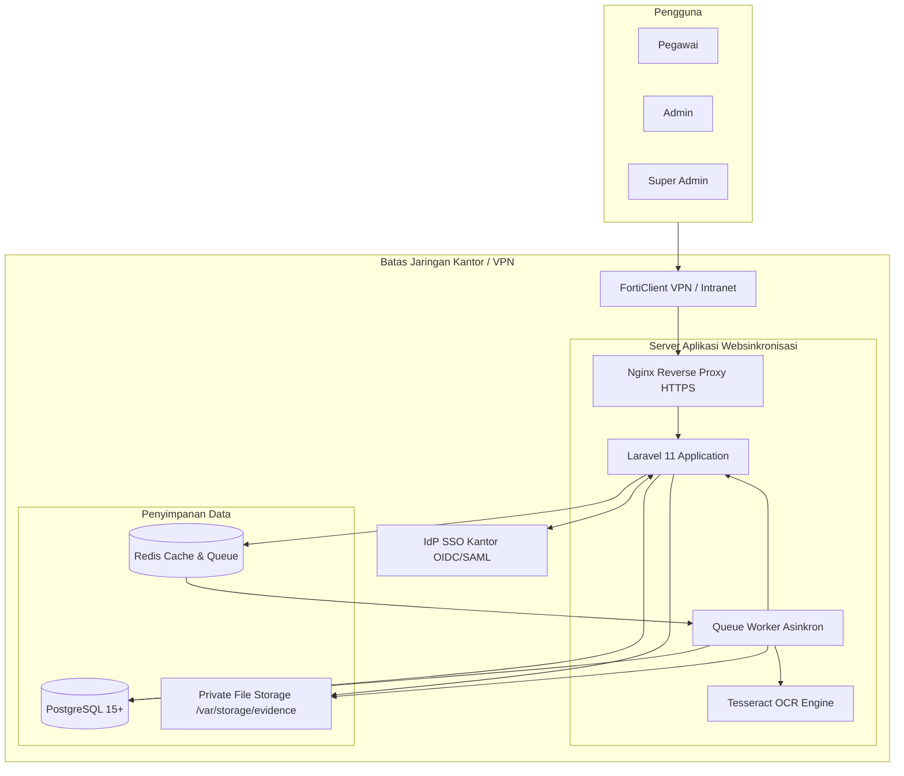
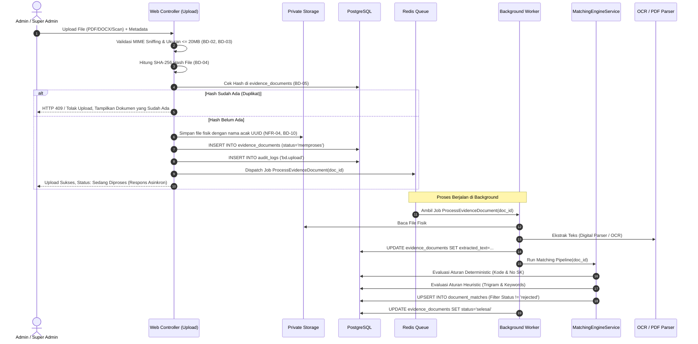
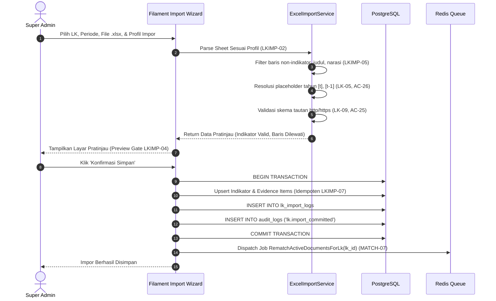

# Arsitektur Sistem (ARCHITECTURE.md)
## Sistem Matching Bukti Dukung ke Lembar Kerja (LK)

| Atribut | Nilai |
|---|---|
| Versi Dokumen | 1.0 |
| Tanggal | 29 Oktober 2026 |
| Basis PRD | `PRD.md` Versi 1.1 (Bagian 7, 8, 9, 11) |
| Dokumen Terkait | `DATABASE.md`, `RBAC.md`, `MATCHING_ALGORITHM.md` |
| Rekomendasi Stack | Laravel 11 + Filament v3 + PostgreSQL 15 + Redis + Tesseract OCR |
| Pola Arsitektur | *Layered Clean Architecture* (Controller ➔ Service ➔ Repository/Domain) |

---

## 1. Ringkasan Sistem & Diagram Konteks

Sistem Websinkronisasi adalah aplikasi web terpusat yang memetakan dokumen Bukti Dukung (SK, laporan, data) ke indikator penilaian pada berbagai Lembar Kerja (LK) internal dan eksternal. Aplikasi di-deploy di server kantor (*on-premise*) dan diakses melalui jaringan intranet atau VPN kantor (D8, NFR-15).



---

## 2. Pemilihan Teknologi (Technology Stack)

Sesuai rekomendasi pada **PRD Bagian 11.3 (Q4)**, stack teknologi dipilih dengan mempertimbangkan produktivitas, stabilitas jangka panjang di lingkungan pemerintahan, kemudahan audit keamanan, dan integrasi PostgreSQL tingkat lanjut:

| Komponen | Pilihan Teknologi | Justifikasi Teknis |
|---|---|---|
| **Core Framework** | **Laravel 11 (PHP 8.3+)** | Framework enterprise dengan ekosistem matang, dukungan native untuk job queues, caching, storage abstraction, middleware pipeline, dan database migrations. |
| **Admin & UI Kit** | **Filament v3 (Livewire 3 + Alpine.js + Tailwind CSS)** | Menyediakan komponen tabel data dinamis, form builder, dan dashboard reaktif. Sangat ideal untuk membangun Matriks Monitor centang, antrean verifikasi, dan pratinjau impor Excel tanpa overhead API terpisah. |
| **Basis Data** | **PostgreSQL 15+** | Dukungan native tipe `JSONB`, ekstensi `pg_trgm` (pencarian fuzzy nama/nomor SK), Full-Text Search bahasa Indonesia, dan check constraints ketat (NFR-09, NFR-10). |
| **Queue & Caching** | **Redis 7+** | Manajemen antrean asinkron berkecepatan tinggi untuk pemrosesan file, OCR, dan matching pipeline (MATCH-01, NFR-06). |
| **Ekstraksi PDF** | **`smalot/pdfparser` / Poppler `pdftotext`** | Ekstraksi teks cepat untuk PDF digital native tanpa beban komputasi OCR. |
| **OCR Engine** | **Tesseract OCR 5+ (`tessdata/ind`)** | Ekstraksi teks dari file scan (JPG, PNG, PDF raster) bahasa Indonesia (A5, BD-07). |
| **Excel Parser** | **`PhpSpreadsheet`** | Membaca file `.xlsx` multiformat, mendukung ekstraksi teks dan objek hyperlink sel (LKIMP-09, LKIMP-10). |
| **Storage Engine** | **Local Private Filesystem** | Penyimpanan file fisik di luar direktori publik web (`storage/app/private/`), diberi nama acak UUID untuk mencegah *path traversal* (NFR-04, BD-10). |

---

## 3. Arsitektur Komponen Perangkat Lunak (Layered Architecture)

Aplikasi dibangun menggunakan pola arsitektur berlapis untuk memastikan pemisahan tanggung jawab (*Separation of Concerns*):

```
┌─────────────────────────────────────────────────────────────┐
│ 1. Presentation Layer (Filament Pages, Livewire, Controllers)│
│    - MonitorMatrixPage, VerificationQueuePage               │
│    - ExcelImportWizard, DocumentUploadForm                  │
└──────────────────────────────┬──────────────────────────────┘
                               │ memanggil
┌──────────────────────────────▼──────────────────────────────┐
│ 2. Middleware & Security Layer                              │
│    - Authenticate, EnsureAccountIsActive, EnsurePasswordSet  │
│    - AuthorizePermission (RBAC Guard)                       │
└──────────────────────────────┬──────────────────────────────┘
                               │ memanggil
┌──────────────────────────────▼──────────────────────────────┐
│ 3. Application Services Layer                               │
│    - EvidenceProcessingService (validasi MIME, hash, save)   │
│    - MatchingEngineService (deterministic & heuristic engine)│
│    - ExcelImportService (profiling, parse, preview, commit) │
│    - SSOService (SSOProviderInterface adapter)              │
│    - AuditLoggerService (append-only logging)               │
└──────────────────────────────┬──────────────────────────────┘
                               │ memanggil
┌──────────────────────────────▼──────────────────────────────┐
│ 4. Domain & Model Layer (Eloquent Models & Business Entities)│
│    - EvidenceDocument, LembarKerja, LkIndicator             │
│    - LkEvidenceItem, DocumentMatch, AuditLog                │
└──────────────────────────────┬──────────────────────────────┘
                               │ memanggil
┌──────────────────────────────▼──────────────────────────────┐
│ 5. Infrastructure & Drivers Layer                           │
│    - PostgreSQL Connection, Redis Queue Driver              │
│    - Tesseract OCR Wrapper, PdfParser Wrapper               │
│    - Private File Storage Driver                            │
└─────────────────────────────────────────────────────────────┘
```

---

## 4. Alur Kerja Data Kunci (Sequence Diagrams)

### 4.1 Alur Upload Bukti Dukung & Asynchronous Matching (BD-01 s.d. MATCH-03)



---

### 4.2 Alur Impor Lembar Kerja dari Excel (LKIMP-01 s.d. LKIMP-08)



---

## 5. Keamanan Sistem & Hardening (Security Engineering)

Menjamin kepatuhan terhadap kebutuhan non-fungsional keamanan:

1. **Penyimpanan Berkas Terisolasi (NFR-04, BD-10):**
   * Berkas fisik tidak disimpan di direktori `public/`.
   * Nama file di-hash/random: `/var/storage/evidence/2026/10/d3b07384-d113-4660-9080-a20078028f08.pdf`.
   * Akses unduh file hanya dilayani melalui Controller khusus yang memeriksa `evidence.search` permission (`GET /api/v1/evidence/{id}/download`).
2. **Sanitasi File Excel & Anti-Macro (LKIMP-10):**
   * Hanya file berekstensi `.xlsx` (MIME `application/vnd.openxmlformats-officedocument.spreadsheetml.sheet`) yang diizinkan.
   * File `.xlsm` (macro-enabled) ditolak keras.
   * `PhpSpreadsheet` diatur dalam mode *read data only* (`$reader->setReadDataOnly(true)`), menonaktifkan eksekusi formula atau macro.
3. **Pembersihan Tautan & Anti-XSS (LK-09, AC-25, MON-10):**
   * Kolom tautan bukti divalidasi dengan regex `^https?://.+`. Tautan dengan skema `javascript:`, `data:`, atau `file:` ditolak saat impor.
   * Seluruh output teks yang dirender di-escape otomatis oleh Blade templating engine (`{{ $text }}`).
   * Tautan eksternal pada monitor selalu dibuka dengan atribut `target="_blank" rel="noopener noreferrer"`.
4. **Pencegahan SQL Injection (SEARCH-05):**
   * Seluruh kueri basis data menggunakan Eloquent ORM atau Query Builder terparameter (*prepared statements*). Input pencarian bebas disanitasi sebelum dimasukkan ke query Full-Text Search.

---

## 6. Struktur Direktori Proyek

```text
websinkronisasi/
├── app/
│   ├── Enums/                     # UserRole, MatchStatus, MatchMethod, dll.
│   ├── Http/
│   │   ├── Controllers/           # AuthController, EvidenceDownloadController
│   │   └── Middleware/            # Authenticate, EnsureAccountIsActive, AuthorizePermission
│   ├── Filament/
│   │   ├── Pages/                 # MonitorMatrix, VerificationQueue, ExcelImportWizard
│   │   └── Resources/             # UserResource, LembarKerjaResource, EvidenceResource
│   ├── Jobs/                      # ProcessEvidenceDocumentJob, RematchActiveDocumentsJob
│   ├── Models/                    # User, LembarKerja, LkIndicator, EvidenceDocument, DocumentMatch
│   └── Services/
│       ├── Auth/                  # SSOProviderInterface, OIDCProvider, SAML2Provider
│       ├── Evidence/              # EvidenceProcessingService, TextExtractionService
│       ├── Import/                # ExcelImportService, ParsingStrategies/
│       └── Matching/              # MatchingEngineService, SimilarityEvaluator
├── config/                        # auth.php, sso.php, queue.php, settings.php
├── database/
│   ├── migrations/                # Migration DDL PostgreSQL
│   └── seeders/                   # SuperAdminSeeder, InitialLkSeeder
├── storage/
│   └── app/
│       └── private/evidence/      # Penyimpanan berkas bukti dukung (aman)
├── tests/
│   ├── Feature/                   # Pengujian endpoint, otorisasi RBAC, upload
│   └── Unit/                      # Pengujian formula matching, parser Excel
└── Md/                            # Dokumentasi resmi proyek (PRD, DATABASE, RBAC, dll.)
```

