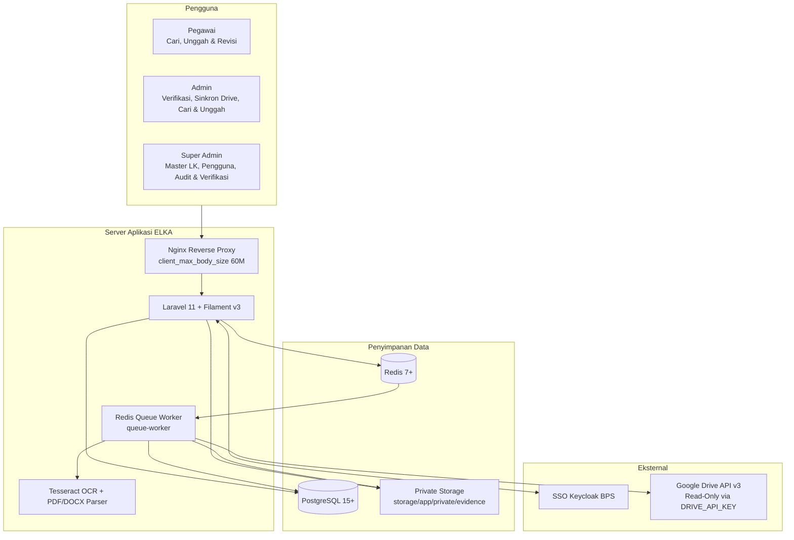

# Arsitektur Sistem (ARCHITECTURE.md)
## Sistem Matching Bukti Dukung ke Lembar Kerja (LK)

| Atribut | Nilai |
|---|---|
| Versi Dokumen | 2.0 |
| Tanggal | 16 November 2026 |
| Basis PRD | `PRD.md` Versi 2.0 |
| Dokumen Terkait | `DATABASE.md`, `RBAC.md`, `MATCHING_ALGORITHM.md`, `AGENTS.md` |
| Stack Resmi | Laravel 11 (PHP 8.3+) + Filament v3 (Livewire 3) + PostgreSQL 15+ + Redis 7+ + Tesseract OCR 5+ |
| Pola Arsitektur | *Layered Clean Architecture* (Controller/Filament Page ➔ Service ➔ Model/Storage) |

---

## 1. Ringkasan Sistem & Diagram Konteks

Websinkronisasi (ELKA) adalah aplikasi web internal kantor untuk mengumpulkan, memverifikasi, mencari, dan memetakan dokumen Bukti Dukung ke berbagai Lembar Kerja (LK) penilaian.



---

## 2. Alur Kerja Utama

### 2.1 Alur Pengajuan Bukti Dukung ➔ Menunggu ➔ Verifikasi Admin ➔ Disetujui
1. **Pengajuan (`EvidenceDocumentResource` / `EvidenceUploadService`):**
   * Pegawai atau Admin memilih metode pengajuan:
     * **Unggah Berkas (`source_type = 'upload'`):** Maksimal **50 MB** (`config('evidence.max_file_size_mb')`). Berkas divalidasi dengan MIME *magic bytes* sniffing (`finfo`), dihitung hash SHA-256 (`findIdenticalByHash`), dan disimpan ke disk `private` dengan nama acak UUID.
     * **Tempel Tautan (`source_type = 'link'`):** Untuk berkas $> 50\text{ MB}$ atau video/tautan Drive. Wajib menggunakan skema `http://` atau `https://`.
   * Pengunggah memilih satu atau lebih Lembar Kerja tujuan yang disimpan ke `document_lk_links` dengan `link_source = 'proposed'` dalam satu transaksi database (`DB::transaction`).
   * Saat mengetik nama dokumen, `DocumentSimilarityService` menampilkan peringatan maksimal 5 kandidat dokumen serupa.
   * Dokumen baru berstatus `approval_status = 'menunggu'`. Untuk berkas unggahan, `ProcessEvidenceDocumentJob` dieksekusi di antrean untuk mengekstrak teks/OCR dan menghasilkan saran indikator di `document_matches`.
2. **Verifikasi Admin (`VerificationQueuePage`):**
   * Admin atau Super Admin memeriksa pengajuan pada Antrean Verifikasi beserta saran indikator dan usulan LK.
   * **Setujui (`approveDocument`):** Verifikator memilih minimal satu LK resmi. Usulan yang tidak dipilih dihapus, LK yang dipilih disimpan di `document_lk_links` dengan `link_source = 'admin'`, dan dokumen berubah menjadi `approval_status = 'disetujui'`.
   * **Minta Revisi (`requestRevision`):** Wajib mengisi catatan revisi; status berubah menjadi `'revisi'`. Pengunggah asli dapat memperbaiki metadata/berkas melalui `reviseSubmission()` (menangani konflik hash unik & menghapus berkas lama hanya setelah transaksi DB *commit*), yang mengembalikan status ke `'menunggu'`.
   * **Tolak (`rejectDocument`):** Wajib mengisi catatan penolakan; status berubah menjadi `'ditolak'`.

### 2.2 Pencarian Dokumen (`CariDokumenPage` & `DocumentSearchService`)
* Diakses oleh Pegawai dan Admin (`evidence.search`).
* Hanya mencari dan menampilkan dokumen aktif yang telah berstatus **`approval_status = 'disetujui'`**.
* Menggunakan gabungan PostgreSQL Full-Text Search (`to_tsvector('indonesian', ...)`), pencarian substring (`ILIKE`), dan kemiripan trigram (`pg_trgm`) pada nama dokumen, nomor dokumen, dan isi teks hasil ekstraksi/OCR, dilengkapi filter LK dan tahun serta badge LK resmi (`DocumentLkLink::OFFICIAL_SOURCES`).

### 2.3 Matriks Monitor Dokumen x LK & Unduh CSV (`MonitorMatrixPage` & `MonitorMatrixService`)
* Diakses oleh seluruh peran aktif (`monitor.view`).
* **Baris = Dokumen Bukti Dukung yang telah disetujui (`approval_status = 'disetujui'`)**, **Kolom = Lembar Kerja (Internal & Eksternal)** sesuai periode/interval evaluasi.
* Sel menampilkan tanda centang (**✔**) hanya jika terdapat tautan resmi di `document_lk_links` (`link_source` IN `'admin'`, `'drive_sync'`, `'backfill'`). Sel tanpa tautan resmi dikosongkan murni.
* Menyediakan fitur **Unduh CSV** (`exportCsv`) dengan sanitasi anti-*CSV Formula Injection* serta banner peringatan kapasitas disk bagi Super Admin jika pemakaian disk melewati `config('evidence.storage_warning_percent')` (default 80%).

### 2.4 Sinkronisasi Google Drive Baca-Saja & OCR Selektif (`GoogleDriveSyncService`)
* Dikelola oleh Admin (`drive.sync`) melalui panel folder Drive di `VerificationQueuePage` atau perintah CLI `php artisan evidence:sync-drive` (`SyncGoogleDriveJob`).
* Mengambil metadata berkas secara rekursif (kedalaman maks `config('evidence.drive_sync_max_depth', 5)`) menggunakan `config('evidence.drive_api_key')` tanpa pernah menulis/mengubah Google Drive (Invarian #7).
* **Propagasi LK Folder:** Jika `drive_sync_folders.lk_id` terisi, dokumen **baru** yang ditemukan di folder tersebut (maupun subfolder di dalamnya) otomatis disimpan dengan `approval_status = 'disetujui'` dan `document_lk_links` (`link_source = 'drive_sync'`). Jika berkas sudah ada di database, sinkronisasi ulang hanya memperbarui metadata tanpa menghidupkan kembali link LK yang pernah dihapus admin.
* **OCR Selektif (`ProcessDriveFileOcrJob`):** Jika nama berkas Drive terlalu pendek/generik dan berkas berupa PDF/gambar $\le 50\text{ MB}$, worker mengunduh berkas ke direktori sementara, menjalankan ekstraksi teks/OCR, menyimpan `extracted_text`, lalu menghapus berkas sementara di blok `finally`.

### 2.5 Unduhan Aman Berawalan Kode LK Resmi (`EvidenceController::download`)
* Endpoint `GET /evidence/download/{id}` memvalidasi izin `evidence.view_link` dan `EvidenceDocumentPolicy::view` (dokumen `disetujui`, pemilik dokumen sendiri, atau Admin/Super Admin; dokumen *soft-deleted* = 404).
* Untuk `source_type` `'drive'` atau `'link'`: melakukan redirect aman (`redirect()->away()`) ke `$document->external_link` hanya jika skema `http`/`https` valid (selain itu abort 422), tanpa pernah membaca URL tujuan dari parameter request.
* Untuk `source_type` `'upload'`: melakukan streaming dari `Storage::disk('private')->download()` menggunakan nama dari `EvidenceUploadService::buildDownloadFilename()`:
  * Mengambil kode LK resmi (`link_source` IN `'admin'`, `'drive_sync'`, `'backfill'`; `'proposed'` diabaikan), `DISTINCT`, unik, urut abjad, maksimal **4 kode** dipisah `_` (contoh: `KIP_ZI_SK_Program_Kunjungan.pdf`).
  * Jika belum memiliki link resmi, menggunakan awalan `DRAFT_` (contoh: `DRAFT_SK_Program_Kunjungan.pdf`).
  * Karakter ilegal (`/ \ : * ? " < > |` dan karakter kontrol) disanitasi, panjang total nama dibatasi **$\le 150$ karakter** dengan ekstensi tervalidasi tetap utuh.

---

## 3. Komponen Warisan yang Telah Dihapus (Pembersihan Sistem)

Untuk menjaga kode tetap ramping dan bebas *dead code*, komponen-komponen lama berikut telah dihapus permanen:
* **Matriks per Indikator & Drilldown Modal Lama:** Digantikan oleh Matriks Dokumen x LK + Unduh CSV.
* **Antrean Verifikasi Match Indikator Lama & `ManualMatchService`:** Digantikan oleh verifikasi pengajuan dokumen-ke-LK di `VerificationQueuePage`.
* **Panel Uji / Simulasi (`DryRunMatchingService`, `QuickWorkflowWidget`):** Dihapus beserta view dan tesnya.
* **Antarmuka Pengaturan Sistem (`SystemSettingResource`, `SystemSettingObserver`, `SystemSettingPolicy`):** Dihapus; seluruh konfigurasi kini dikelola melalui `config/evidence.php` dan `.env`.

---

## 4. Struktur Direktori Proyek Aktual

```text
websinkronisasi/
├── app/
│   ├── Console/Commands/          # SyncGoogleDriveCommand, CleanupDevTestLembarKerjaCommand
│   ├── Exceptions/                # DuplicateDocumentException
│   ├── Filament/
│   │   ├── Pages/                 # Dashboard, MonitorMatrixPage, VerificationQueuePage, CariDokumenPage
│   │   └── Resources/             # EvidenceDocumentResource, LembarKerjaResource, LkImportProfileResource,
│   │                              # LkIndicatorResource, UserResource, AuditLogResource
│   ├── Http/
│   │   ├── Controllers/           # Auth/ (LoginController, SSOController, ForceChangePasswordController),
│   │   │                          # Evidence/EvidenceController
│   │   └── Middleware/            # EnsureAccountIsActive, EnsurePasswordChanged, AuthorizePermission
│   ├── Jobs/                      # ProcessEvidenceDocumentJob, SyncGoogleDriveJob,
│   │                              # ProcessDriveFileOcrJob, RematchActiveDocumentsJob
│   ├── Models/                    # User, LembarKerja, LkIndicator, LkEvidenceItem, EvidenceDocument,
│   │                              # DocumentLkLink, DriveSyncFolder, DocumentMatch, AuditLog, SystemSetting
│   ├── Policies/                  # EvidenceDocumentPolicy, LembarKerjaPolicy, LkImportProfilePolicy,
│   │                              # LkIndicatorPolicy, UserPolicy, AuditLogPolicy
│   └── Services/
│       ├── Audit/                 # AuditLogService
│       ├── Auth/                  # SSOProviderInterface, BpsKeycloakOidcProvider, MockSSOProvider,
│       │                          # UserManagerService, SessionManagerService
│       ├── Drive/                 # GoogleDriveSyncService
│       ├── Evidence/              # EvidenceUploadService, DocumentSimilarityService, TextExtractionService
│       ├── LkImport/              # LkImportService, ExcelParserService, Strategies/, Resolvers/
│       ├── Matching/              # MatchingEngineService, MatchingRepository, VerificationService, Rules/
│       ├── Monitor/               # MonitorMatrixService
│       └── Search/                # DocumentSearchService
├── config/                        # evidence.php, livewire.php, services.php, filesystems.php, ...
├── database/
│   ├── migrations/                # Migrasi PostgreSQL (termasuk skema pivot & backfill)
│   └── seeders/                   # SuperAdminSeeder, InitialLkSeeder, BpsDemoUserSeeder,
│                                  # DemoIndicatorAndSampleDocumentsSeeder, BpsAuditLogDemoSeeder
├── resources/views/               # View Blade halaman login, monitor-matrix, verification-queue, cari-dokumen
├── routes/                        # web.php, console.php
└── tests/                         # Unit & Feature test suite (305 tests)
```
