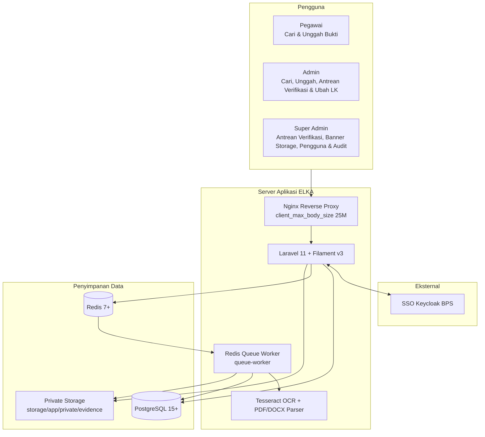

# Arsitektur Sistem (ARCHITECTURE.md)
## Perpustakaan Bukti Dukung BPS Kabupaten Tegal (ELKA)

| Atribut | Nilai |
|---|---|
| Versi Dokumen | 3.0 |
| Tanggal | 17 November 2026 |
| Basis PRD | `PRD.md` Versi 3.0 |
| Dokumen Terkait | `DATABASE.md`, `RBAC.md`, `MATCHING_ALGORITHM.md`, `AGENTS.md` |
| Stack Resmi | Laravel 11 (PHP 8.3+) + Filament v3 (Livewire 3) + PostgreSQL 15+ + Redis 7+ + Tesseract OCR 5+ |
| Pola Arsitektur | *Layered Clean Architecture* (Controller/Filament Page ➔ Service ➔ Model/Storage) |

---

## 1. Ringkasan Sistem & Diagram Konteks

Websinkronisasi (**ELKA**) adalah aplikasi **Perpustakaan Bukti Dukung BPS Kabupaten Tegal** untuk mengumpulkan, memeriksa keabsahan, mencari, dan memetakan dokumen bukti dukung ke 6 Lembar Kerja (`KIP`, `PEKPPP`, `ZI`, `SAKIP`, `DATA_SEKTORAL`, `DATA_SEKUNDER`).



---

## 2. Alur Kerja Utama

### 2.1 Alur Unggah Bukti ➔ Menunggu ➔ Verifikasi ➔ Disetujui
1. **Pengajuan (`EvidenceDocumentResource` / `EvidenceUploadService`):**
   * Pegawai atau Admin memilih metode pengajuan:
     * **Unggah Berkas (`source_type = 'upload'`):** Maksimal **20 MB** (`config('evidence.max_file_size_mb', 20)`). Berkas divalidasi ukuran & MIME *magic bytes* sniffing (`finfo` + inspeksi kontainer ZIP DOCX/XLSX), dihitung SHA-256 (`findIdenticalByHash`), dan disimpan di disk `private` dengan nama acak UUID.
     * **Tempel Tautan (`source_type = 'link'`):** Untuk berkas berukuran $> 20\text{ MB}$ (misalnya video) yang telah diunggah mandiri pengguna ke Google Drive. Hanya menerima skema `http://` atau `https://`.
   * Pengunggah **wajib memilih minimal 1 Lembar Kerja** usulan (`lk_ids`), yang disimpan di `document_lk_links` (`link_source = 'proposed'`, `indicator_id = null`) dalam satu `DB::transaction`.
   * Untuk berkas unggahan fisik, `ProcessEvidenceDocumentJob` dijalankan oleh `queue-worker` untuk mengekstrak `extracted_text` (`TextExtractionService` via `PdfTextExtractor`, `DocxTextExtractor`, dan `TesseractOcrExtractor`) agar dokumen dapat dicari melalui FTS dan deteksi kemiripan.
2. **Verifikasi (`VerificationQueuePage`):**
   * Admin atau Super Admin meninjau kartu pengajuan beserta usulan LK dan tautan unduh/buka berkas.
   * **Banner Kapasitas Penyimpanan:** `VerificationQueuePage::getStorageUsage()` memanggil `MonitorMatrixService::getStorageUsage()` (`config('evidence.storage_warning_percent', 80)`). Banner peringatan hanya dirender untuk `super_admin` (`$isSuperAdmin && $storage['is_warning']`).
   * **Setujui (`approveDocument`):** Wajib memilih $\ge 1$ LK resmi. Usulan yang tidak dipilih dihapus, LK pilihan disimpan sebagai `link_source = 'admin'`, dan dokumen berubah menjadi `approval_status = 'disetujui'`.
   * **Minta Revisi (`requestRevision`):** Wajib mengisi catatan; status menjadi `'revisi'`. Pengunggah asli dapat memperbaiki data/berkas lewat `reviseSubmission()` (menghapus berkas lama hanya setelah transaksi DB *commit*).
   * **Tolak (`rejectDocument`):** Wajib mengisi catatan penolakan; status menjadi `'ditolak'`.

### 2.2 Halaman Cari Gabungan (`CariDokumenPage` + `MonitorMatrixService` + `DocumentSearchService`)
* Diakses oleh Pegawai dan Admin (`evidence.search`; Super Admin ditolak **HTTP 403**).
* **Pencarian & Matriks 6 LK:** Menampilkan filter kata kunci (`DocumentSearchService::applySearchFilter`: FTS bahasa Indonesia, `ILIKE`, dan `pg_trgm`), jenis dokumen, tahun, dan kategori LK (`Semua`, `Internal`, `Eksternal`) langsung dalam bentuk tabel matriks Dokumen `'disetujui'` x 6 LK aktif (`MonitorMatrixService::getMatrixData()` dengan deduplikasi `DISTINCT lk_id` dan sumber resmi `DocumentLkLink::OFFICIAL_SOURCES`).
* **Klik Centang Membuka Bagian Unduh:** Mengklik tombol centang (**✔**) memanggil `toggleDownloadSection(string $docId)` untuk membuka baris unduhan berisi tombol **Unduh Dokumen** (`route('evidence.download', $docId)`) dan/atau **Buka Tautan** (`rel="noopener noreferrer"`).
* **Cek Berkas Sebelum Unggah (`checkUploadedFile()`):**
  * Memvalidasi berkas sementara via `EvidenceUploadService::inspectAndValidate($this->checkFile)`.
  * Jika hash SHA-256 identik ditemukan (`DuplicateDocumentException` / `findIdenticalByHash`), menampilkan kotak merah **Ditolak — Dokumen Sudah Ada** beserta judul, pengunggah, status, dan daftar LK resmi.
  * Jika tidak identik, mengekstrak teks sementara via `TextExtractionService::extract()` lalu memanggil `DocumentSimilarityService::findSimilarCandidates(..., 5)`. Jika ada kandidat mirip, menampilkan peringatan kuning non-blocking (maks 5 + skor `%`); jika kosong, menampilkan kotak hijau **"Dokumen belum ada di perpustakaan. Silakan unggah."** beserta tautan ke `/admin/evidence-documents/create`.
  * Blok `finally` selalu menghapus berkas sementara dan me-reset `$this->checkFile`, tanpa pernah membuat baris `evidence_documents` baru.
* **Ubah LK Admin (`reviseMarkup`):** Admin (`evidence.manage_markup`) dapat mengubah LK resmi dokumen `'disetujui'` (wajib $\ge 1$ LK) langsung dari tombol **Ubah LK** pada tabel hasil Cari.

### 2.3 Unduhan Aman Berawalan Kode LK Resmi (`EvidenceController::download`)
* Menegakkan `evidence.view_link` dan `EvidenceDocumentPolicy::view` (dokumen *soft-deleted* = **HTTP 404**).
* Untuk `source_type` `'link'` atau `'drive'`: melakukan redirect aman ke `external_link` hanya jika skema `http`/`https` valid (selain itu **422**).
* Untuk `source_type` `'upload'`: men-stream berkas dari disk `private` dengan nama hasil `EvidenceUploadService::buildDownloadFilename()` (awalan maks 4 kode LK resmi urut abjad atau `DRAFT`, sanitasi karakter ilegal, panjang total $\le 150$ karakter dengan ekstensi utuh).

---

## 3. Struktur Direktori Proyek Aktual

```text
websinkronisasi/
├── app/
│   ├── Exceptions/                # DuplicateDocumentException
│   ├── Filament/
│   │   ├── Pages/                 # Dashboard (redirect ke homeUrl), CariDokumenPage, VerificationQueuePage
│   │   └── Resources/             # EvidenceDocumentResource, UserResource, AuditLogResource
│   ├── Http/
│   │   ├── Controllers/           # Auth/ (LoginController, SSOController, ForceChangePasswordController),
│   │   │                          # Evidence/EvidenceController
│   │   └── Middleware/            # EnsureAccountIsActive, EnsurePasswordChanged, AuthorizePermission
│   ├── Jobs/                      # ProcessEvidenceDocumentJob
│   ├── Listeners/                 # AuditAuthEventsListener
│   ├── Models/                    # User, LembarKerja, EvidenceDocument, DocumentLkLink, AuditLog
│   │                              # (+ model pasif: DocumentMatch, DriveSyncFolder, LkIndicator, LkEvidenceItem, LkImportProfile, LkImportLog, SystemSetting)
│   ├── Policies/                  # EvidenceDocumentPolicy, UserPolicy, AuditLogPolicy
│   ├── Providers/                 # AppServiceProvider, Filament/AdminPanelProvider
│   └── Services/
│       ├── Audit/                 # AuditLogService
│       ├── Auth/                  # SSOProviderInterface, BpsKeycloakOidcProvider, MockSSOProvider,
│       │                          # UserManagerService, SessionManagerService
│       ├── Evidence/              # EvidenceUploadService, DocumentSimilarityService, TextExtractionService, Extractors/
│       ├── Monitor/               # MonitorMatrixService
│       └── Search/                # DocumentSearchService
├── config/                        # evidence.php, livewire.php, services.php, filesystems.php, ...
├── database/
│   ├── migrations/                # Migrasi PostgreSQL (skema inti, pivot & backfill)
│   └── seeders/                   # SuperAdminSeeder, InitialLkSeeder, BpsDemoUserSeeder,
│                                  # DemoIndicatorAndSampleDocumentsSeeder, BpsAuditLogDemoSeeder
├── public/css/                    # filament-custom.css (tema Vintage Hangat), tailwind-compiled.css
├── resources/views/               # auth/ (login, force-change-password), filament/ (components, pages, resources)
├── routes/                        # web.php, console.php
└── tests/                         # Unit & Feature test suite (211 tests)
```
