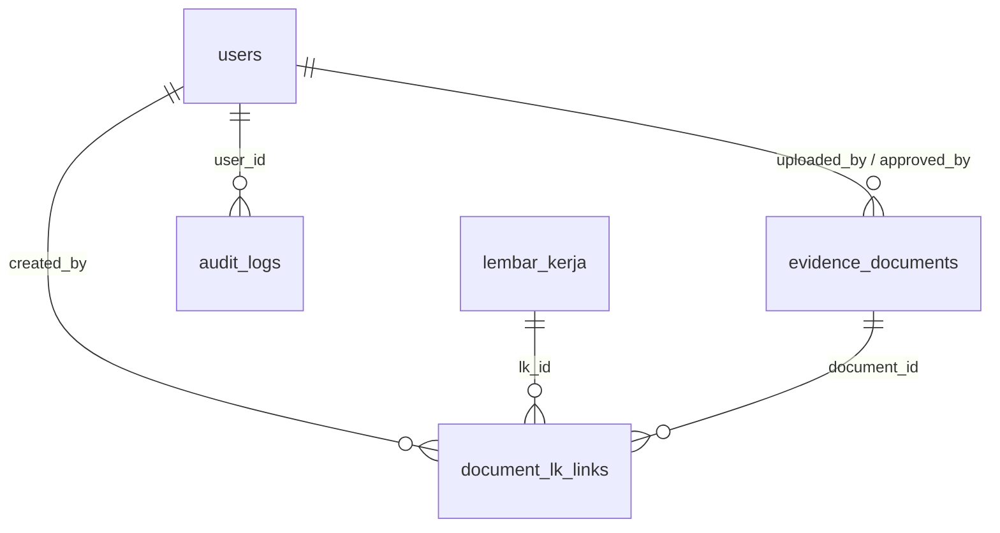

# Spesifikasi Basis Data (DATABASE.md)
## Perpustakaan Bukti Dukung BPS Kabupaten Tegal (ELKA)

| Atribut | Nilai |
|---|---|
| Versi Dokumen | 3.0 |
| Tanggal | 17 November 2026 |
| Basis PRD | `PRD.md` Versi 3.0 |
| Target RDBMS | PostgreSQL 15+ (`pgcrypto`, `pg_trgm`, `unaccent`) |
| Standar Waktu | UTC (`TIMESTAMPTZ`), disajikan dalam `Asia/Jakarta` |
| Skema ID | UUID (128-bit) untuk entitas utama; `BIGINT IDENTITY` untuk log |

---

## 1. Pendahuluan & Prinsip Desain

1. **Penegakan Integritas di Tingkat Database (`NFR-09`, `NFR-10`):** Relasi, indeks unik parsial, dan validasi nilai ditegakkan melalui Foreign Keys, Unique Index, dan Check Constraints PostgreSQL.
2. **Pemetaan Resmi Dokumen ke 6 LK (`document_lk_links`):**
   * Tabel `document_lk_links` menghubungkan `evidence_documents` ke `lembar_kerja` (`link_source` IN `'proposed'`, `'admin'`, `'drive_sync'`, `'backfill'`).
   * Seluruh tautan baru dari aplikasi (`'proposed'` saat unggah/revisi dan `'admin'` saat verifikasi/ubah LK) menyimpan `indicator_id = NULL`.
   * Tanda centang (**✔**) pada matriks di `CariDokumenPage` dihitung **hanya** untuk dokumen `approval_status = 'disetujui'` + sumber resmi `DocumentLkLink::OFFICIAL_SOURCES` (`'admin'`, `'drive_sync'`, `'backfill'`), dengan deduplikasi `DISTINCT lk_id`.
3. **Deduplikasi Parsial Aktif & Batas Ukuran Berkas:**
   * Indeks unik parsial `uq_evidence_documents_hash_active` (`WHERE file_hash IS NOT NULL AND deleted_at IS NULL`) mencegah duplikasi berkas aktif berdasarkan SHA-256, namun mengizinkan unggah ulang berkas yang telah di-*soft-delete*.
   * Pada tingkat PostgreSQL, constraint `chk_document_file_size` mempertahankan batas `52428800` byte (tanpa migrasi destruktif), sedangkan lapisan aplikasi (`config('evidence.max_file_size_mb', 20)`, `EvidenceUploadService`, `config/livewire.php`, `EvidenceDocumentResource`, `uploads.ini`, Nginx) menegakkan batas ketat **20 MB (`20.971.520` byte)**.
4. **Imutabilitas Jejak Audit (`AUDIT-02`, Invarian #5):** Tabel `audit_logs` bersifat *append-only* dan dilindungi trigger PostgreSQL `prevent_audit_logs_mutation` yang menolak `UPDATE` dan `DELETE`.
5. **Kompatibilitas Skema Historis Tanpa Migrasi Drop:** Tabel warisan dari fase awal (`lk_import_profiles`, `lk_indicators`, `lk_evidence_items`, `lk_import_logs`, `document_matches`, `drive_sync_folders`, `system_settings`) tetap dipertahankan secara pasif di database tanpa migrasi penghapusan agar data historis dan skema migrasi awal tetap utuh.

---

## 2. Ekstensi & Tipe ENUM PostgreSQL

```sql
CREATE EXTENSION IF NOT EXISTS "pgcrypto";
CREATE EXTENSION IF NOT EXISTS "pg_trgm";
CREATE EXTENSION IF NOT EXISTS "unaccent";

CREATE TYPE user_role AS ENUM ('super_admin', 'admin', 'pegawai');
CREATE TYPE lk_category AS ENUM ('internal', 'eksternal');
CREATE TYPE document_processing_status AS ENUM ('memproses', 'selesai', 'perlu_review_manual', 'gagal');
```

---

## 3. Diagram Hubungan Entitas Inti Aktif (ERD)



---

## 4. Rincian Tabel Aktif

### 4.1 Tabel `users`
Menyimpan akun pengguna (`super_admin`, `admin`, `pegawai`), `is_active`, `must_change_password`, `auth_provider` (`sso` atau `local`), dan `deleted_at`. Dilindungi trigger PostgreSQL agar satu-satunya Super Admin aktif terakhir tidak dapat dinonaktifkan, dihapus, atau diturunkan perannya (Invarian #4).

### 4.2 Tabel `lembar_kerja` (6 Rak Perpustakaan via `InitialLkSeeder`)
Menyimpan 6 Lembar Kerja aktif (`period = 2026`, `default_profile_id = NULL`, `is_active = true`) yang disiapkan secara idempoten melalui `InitialLkSeeder`:
* **Internal (4):** `KIP` (`3 Bulan`), `PEKPPP` (`6 Bulan`), `ZI` (`12 Bulan`), `SAKIP` (`12 Bulan`).
* **Eksternal (2):** `DATA_SEKTORAL` (`1 Bulan`), `DATA_SEKUNDER` (`1 Bulan`).

Unik pada kombinasi `(code, period, evaluation_interval) WHERE deleted_at IS NULL`.

### 4.3 Tabel `evidence_documents`
Menyimpan dokumen bukti dukung (`upload` untuk berkas $\le 20\text{ MB}$ di aplikasi, `link` untuk tautan eksternal/Google Drive berkas $> 20\text{ MB}$, dan `drive` untuk rekaman historis):

```sql
CREATE TABLE evidence_documents (
    id UUID PRIMARY KEY DEFAULT gen_random_uuid(),
    document_name TEXT NOT NULL,
    document_number VARCHAR(128) NULL,
    year INTEGER NOT NULL,
    document_type VARCHAR(64) NULL,
    external_link TEXT NULL,
    file_path TEXT NULL,
    original_filename TEXT NULL,
    mime_type VARCHAR(128) NULL,
    file_size_bytes BIGINT NULL,
    file_hash VARCHAR(64) NULL,
    extracted_text TEXT NULL,
    processing_status document_processing_status NOT NULL DEFAULT 'memproses',
    error_message TEXT NULL,
    uploaded_by UUID NULL REFERENCES users(id) ON DELETE RESTRICT,
    approval_status VARCHAR(20) NOT NULL DEFAULT 'menunggu',
    approval_notes TEXT NULL,
    approved_by UUID NULL REFERENCES users(id) ON DELETE SET NULL,
    approved_at TIMESTAMPTZ NULL,
    source_type VARCHAR(16) NOT NULL DEFAULT 'upload',
    drive_file_id VARCHAR(128) NULL,
    drive_folder_id VARCHAR(128) NULL,
    drive_md5_checksum VARCHAR(64) NULL,
    drive_modified_at TIMESTAMPTZ NULL,
    created_at TIMESTAMPTZ NOT NULL DEFAULT CURRENT_TIMESTAMP,
    updated_at TIMESTAMPTZ NOT NULL DEFAULT CURRENT_TIMESTAMP,
    deleted_at TIMESTAMPTZ NULL,

    CONSTRAINT chk_document_approval_status
        CHECK (approval_status IN ('menunggu', 'disetujui', 'revisi', 'ditolak')),
    CONSTRAINT chk_document_source_type
        CHECK (source_type IN ('upload', 'drive', 'link')),
    CONSTRAINT chk_document_file_size
        CHECK (
            file_size_bytes IS NULL
            OR (file_size_bytes > 0 AND (source_type = 'drive' OR file_size_bytes <= 52428800))
        ),
    CONSTRAINT chk_document_external_link CHECK (
        external_link IS NULL OR external_link ~* '^https?://.+'
    )
);

CREATE UNIQUE INDEX uq_evidence_documents_hash_active
    ON evidence_documents (file_hash)
    WHERE file_hash IS NOT NULL AND deleted_at IS NULL;

CREATE INDEX idx_evidence_documents_approval_status
    ON evidence_documents (approval_status)
    WHERE deleted_at IS NULL;
```

* **Indeks Pencarian & Kemiripan:** Menggunakan indeks GIN `to_tsvector('indonesian', ...)` dan indeks GIN trigram (`pg_trgm`) pada `document_name` dan `document_number`.
* **Constraint `chk_document_file_size`:** Tetap bernilai `52428800` byte pada DDL database agar kompatibel dengan migrasi awal, sementara seluruh aplikasi dan web server menegakkan batas **20 MB** (`20.971.520` byte).

### 4.4 Tabel `document_lk_links`
Menyimpan hubungan dokumen ke rak LK:

```sql
CREATE TABLE document_lk_links (
    id UUID PRIMARY KEY DEFAULT gen_random_uuid(),
    document_id UUID NOT NULL REFERENCES evidence_documents(id) ON DELETE CASCADE,
    lk_id UUID NOT NULL REFERENCES lembar_kerja(id) ON DELETE CASCADE,
    indicator_id UUID NULL REFERENCES lk_indicators(id) ON DELETE SET NULL,
    link_source VARCHAR(20) NOT NULL
        CONSTRAINT chk_doc_lk_link_source CHECK (link_source IN ('proposed', 'admin', 'drive_sync', 'backfill')),
    created_by UUID NULL REFERENCES users(id) ON DELETE SET NULL,
    created_at TIMESTAMPTZ NOT NULL DEFAULT CURRENT_TIMESTAMP,
    updated_at TIMESTAMPTZ NOT NULL DEFAULT CURRENT_TIMESTAMP
);
```

* **`proposed`:** Usulan LK dari pengunggah saat mengirim bukti dukung baru atau revisi. Tidak dihitung sebagai centang resmi maupun awalan nama unduhan.
* **`DocumentLkLink::OFFICIAL_SOURCES` (`'admin'`, `'drive_sync'`, `'backfill'`):** Tautan resmi yang menampilkan tanda centang (**✔**) di matriks `CariDokumenPage` (deduplikasi `DISTINCT lk_id`) dan menjadi awalan nama berkas unduhan.

### 4.5 Tabel `audit_logs`
Menyimpan catatan aktivitas autentikasi, mutasi pengguna, unggahan, pemrosesan teks, persetujuan/revisi/penolakan, ubah LK, dan penghapusan dokumen secara *append-only*. Trigger `prevent_audit_logs_mutation` memblokir `UPDATE` dan `DELETE` (Invarian #5).

---

## 5. Tabel Historis Pasif (Tidak Aktif di Alur Aplikasi)

Tabel berikut tetap ada di skema database (dan modelnya di `app/Models/`) demi keutuhan riwayat migrasi tanpa `DROP TABLE`, namun tidak lagi dipakai pada antarmuka maupun proses bisnis aktif:
* `lk_import_profiles`, `lk_indicators`, `lk_evidence_items`, `lk_import_logs`
* `document_matches`
* `drive_sync_folders`
* `system_settings` (seluruh konfigurasi dibaca dari `config/evidence.php` dan `.env`)
