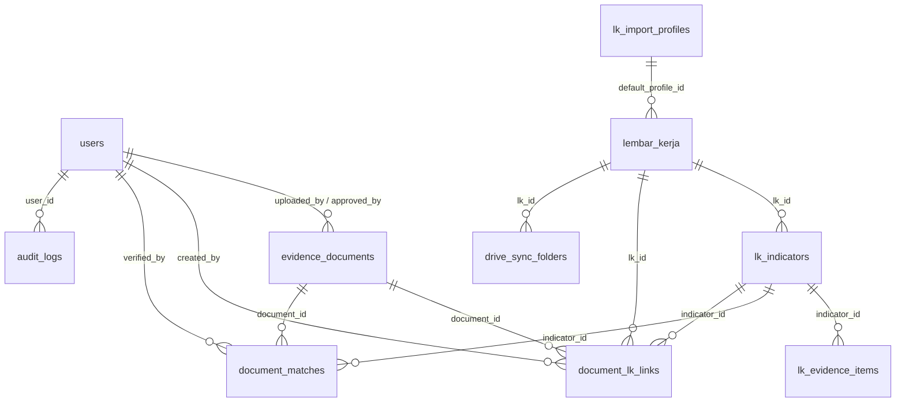

# Spesifikasi Basis Data (DATABASE.md)
## Sistem Matching Bukti Dukung ke Lembar Kerja (LK)

| Atribut | Nilai |
|---|---|
| Versi Dokumen | 2.0 |
| Tanggal | 16 November 2026 |
| Basis PRD | `PRD.md` Versi 2.0 |
| Target RDBMS | PostgreSQL 15+ (`pgcrypto`, `pg_trgm`, `unaccent`) |
| Standar Waktu | UTC (`TIMESTAMPTZ`), disajikan dalam `Asia/Jakarta` |
| Skema ID | UUID (128-bit) untuk entitas utama; `BIGINT IDENTITY` untuk log |

---

## 1. Pendahuluan & Prinsip Desain

Dokumen ini mendefinisikan skema basis data PostgreSQL aktual pada aplikasi Websinkronisasi (ELKA):

1. **Penegakan Integritas di Tingkat Database (NFR-09, NFR-10):** Validasi relasi, constraint unik parsial, dan validasi domain ditegakkan melalui Foreign Keys, Unique Index, dan Check Constraints pada level PostgreSQL.
2. **Pemisahan Tautan Resmi LK (`document_lk_links`) dari Saran Algoritma (`document_matches`):**
   * Tabel `document_lk_links` menyimpan hubungan dokumen ke Lembar Kerja (`link_source` IN `'proposed'`, `'admin'`, `'drive_sync'`, `'backfill'`). Tanda centang (**✔**) pada Matriks Monitor ditentukan oleh `evidence_documents.approval_status = 'disetujui'` + baris resmi di `document_lk_links` (`admin`, `drive_sync`, `backfill`).
   * Tabel `document_matches` berfungsi sebagai **tabel saran indikator** hasil mesin pencocokan (`confirmed`, `auto`, `perlu_verifikasi`, `rejected`) untuk membantu verifikator di `VerificationQueuePage`.
3. **Deduplikasi Parsial Aktif & Tiga Sumber Bukti (`upload`, `link`, `drive`):**
   * Indeks unik parsial `uq_evidence_documents_hash_active` (`WHERE file_hash IS NOT NULL AND deleted_at IS NULL`) mencegah duplikasi berkas aktif namun mengizinkan unggah ulang berkas yang telah di-*soft-delete*.
   * Indeks unik parsial `uq_evidence_documents_drive_file_active` (`WHERE drive_file_id IS NOT NULL AND deleted_at IS NULL`) menjaga idempotensi sinkronisasi Google Drive.
4. **Immutability pada Audit Trail (AUDIT-01, AUDIT-02, Invarian #5):** Tabel `audit_logs` bersifat *append-only* dengan trigger PostgreSQL `prevent_audit_logs_mutation` yang memblokir `UPDATE` dan `DELETE`.

---

## 2. Ekstensi & Tipe ENUM PostgreSQL

```sql
CREATE EXTENSION IF NOT EXISTS "pgcrypto";
CREATE EXTENSION IF NOT EXISTS "pg_trgm";
CREATE EXTENSION IF NOT EXISTS "unaccent";

CREATE TYPE user_role AS ENUM ('super_admin', 'admin', 'pegawai');
CREATE TYPE lk_category AS ENUM ('internal', 'eksternal');

CREATE TYPE import_parsing_strategy AS ENUM (
    'numbered_list_single_cell',
    'checklist_sheet',
    'single_item_per_row'
);

CREATE TYPE document_processing_status AS ENUM (
    'memproses',
    'selesai',
    'perlu_review_manual',
    'gagal'
);

CREATE TYPE match_status AS ENUM (
    'auto',
    'confirmed',
    'rejected',
    'perlu_verifikasi'
);

CREATE TYPE match_method AS ENUM (
    'exact_number',
    'exact_code',
    'title_similarity',
    'content_similarity',
    'manual'
);

CREATE TYPE import_session_status AS ENUM (
    'previewed',
    'committed',
    'failed'
);
```

---

## 3. Diagram Hubungan Entitas (ERD)



---

## 4. Rincian Skema Tabel Utama

### 4.1 Tabel `users`
Menyimpan akun pengguna (`super_admin`, `admin`, `pegawai`), status `is_active`, flag karantina password pertama `must_change_password`, serta provider autentikasi (`sso` atau `local`). Dilengkapi trigger PostgreSQL untuk mencegah penghapusan atau penonaktifan Super Admin aktif terakhir (Invarian #4).

### 4.2 Tabel `lembar_kerja`, `lk_import_profiles`, `lk_indicators`, `lk_evidence_items`, `lk_import_logs`
* `lembar_kerja`: Menyimpan master LK dengan `code`, `name`, `category` (`internal`/`eksternal`), `period` (tahun, misal `2026`), `evaluation_interval` (`1 Bulan`, `3 Bulan`, `6 Bulan`, `12 Bulan`), `default_profile_id`, dan `is_active`. Unik per `(code, period, evaluation_interval)`.
* `lk_import_profiles`: Konfigurasi pemetaan sheet dan kolom Excel per LK.
* `lk_indicators`: Menyimpan indikator per LK (`code`, `title`, `order_index`, `evidence_link` dengan validasi skema `^https?://.+`, `pic`).
* `lk_evidence_items`: Menyimpan butir dokumen harapan (`raw_template_name` dan `resolved_name` hasil resolusi `[t]`, `[t-1]`, `[t-2]`).
* `lk_import_logs`: Riwayat impor Excel LK.

---

### 4.3 Tabel `evidence_documents` (Bukti Dukung, Persetujuan, & Metadata Drive)
Menyimpan dokumen bukti dukung dari 3 sumber (`upload`, `link`, `drive`) beserta siklus persetujuan admin:

```sql
CREATE TABLE evidence_documents (
    id UUID PRIMARY KEY DEFAULT gen_random_uuid(),
    document_name TEXT NOT NULL,
    document_number VARCHAR(128) NULL,
    year INTEGER NOT NULL,
    document_type VARCHAR(64) NULL,
    external_link TEXT NULL,
    file_path TEXT NULL,                           -- Wajib untuk source_type='upload'
    original_filename TEXT NULL,
    mime_type VARCHAR(128) NULL,
    file_size_bytes BIGINT NULL,                   -- Maks 50 MB (52.428.800 bytes) untuk upload
    file_hash VARCHAR(64) NULL,
    extracted_text TEXT NULL,
    processing_status document_processing_status NOT NULL DEFAULT 'memproses',
    error_message TEXT NULL,
    uploaded_by UUID NULL REFERENCES users(id) ON DELETE RESTRICT,
    approval_status VARCHAR(20) NOT NULL DEFAULT 'menunggu', -- 'menunggu', 'disetujui', 'revisi', 'ditolak'
    approval_notes TEXT NULL,
    approved_by UUID NULL REFERENCES users(id) ON DELETE SET NULL,
    approved_at TIMESTAMPTZ NULL,
    source_type VARCHAR(16) NOT NULL DEFAULT 'upload',       -- 'upload', 'drive', 'link'
    drive_file_id VARCHAR(128) NULL,
    drive_folder_id VARCHAR(128) NULL,
    drive_md5_checksum VARCHAR(64) NULL,
    drive_modified_at TIMESTAMPTZ NULL,
    created_at TIMESTAMPTZ NOT NULL DEFAULT CURRENT_TIMESTAMP,
    updated_at TIMESTAMPTZ NOT NULL DEFAULT CURRENT_TIMESTAMP,
    deleted_at TIMESTAMPTZ NULL,

    CONSTRAINT chk_document_approval_status
        CHECK (approval_status IN ('menunggu', 'disetujui', 'revisi', 'ditolak')),
    CONSTRAINT chk_document_source_type
        CHECK (source_type IN ('upload', 'drive', 'link')),
    CONSTRAINT chk_document_file_size
        CHECK (
            file_size_bytes IS NULL
            OR (file_size_bytes > 0 AND (source_type = 'drive' OR file_size_bytes <= 52428800))
        ),
    CONSTRAINT chk_document_source_payload CHECK (
        (
            source_type = 'upload'
            AND uploaded_by IS NOT NULL
            AND file_path IS NOT NULL
            AND original_filename IS NOT NULL
            AND mime_type IS NOT NULL
            AND file_size_bytes IS NOT NULL
            AND file_hash IS NOT NULL
        )
        OR (source_type = 'drive' AND drive_file_id IS NOT NULL AND external_link IS NOT NULL)
        OR (source_type = 'link' AND uploaded_by IS NOT NULL AND external_link IS NOT NULL)
    ),
    CONSTRAINT chk_document_external_link CHECK (
        external_link IS NULL OR external_link ~* '^https?://.+'
    )
);

CREATE UNIQUE INDEX uq_evidence_documents_hash_active
    ON evidence_documents (file_hash)
    WHERE file_hash IS NOT NULL AND deleted_at IS NULL;

CREATE UNIQUE INDEX uq_evidence_documents_drive_file_active
    ON evidence_documents (drive_file_id)
    WHERE drive_file_id IS NOT NULL AND deleted_at IS NULL;

CREATE INDEX idx_evidence_documents_approval_status
    ON evidence_documents (approval_status)
    WHERE deleted_at IS NULL;
```

---

### 4.4 Tabel `document_lk_links` (Pemetaan Dokumen ke Lembar Kerja)
Menyimpan hubungan antara `evidence_documents` dan `lembar_kerja`:

```sql
CREATE TABLE document_lk_links (
    id UUID PRIMARY KEY DEFAULT gen_random_uuid(),
    document_id UUID NOT NULL REFERENCES evidence_documents(id) ON DELETE CASCADE,
    lk_id UUID NOT NULL REFERENCES lembar_kerja(id) ON DELETE CASCADE,
    indicator_id UUID NULL REFERENCES lk_indicators(id) ON DELETE SET NULL,
    link_source VARCHAR(20) NOT NULL
        CONSTRAINT chk_doc_lk_link_source CHECK (link_source IN ('proposed', 'admin', 'drive_sync', 'backfill')),
    created_by UUID NULL REFERENCES users(id) ON DELETE SET NULL,
    created_at TIMESTAMPTZ NOT NULL DEFAULT CURRENT_TIMESTAMP,
    updated_at TIMESTAMPTZ NOT NULL DEFAULT CURRENT_TIMESTAMP
);

CREATE UNIQUE INDEX uq_doc_lk_links_doc_lk_ind
    ON document_lk_links (
        document_id,
        lk_id,
        COALESCE(indicator_id, '00000000-0000-0000-0000-000000000000'::uuid)
    );

CREATE INDEX idx_doc_lk_links_lk_document ON document_lk_links (lk_id, document_id);

CREATE INDEX idx_doc_lk_links_official
    ON document_lk_links (document_id, lk_id)
    WHERE link_source IN ('admin', 'drive_sync', 'backfill');
```

* **`proposed`:** Usulan LK saat Pegawai/Admin mengajukan dokumen baru. **Tidak** dihitung sebagai tanda centang resmi dan **tidak** dipakai pada awalan nama unduhan.
* **`admin` / `drive_sync` / `backfill` (`DocumentLkLink::OFFICIAL_SOURCES`):** Tautan resmi yang menentukan tanda centang (**✔**) pada Matriks Monitor, badge LK pada Cari Dokumen, dan awalan kode LK pada nama berkas unduhan.

---

### 4.5 Tabel `drive_sync_folders` (Konfigurasi Folder Sinkronisasi Google Drive)
Menyimpan daftar folder Google Drive yang dipantau secara baca-saja oleh `GoogleDriveSyncService`:

```sql
CREATE TABLE drive_sync_folders (
    id UUID PRIMARY KEY DEFAULT gen_random_uuid(),
    folder_id VARCHAR(128) NOT NULL UNIQUE,
    label VARCHAR(255) NULL,
    lk_id UUID NULL REFERENCES lembar_kerja(id) ON DELETE SET NULL,
    is_active BOOLEAN NOT NULL DEFAULT true,
    last_synced_at TIMESTAMPTZ NULL,
    created_at TIMESTAMPTZ NOT NULL DEFAULT CURRENT_TIMESTAMP,
    updated_at TIMESTAMPTZ NOT NULL DEFAULT CURRENT_TIMESTAMP
);
```

* Jika `lk_id` terisi pada folder aktif, dokumen **baru** yang ditemukan dari folder tersebut otomatis mendapat `approval_status = 'disetujui'` dan baris `document_lk_links` dengan `link_source = 'drive_sync'`.

---

### 4.6 Tabel `document_matches` (Tabel Saran Indikator)
Menyimpan saran kecocokan dokumen terhadap indikator LK (`status` IN `'auto'`, `'confirmed'`, `'perlu_verifikasi'`, `'rejected'`).
* Digunakan sebagai informasi bantu di Antrean Verifikasi (`VerificationQueuePage`) dan rincian indikator terkait.
* Tidak menentukan tanda centang Matriks Monitor secara langsung.
* Baris berstatus `'rejected'` bersifat kekal dan tidak ditimpa oleh pencocokan ulang otomatis (Invarian #2).

---

### 4.7 Tabel `audit_logs`
Menyimpan jejak audit seluruh aksi penting sistem secara *append-only*. Dilindungi oleh trigger `prevent_audit_logs_mutation` yang menolak setiap operasi `UPDATE` dan `DELETE` (AUDIT-02, Invarian #5).

---

### 4.8 Tabel `system_settings` (Warisan Skema — Tidak Dipakai di Aplikasi)
Tabel `system_settings` dan model `App\Models\SystemSetting` tetap dipertahankan di basis data demi kompatibilitas migrasi historis (tanpa migrasi drop), namun **tidak lagi dipakai oleh kode aplikasi maupun UI**. Seluruh konfigurasi aktif (batas ukuran berkas 50 MB, ambang saran matching 75.0 / 60.0, peringatan kapasitas penyimpanan 80%, dan kunci API Google Drive) dibaca dari `config/evidence.php` dan variabel `.env`.
