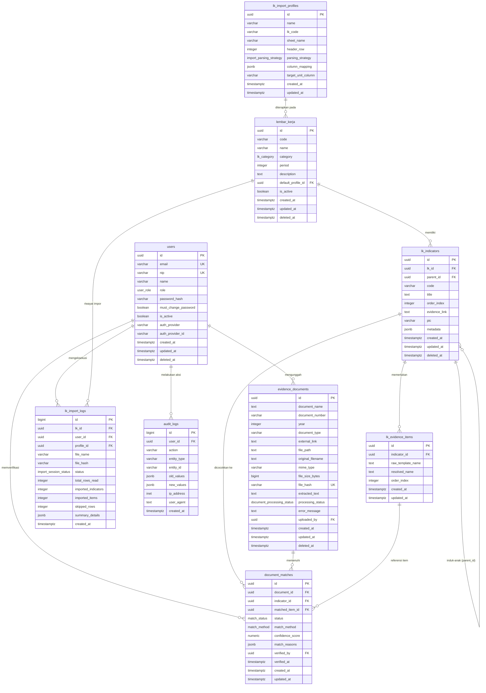

# Spesifikasi Basis Data (DATABASE.md)
## Sistem Matching Bukti Dukung ke Lembar Kerja (LK)

| Atribut | Nilai |
|---|---|
| Versi Dokumen | 1.0 |
| Tanggal | 29 Oktober 2026 |
| Basis PRD | `PRD.md` Versi 1.1 |
| Target RDBMS | PostgreSQL 15+ |
| Standar Waktu | UTC (`TIMESTAMPTZ`), disajikan dalam `Asia/Jakarta` |
| Skema ID | UUID v7 (Time-ordered 128-bit UUID) untuk entitas utama; BIGINT IDENTITY untuk logging |

---

## 1. Pendahuluan & Prinsip Desain

Dokumen ini mendefinisikan arsitektur basis data relasional untuk sistem pencocokan bukti dukung ke Lembar Kerja (LK). Desain skema ini disusun dengan mengacu pada prinsip-prinsip:

1. **Penegakan Integritas di Tingkat Database (NFR-09, NFR-10):** Validasi relasi, constraint unik, dan validasi domain ditegakkan melalui Foreign Keys, Unique Index, dan Check Constraints pada level database engine, bukan hanya mengandalkan kode aplikasi.
2. **Idempotensi & Pencegahan Race Condition (AC-05, AC-16, LKIMP-07):** Upload duplikat dicegah melalui hash SHA-256 yang unik, dan matching konkuren dijamin aman melalui constraint unik `(document_id, indicator_id)`.
3. **Kekekalan Keputusan Admin (MATCH-06, AC-11):** Relasi yang pernah ditolak (`rejected`) atau dihapus manual oleh admin disimpan sebagai catatan status permanen sehingga algoritma otomatis tidak dapat membuat ulang relasi tersebut.
4. **Optimasi Kueri Matriks Monitor & Pencarian (G1, NFR-05, SEARCH-01, SEARCH-02):** Penyusunan indeks komposit terarah untuk rendering matriks centang berkecepatan tinggi (≤ 2 detik untuk 10.000 dokumen), serta dukungan Full-Text Search dan Trigram (`pg_trgm`) untuk pencarian fuzzy pada nama, nomor, dan isi dokumen.
5. **Immutability pada Audit Trail (AUDIT-01, AUDIT-02):** Tabel audit log dirancang bersifat append-only dengan pembatasan hak akses DML (`UPDATE`/`DELETE` dicegah).

---

## 2. Ekstensi & Tipe Data Khusus PostgreSQL

Aplikasi memerlukan ekstensi resmi PostgreSQL berikut:

```sql
-- Ekstensi untuk pembuatan UUID dan hashing
CREATE EXTENSION IF NOT EXISTS "pgcrypto";

-- Ekstensi untuk pencarian kemiripan teks (fuzzy search) dan indexing trigram
CREATE EXTENSION IF NOT EXISTS "pg_trgm";

-- Ekstensi unaccent untuk normalisasi karakter aksen (opsional tapi dianjurkan)
CREATE EXTENSION IF NOT EXISTS "unaccent";
```

### 2.1 Definisi ENUM Khusus

```sql
-- Peran pengguna sistem
CREATE TYPE user_role AS ENUM ('super_admin', 'admin', 'pegawai');

-- Kategori Lembar Kerja
CREATE TYPE lk_category AS ENUM ('internal', 'eksternal');

-- Strategi parsing profil impor Excel
CREATE TYPE import_parsing_strategy AS ENUM (
    'numbered_list_single_cell',  -- Contoh: ZI (1. SK Tim... 2. SK Perubahan...)
    'checklist_sheet',            -- Contoh: PEKPPP (Sheet checklist terpisah)
    'single_item_per_row'         -- Contoh: KIP (Satu baris satu item bukti)
);

-- Status pemrosesan bukti dukung
CREATE TYPE document_processing_status AS ENUM (
    'memproses',             -- Dokumen baru diunggah, teks sedang diekstrak / OCR
    'selesai',               -- Ekstraksi teks dan matching otomatis berhasil
    'perlu_review_manual',   -- Ekstraksi teks kosong/gagal, dokumen tetap tersimpan
    'gagal'                  -- Kegagalan fatal saat pemrosesan file
);

-- Status relasi matching antara Bukti Dukung dan Indikator LK
CREATE TYPE match_status AS ENUM (
    'auto',        -- Dihasilkan otomatis oleh algoritma, belum diverifikasi admin
    'confirmed',   -- Terverifikasi (diverifikasi admin, bukti pasti, atau dibuat manual)
    'rejected'     -- Ditolak oleh admin atau dihapus manual (tidak tampil di monitor)
);

-- Metode pencocokan yang menghasilkan relasi
CREATE TYPE match_method AS ENUM (
    'exact_number',        -- Nomor dokumen identik (Bukti Pasti -> langsung confirmed)
    'exact_code',          -- Kode indikator tertera pada nama file (Bukti Pasti -> confirmed)
    'title_similarity',    -- Kemiripan nama dokumen dengan item bukti (status auto)
    'content_similarity',  -- Kemiripan isi teks dokumen dengan uraian item (status auto)
    'manual'               -- Ditambahkan manual oleh admin (status confirmed)
);

-- Status sesi impor Excel
CREATE TYPE import_session_status AS ENUM (
    'previewed',   -- Hasil parse ditampilkan, belum disimpan
    'committed',   -- Dikonfirmasi dan disimpan ke database
    'failed'       -- Gagal dalam validasi/eksekusi
);
```

---

## 3. Diagram Hubungan Entitas (ERD)



---

## 4. Rincian Skema Tabel (DDL & Kamus Data)

### 4.1 Tabel `users`
Menyimpan akun pengguna. Mendukung login SSO kantor (AUTH-01, AUTH-02) dan akun awal dummy Super Admin lokal (AUTH-03, AUTH-04, D6).

```sql
CREATE TABLE users (
    id UUID PRIMARY KEY DEFAULT gen_random_uuid(),
    email VARCHAR(255) NOT NULL,
    nip VARCHAR(64) NULL,
    name VARCHAR(255) NOT NULL,
    role user_role NOT NULL DEFAULT 'pegawai',
    password_hash VARCHAR(255) NULL,
    must_change_password BOOLEAN NOT NULL DEFAULT FALSE,
    is_active BOOLEAN NOT NULL DEFAULT TRUE,
    auth_provider VARCHAR(32) NOT NULL DEFAULT 'sso', -- 'sso' atau 'local'
    auth_provider_id VARCHAR(255) NULL,              -- Subject ID / Identitas unik SSO
    created_at TIMESTAMPTZ NOT NULL DEFAULT CURRENT_TIMESTAMP,
    updated_at TIMESTAMPTZ NOT NULL DEFAULT CURRENT_TIMESTAMP,
    deleted_at TIMESTAMPTZ NULL,

    -- Email harus unik di antara akun yang aktif
    CONSTRAINT uq_users_email UNIQUE (email),
    
    -- NIP unik jika diisi
    CONSTRAINT uq_users_nip UNIQUE (nip),

    -- Validasi logika autentikasi
    CONSTRAINT chk_users_auth CHECK (
        (auth_provider = 'local' AND password_hash IS NOT NULL) OR
        (auth_provider = 'sso')
    )
);

-- Indeks pencarian cepat saat otentikasi dan pemeriksaan status aktif
CREATE INDEX idx_users_email_active ON users(email, is_active) WHERE deleted_at IS NULL;
CREATE INDEX idx_users_nip_active ON users(nip, is_active) WHERE deleted_at IS NULL AND nip IS NOT NULL;
CREATE INDEX idx_users_role ON users(role) WHERE deleted_at IS NULL;
```

#### Aturan Bisnis & Trigger `users`:
* **Pencegahan Penghapusan/Penonaktifan Super Admin Terakhir (AUTH-06, AC-04):**
  Dibuat trigger fungsi pada `BEFORE UPDATE OR DELETE` untuk memastikan setidaknya terdapat minimal 1 akun `super_admin` dengan status `is_active = TRUE` dan `deleted_at IS NULL`.

---

### 4.2 Tabel `lembar_kerja`
Menyimpan master instansi Lembar Kerja yang menjadi target matching (LK-01, LK-02, LK-03).

```sql
CREATE TABLE lembar_kerja (
    id UUID PRIMARY KEY DEFAULT gen_random_uuid(),
    code VARCHAR(32) NOT NULL,                     -- Contoh: 'ZI', 'PEKPPP', 'KIP'
    name VARCHAR(255) NOT NULL,                    -- Contoh: 'LKE Zona Integritas'
    category lk_category NOT NULL,                 -- 'internal' atau 'eksternal'
    period INTEGER NOT NULL,                       -- Tahun berlaku: 2025, 2026 (A8, LK-03)
    description TEXT NULL,
    default_profile_id UUID NULL,                  -- Profil impor default (opsional)
    is_active BOOLEAN NOT NULL DEFAULT TRUE,
    created_at TIMESTAMPTZ NOT NULL DEFAULT CURRENT_TIMESTAMP,
    updated_at TIMESTAMPTZ NOT NULL DEFAULT CURRENT_TIMESTAMP,
    deleted_at TIMESTAMPTZ NULL,                   -- Soft delete (LK-06)

    -- Kode unik dalam periode yang sama untuk LK yang aktif (LK-03)
    CONSTRAINT uq_lk_code_period UNIQUE (code, period),
    
    -- Validasi tahun periode realistis
    CONSTRAINT chk_lk_period CHECK (period >= 2020 AND period <= 2099)
);

CREATE INDEX idx_lk_category_period ON lembar_kerja(category, period) WHERE deleted_at IS NULL;
```

---

### 4.3 Tabel `lk_import_profiles`
Menyimpan konfigurasi cara membaca file Excel per LK (LKIMP-02, LKIMP-03, LKIMP-06).

```sql
CREATE TABLE lk_import_profiles (
    id UUID PRIMARY KEY DEFAULT gen_random_uuid(),
    name VARCHAR(100) NOT NULL,                    -- 'Profil Standar LKE ZI'
    lk_code VARCHAR(32) NOT NULL,                  -- 'ZI', 'PEKPPP', 'KIP'
    sheet_name VARCHAR(100) NOT NULL,              -- Nama sheet yang diproses
    header_row INTEGER NOT NULL DEFAULT 1,         -- Baris judul kolom (1-based index)
    parsing_strategy import_parsing_strategy NOT NULL,
    column_mapping JSONB NOT NULL,                 -- Pemetaan kolom ke properti data
    target_unit_column VARCHAR(64) NULL,           -- Kolom pembeda unit kerja (kasus KIP)
    created_at TIMESTAMPTZ NOT NULL DEFAULT CURRENT_TIMESTAMP,
    updated_at TIMESTAMPTZ NOT NULL DEFAULT CURRENT_TIMESTAMP,

    CONSTRAINT chk_header_row_positive CHECK (header_row > 0)
);

-- Contoh struktur JSONB column_mapping:
-- {
--   "code_col": "B",
--   "title_col": "C",
--   "evidence_items_col": "D",
--   "evidence_link_col": "E",
--   "pic_col": "F",
--   "filter_criteria": {"status_col": "A", "exclude_values": ["Total", "Rekap"]}
-- }
```

---

### 4.4 Tabel `lk_indicators`
Menyimpan butir/indikator persyaratan di dalam LK (LK-04, LK-08, LK-09, LK-10).

```sql
CREATE TABLE lk_indicators (
    id UUID PRIMARY KEY DEFAULT gen_random_uuid(),
    lk_id UUID NOT NULL REFERENCES lembar_kerja(id) ON DELETE CASCADE,
    parent_id UUID NULL REFERENCES lk_indicators(id) ON DELETE CASCADE,
    code VARCHAR(64) NOT NULL,                     -- Contoh: 'AI1i', '1a', '1.2.a'
    title TEXT NOT NULL,                           -- Uraian butir / pertanyaan indikator
    order_index INTEGER NOT NULL DEFAULT 0,        -- Mempertahankan urutan baris Excel
    evidence_link TEXT NULL,                       -- Tautan Drive atau Web hasil impor
    pic VARCHAR(255) NULL,                         -- PIC teks opsional (LK-10)
    metadata JSONB NULL,                           -- Komponen hierarki (Area, Aspek, dll.)
    created_at TIMESTAMPTZ NOT NULL DEFAULT CURRENT_TIMESTAMP,
    updated_at TIMESTAMPTZ NOT NULL DEFAULT CURRENT_TIMESTAMP,
    deleted_at TIMESTAMPTZ NULL,

    -- Kode unik dalam SATU LK dan SATU periode (LK-04, NFR-10)
    CONSTRAINT uq_indicator_lk_code UNIQUE (lk_id, code),

    -- Tautan bukti HANYA boleh skema http atau https (LK-09, AC-25)
    CONSTRAINT chk_indicator_link_scheme CHECK (
        evidence_link IS NULL OR 
        evidence_link ~* '^https?://.+'
    )
);

CREATE INDEX idx_indicators_lk_id ON lk_indicators(lk_id) WHERE deleted_at IS NULL;
CREATE INDEX idx_indicators_parent_id ON lk_indicators(parent_id);
CREATE INDEX idx_indicators_order ON lk_indicators(lk_id, order_index);
```

---

### 4.5 Tabel `lk_evidence_items`
Menyimpan dokumen bukti yang diharapkan untuk masing-masing indikator (LK-05, AC-26). Objek inilah yang menjadi target pencocokan teks oleh algoritma matching.

```sql
CREATE TABLE lk_evidence_items (
    id UUID PRIMARY KEY DEFAULT gen_random_uuid(),
    indicator_id UUID NOT NULL REFERENCES lk_indicators(id) ON DELETE CASCADE,
    raw_template_name TEXT NOT NULL,               -- Misal: "Laporan Evaluasi Tahun [t-1]"
    resolved_name TEXT NOT NULL,                   -- Misal: "Laporan Evaluasi Tahun 2025"
    order_index INTEGER NOT NULL DEFAULT 0,
    created_at TIMESTAMPTZ NOT NULL DEFAULT CURRENT_TIMESTAMP,
    updated_at TIMESTAMPTZ NOT NULL DEFAULT CURRENT_TIMESTAMP,

    -- Menghindari item kembar pada satu indikator yang sama saat impor ulang
    CONSTRAINT uq_evidence_item_indicator_resolved UNIQUE (indicator_id, resolved_name)
);

CREATE INDEX idx_evidence_items_indicator_id ON lk_evidence_items(indicator_id);

-- Indeks Trigram untuk pencocokan kemiripan teks nama item bukti
CREATE INDEX idx_evidence_items_trgm_resolved ON lk_evidence_items USING GIN (resolved_name gin_trgm_ops);
```

---

### 4.6 Tabel `evidence_documents` (Bukti Dukung)
Menyimpan metadata dan isi teks dari dokumen bukti dukung yang diunggah pengguna (BD-01 s.d. BD-10).

```sql
CREATE TABLE evidence_documents (
    id UUID PRIMARY KEY DEFAULT gen_random_uuid(),
    document_name TEXT NOT NULL,                   -- Nama dokumen yang diinput admin
    document_number VARCHAR(128) NULL,             -- Nomor SK / Surat (opsional)
    year INTEGER NOT NULL,                         -- Tahun dokumen berlaku
    document_type VARCHAR(64) NULL,                -- SK, Laporan, Notula, SOP, Data
    external_link TEXT NULL,                       -- Tautan eksternal tambahan jika ada
    file_path TEXT NOT NULL,                       -- Path file acak di penyimpanan privat (NFR-04, BD-10)
    original_filename TEXT NOT NULL,               -- Nama asli saat diunggah
    mime_type VARCHAR(128) NOT NULL,               -- Hasil validasi MIME sniffing (BD-03)
    file_size_bytes BIGINT NOT NULL,               -- Ukuran berkas (BD-02)
    file_hash VARCHAR(64) NOT NULL,                -- SHA-256 hash (BD-04, BD-05)
    extracted_text TEXT NULL,                      -- Teks hasil ekstraksi digital / OCR (BD-07)
    processing_status document_processing_status NOT NULL DEFAULT 'memproses',
    error_message TEXT NULL,                       -- Pesan kegagalan OCR / ekstraksi
    uploaded_by UUID NOT NULL REFERENCES users(id),
    created_at TIMESTAMPTZ NOT NULL DEFAULT CURRENT_TIMESTAMP,
    updated_at TIMESTAMPTZ NOT NULL DEFAULT CURRENT_TIMESTAMP,
    deleted_at TIMESTAMPTZ NULL,                   -- Soft delete (BD-09)

    -- Cegah upload file fisik yang identik dua kali (BD-05, AC-05)
    CONSTRAINT uq_documents_file_hash UNIQUE (file_hash),

    -- Batas ukuran file (maks 20MB secara default, dapat disesuaikan)
    CONSTRAINT chk_document_file_size CHECK (file_size_bytes > 0 AND file_size_bytes <= 20971520),

    -- Tautan eksternal jika diisi harus valid HTTP/HTTPS
    CONSTRAINT chk_document_external_link CHECK (
        external_link IS NULL OR 
        external_link ~* '^https?://.+'
    )
);

-- Indeks pencarian dan audit
CREATE INDEX idx_documents_year ON evidence_documents(year) WHERE deleted_at IS NULL;
CREATE INDEX idx_documents_type ON evidence_documents(document_type) WHERE deleted_at IS NULL;
CREATE INDEX idx_documents_status ON evidence_documents(processing_status) WHERE deleted_at IS NULL;
CREATE INDEX idx_documents_uploaded_by ON evidence_documents(uploaded_by);

-- Indeks Trigram untuk pencarian fuzzy pada nama & nomor dokumen (SEARCH-02)
CREATE INDEX idx_documents_trgm_name ON evidence_documents USING GIN (document_name gin_trgm_ops);
CREATE INDEX idx_documents_trgm_number ON evidence_documents USING GIN (document_number gin_trgm_ops) WHERE document_number IS NOT NULL;

-- Indeks Full-Text Search PostgreSQL (SEARCH-01)
-- Menggabungkan nama dokumen, nomor dokumen, dan isi hasil ekstraksi teks/OCR
CREATE INDEX idx_documents_fts ON evidence_documents USING GIN (
    to_tsvector('indonesian', 
        coalesce(document_name, '') || ' ' || 
        coalesce(document_number, '') || ' ' || 
        coalesce(extracted_text, '')
    )
) WHERE deleted_at IS NULL;
```

---

### 4.7 Tabel `document_matches` (Relasi Matching)
Menyimpan relasi kecocokan antara Bukti Dukung dengan Indikator LK (MATCH-01 s.d. MATCH-11, MON-01 s.d. MON-04).

```sql
CREATE TABLE document_matches (
    id UUID PRIMARY KEY DEFAULT gen_random_uuid(),
    document_id UUID NOT NULL REFERENCES evidence_documents(id) ON DELETE CASCADE,
    indicator_id UUID NOT NULL REFERENCES lk_indicators(id) ON DELETE CASCADE,
    matched_item_id UUID NULL REFERENCES lk_evidence_items(id) ON DELETE SET NULL,
    status match_status NOT NULL DEFAULT 'auto',
    match_method match_method NOT NULL,
    confidence_score NUMERIC(5,2) NOT NULL DEFAULT 0.00, -- Nilai 0.00 s.d. 100.00
    match_reasons JSONB NOT NULL DEFAULT '{}'::jsonb,    -- Rincian bukti kecocokan
    verified_by UUID NULL REFERENCES users(id),          -- Admin pemeriksa
    verified_at TIMESTAMPTZ NULL,                        -- Waktu verifikasi/penolakan
    created_at TIMESTAMPTZ NOT NULL DEFAULT CURRENT_TIMESTAMP,
    updated_at TIMESTAMPTZ NOT NULL DEFAULT CURRENT_TIMESTAMP,

    -- Integritas Kunci: Mencegah record ganda pasangan (BD, Indikator)
    -- Menangani balapan konkurensi antar worker/admin (NFR-10, AC-16)
    CONSTRAINT uq_matches_doc_indicator UNIQUE (document_id, indicator_id),

    -- Validasi rentang skor 0 s.d 100
    CONSTRAINT chk_matches_score CHECK (confidence_score >= 0.00 AND confidence_score <= 100.00)
);

-- Indeks krusial untuk rendering Matriks Monitor (MON-02, MON-03, NFR-05)
-- Mempercepat filter relasi aktif (auto & confirmed) saat menyusun tabel centang
CREATE INDEX idx_matches_monitor_lookup ON document_matches(document_id, indicator_id) 
WHERE status IN ('auto', 'confirmed');

-- Indeks antrean verifikasi admin
CREATE INDEX idx_matches_verification_queue ON document_matches(status, created_at) 
WHERE status = 'auto';

CREATE INDEX idx_matches_indicator ON document_matches(indicator_id);
```

#### Mekanisme Kekekalan Penolakan (MATCH-06 & AC-11):
Ketika seorang Admin menolak suatu hasil matching atau menghapus relasi yang ada:
1. Status pada `document_matches` **TIDAK DIHAPUS DARI DATABASE**, melainkan diubah menjadi `status = 'rejected'` dengan mencatat `verified_by = auth.user_id` dan `verified_at = CURRENT_TIMESTAMP`.
2. Pada matriks monitor: Query hanya mengambil baris dengan `status IN ('auto', 'confirmed')`, sehingga tanda centang ✔ langsung hilang dari layar pengguna (MON-02, MON-03).
3. Pada proses *re-matching* otomatis (MATCH-06, MATCH-07): Algoritma selalu mengeksekusi query `WHERE status = 'rejected'` untuk pasangan `(document_id, indicator_id)` tersebut dan **melewatinya secara mutlak**.
4. Jika admin secara eksplisit menambahkan kembali relasi itu secara manual (MATCH-05), query melakukan `UPSERT` yang memperbarui status dari `rejected` menjadi `confirmed` dengan `match_method = 'manual'`.

---

### 4.8 Tabel `lk_import_logs`
Menyimpan riwayat dan catatan audit setiap eksekusi impor file Excel LK (LKIMP-04, LKIMP-11).

```sql
CREATE TABLE lk_import_logs (
    id BIGINT GENERATED ALWAYS AS IDENTITY PRIMARY KEY,
    lk_id UUID NOT NULL REFERENCES lembar_kerja(id) ON DELETE CASCADE,
    user_id UUID NOT NULL REFERENCES users(id),
    profile_id UUID NOT NULL REFERENCES lk_import_profiles(id),
    file_name VARCHAR(255) NOT NULL,
    file_hash VARCHAR(64) NOT NULL,                -- Hash SHA-256 file Excel yang diunggah
    status import_session_status NOT NULL,
    total_rows_read INTEGER NOT NULL DEFAULT 0,
    imported_indicators INTEGER NOT NULL DEFAULT 0,
    imported_items INTEGER NOT NULL DEFAULT 0,
    skipped_rows INTEGER NOT NULL DEFAULT 0,
    summary_details JSONB NULL,                    -- Daftar baris dilewati dan alasannya
    created_at TIMESTAMPTZ NOT NULL DEFAULT CURRENT_TIMESTAMP
);

CREATE INDEX idx_import_logs_lk ON lk_import_logs(lk_id, created_at DESC);
```

---

### 4.9 Tabel `audit_logs`
Menyimpan seluruh catatan audit mutasi data sistem (AUDIT-01, AUDIT-02, AUDIT-03).

```sql
CREATE TABLE audit_logs (
    id BIGINT GENERATED ALWAYS AS IDENTITY PRIMARY KEY,
    user_id UUID NULL REFERENCES users(id) ON DELETE SET NULL, -- NULL bila aksi sistem
    action VARCHAR(64) NOT NULL,                   -- 'auth.login', 'match.confirmed', dll.
    entity_type VARCHAR(64) NOT NULL,              -- 'users', 'document_matches', dll.
    entity_id VARCHAR(64) NOT NULL,                -- ID entitas yang dimutasi
    old_values JSONB NULL,                         -- Snapshot data sebelum perubahan
    new_values JSONB NULL,                         -- Snapshot data sesudah perubahan
    ip_address INET NULL,                          -- Alamat IP pemanggil
    user_agent TEXT NULL,                          -- User Agent browser pemanggil
    created_at TIMESTAMPTZ NOT NULL DEFAULT CURRENT_TIMESTAMP
);

CREATE INDEX idx_audit_logs_user ON audit_logs(user_id, created_at DESC);
CREATE INDEX idx_audit_logs_entity ON audit_logs(entity_type, entity_id);
CREATE INDEX idx_audit_logs_action ON audit_logs(action, created_at DESC);
CREATE INDEX idx_audit_logs_created_at ON audit_logs(created_at DESC);
```

#### Immutability Protection untuk `audit_logs`:
```sql
-- Mencegah UPDATE dan DELETE pada audit_logs secara ketat (AUDIT-02)
CREATE OR REPLACE FUNCTION trg_prevent_audit_tampering()
RETURNS TRIGGER AS $$
BEGIN
    RAISE EXCEPTION 'Operasi % pada tabel audit_logs dilarang demi integritas audit trail!', TG_OP;
END;
$$ LANGUAGE plpgsql;

CREATE TRIGGER prevent_audit_logs_mutation
BEFORE UPDATE OR DELETE ON audit_logs
FOR EACH ROW EXECUTE FUNCTION trg_prevent_audit_tampering();
```

---

### 4.10 Tabel `system_settings`
Menyimpan konfigurasi parameter dinamis sistem (misal: ambang batas matching score, batas upload) (MATCH-11, BD-02).

```sql
CREATE TABLE system_settings (
    key VARCHAR(64) PRIMARY KEY,
    value JSONB NOT NULL,
    description TEXT NULL,
    updated_by UUID NULL REFERENCES users(id),
    updated_at TIMESTAMPTZ NOT NULL DEFAULT CURRENT_TIMESTAMP
);

-- Inisialisasi konfigurasi bawaan
INSERT INTO system_settings (key, value, description) VALUES
('matching.similarity_threshold', '75.0'::jsonb, 'Ambang batas skor minimal (0-100) untuk pembuatan match auto'),
('matching.exact_code_bonus', '25.0'::jsonb, 'Bobot bonus skor kecocokan kode indikator pada nama file'),
('upload.max_file_size_mb', '20'::jsonb, 'Batas maksimal ukuran upload file bukti dukung dalam MB'),
('session.idle_timeout_minutes', '120'::jsonb, 'Batas waktu sesi tidak aktif sebelum logout otomatis (AUTH-09)');
```

---

## 5. Strategi Kueri & Optimasi Performa Matriks Monitor

Kebutuhan non-fungsional **NFR-05** menetapkan bahwa layar monitor harus merespons dalam waktu **≤ 2 detik** untuk skala hingga 10.000 Dokumen Bukti Dukung.

### 5.1 Kueri Inti Matriks Monitor (Pivot Aggregation)

Untuk menyajikan matriks dengan Dokumen pada Baris dan Kolom LK dengan centang (✔):

```sql
-- Mengambil 25 Dokumen per halaman (Pagination di sisi server per MON-08)
WITH paged_docs AS (
    SELECT 
        d.id,
        d.document_name,
        d.document_number,
        d.year,
        d.document_type
    FROM evidence_documents d
    WHERE d.deleted_at IS NULL
      -- Filter dinamis (misal tahun atau tipe dokumen)
      AND (:filter_year IS NULL OR d.year = :filter_year)
      AND (:filter_type IS NULL OR d.document_type = :filter_type)
    ORDER BY d.created_at DESC
    LIMIT :limit OFFSET :offset
)
SELECT 
    pd.id AS document_id,
    pd.document_name,
    pd.document_number,
    pd.year,
    pd.document_type,
    -- Agregasi kecocokan LK aktif ke dalam array / JSON objek
    jsonb_object_agg(
        lk.code, 
        jsonb_build_object(
            'has_match', TRUE,
            'match_count', COUNT(m.id),
            'indicators', jsonb_agg(
                jsonb_build_object(
                    'match_id', m.id,
                    'indicator_code', ind.code,
                    'indicator_title', ind.title,
                    'status', m.status,
                    'confidence_score', m.confidence_score,
                    'evidence_link', ind.evidence_link
                )
            )
        )
    ) FILTER (WHERE lk.id IS NOT NULL) AS lk_matches
FROM paged_docs pd
LEFT JOIN document_matches m 
    ON m.document_id = pd.id 
   AND m.status IN ('auto', 'confirmed') -- Hanya match aktif (MON-02, MON-03)
LEFT JOIN lk_indicators ind 
    ON ind.id = m.indicator_id 
   AND ind.deleted_at IS NULL
LEFT JOIN lembar_kerja lk 
    ON lk.id = ind.lk_id 
   AND lk.deleted_at IS NULL
   AND lk.period = :active_period
GROUP BY 
    pd.id, pd.document_name, pd.document_number, pd.year, pd.document_type;
```

**Hasil Kueri:** Menghasilkan baris dokumen dengan kolom JSON `lk_matches`. Pada antarmuka:
- Jika `lk_matches -> 'ZI'` ada nilainya, render tanda centang **✔**.
- Jika tidak ada, biarkan sel **kosong** murni tanpa teks/simbol (MON-02).
- Saat sel ✔ diklik: data detail indikator, skor, status, dan link langsung tersedia dari payload JSON tanpa perlu round-trip kueri baru (MON-04, MON-05).

---

## 6. Prosedur Seeding Data Awal (Baseline Seeder)

Saat instalasi awal sistem, database diisi dengan data awal sebagai berikut:

### 6.1 Akun Dummy Super Admin (D6, AUTH-03, AUTH-04)
* Dibuat via database seeder dengan membaca kredensial dari environment variable (`SEEDER_SUPERADMIN_EMAIL`, `SEEDER_SUPERADMIN_PASSWORD`).
* `role`: `'super_admin'`
* `auth_provider`: `'local'`
* `must_change_password`: `TRUE` (Sistem memaksa pergantian password sebelum dapat mengakses menu apapun).

### 6.2 Master 6 Lembar Kerja Awal (LK-01, D1)
Untuk periode tahun berjalan (misal: 2026):

| Kode LK | Nama Lengkap | Kategori | Strategi Parsing Profil |
|---|---|---|---|
| `ZI` | LKE Zona Integritas | `internal` | `numbered_list_single_cell` |
| `PEKPPP` | Pemantauan & Evaluasi Kinerja Penyelenggara Pelayanan Publik | `internal` | `checklist_sheet` |
| `KIP` | Evaluasi Keterbukaan Informasi Publik (SAQ/PPID) | `internal` | `single_item_per_row` |
| `SAKIP` | Sistem Akuntabilitas Kinerja Instansi Pemerintah | `internal` | `single_item_per_row` (generik) |
| `DATA_SEKUNDER` | Pengumpulan Data Sekunder | `eksternal` | `single_item_per_row` (generik) |
| `DATA_SEKTORAL` | Pengumpulan Data Statistik Sektoral | `eksternal` | `single_item_per_row` (generik) |

---

## 7. Rangkuman Validasi Terhadap PRD

| Kebutuhan PRD | Implementasi di Skema Database | Status |
|---|---|:---:|
| **LK-03** (Kode LK unik per periode) | `CONSTRAINT uq_lk_code_period UNIQUE (code, period)` | ✔ Terpenuhi |
| **LK-04, NFR-10** (Kode indikator unik per LK) | `CONSTRAINT uq_indicator_lk_code UNIQUE (lk_id, code)` | ✔ Terpenuhi |
| **LK-05, AC-26** (Item bukti & tahun resolved) | Kolom `raw_template_name` & `resolved_name` pada `lk_evidence_items` | ✔ Terpenuhi |
| **LK-09, AC-25** (Tautan bukti http/https saja) | Check constraint regex `evidence_link ~* '^https?://.+'` | ✔ Terpenuhi |
| **BD-04, BD-05, AC-05** (Cegah duplikat file hash) | `CONSTRAINT uq_documents_file_hash UNIQUE (file_hash)` | ✔ Terpenuhi |
| **BD-07, SEARCH-01** (FTS teks dokumen) | Kolom `extracted_text` + GIN Index `to_tsvector('indonesian', ...)` | ✔ Terpenuhi |
| **MATCH-02, MATCH-03** (Status match auto/confirmed) | ENUM `match_status ('auto', 'confirmed', 'rejected')` | ✔ Terpenuhi |
| **MATCH-06, AC-11** (Kekekalan penolakan admin) | Match rejected tetap disimpan sebagai tombstone record, bukan dihapus | ✔ Terpenuhi |
| **AC-16, NFR-10** (Cegah relasi kembar konkuren) | `CONSTRAINT uq_matches_doc_indicator UNIQUE (document_id, indicator_id)` | ✔ Terpenuhi |
| **AUTH-03, AUTH-07** (Akun SSO & Flag nonaktif) | Kolom `is_active`, `must_change_password`, `auth_provider` pada `users` | ✔ Terpenuhi |
| **AUDIT-01, AUDIT-02** (Audit log anti-tampering) | Tabel `audit_logs` + Trigger pelarang UPDATE & DELETE | ✔ Terpenuhi |

