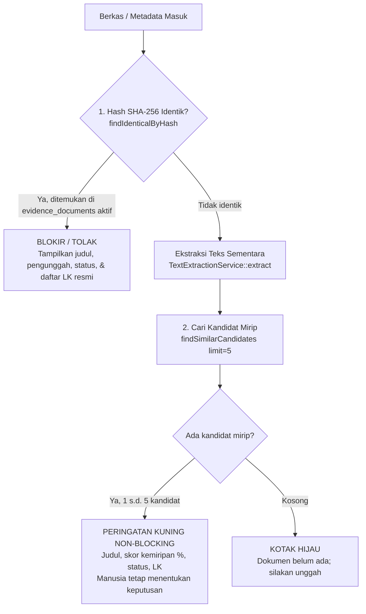

# Spesifikasi Deteksi Duplikasi & Kemiripan Dokumen (MATCHING_ALGORITHM.md)
## Perpustakaan Bukti Dukung BPS Kabupaten Tegal (ELKA)

| Atribut | Nilai |
|---|---|
| Versi Dokumen | 3.0 |
| Tanggal | 17 November 2026 |
| Basis PRD | `PRD.md` Versi 3.0 |
| Layanan Utama | `App\Services\Evidence\DocumentSimilarityService` & `App\Services\Evidence\TextExtractionService` |
| Tabel Terkait | `evidence_documents`, `document_lk_links` |

---

## 1. Perubahan Ruang Lingkup (Pencocokan Indikator Dihapus)

Pada arsitektur final **Perpustakaan Bukti Dukung BPS Kabupaten Tegal**:
* **Mesin pencocokan dokumen ke indikator telah dibuang sepenuhnya** dari aplikasi karena alur kerja kini memetakan **Dokumen $\leftrightarrow$ 6 Rak Lembar Kerja (LK)** secara langsung oleh manusia (usulan pengunggah + pengesahan Admin/Super Admin).
* Sistem tidak lagi menghitung skor kecocokan terhadap indikator maupun menulis saran ke tabel `document_matches`.
* Sebagai penggantinya, sistem berfokus pada **`DocumentSimilarityService`** untuk membantu pengguna **mencegah berkas kembar dan mendeteksi dokumen mirip** sebelum dan saat mengunggah.

---

## 2. Tiga Mekanisme `DocumentSimilarityService`

`App\Services\Evidence\DocumentSimilarityService` menyediakan dua method publik yang dipakai oleh `EvidenceUploadService`, `EvidenceDocumentResource`, dan `CariDokumenPage`:



### 2.1 Pengecekan Hash SHA-256 Identik (`findIdenticalByHash`)
* **Signature:** `findIdenticalByHash(string $fileHash, ?string $excludeId = null): ?array`
* **Cara Kerja:**
  * Mencari baris aktif (`WHERE deleted_at IS NULL`) pada `evidence_documents` dengan kolom `file_hash` yang persis sama (mengecualikan `$excludeId` saat alur revisi).
  * Mengembalikan detail dokumen terdaftar (`id`, `judul`, `uploader_name`, `approval_status`, `rujukan`, `document`).
* **Perilaku Bisnis:**
  * Bersifat **keras (blocking)** pada `EvidenceUploadService::inspectAndValidate()` (melempar `DuplicateDocumentException`) maupun pada fitur **Cek Berkas Sebelum Unggah** di `CariDokumenPage::checkUploadedFile()` (menampilkan kotak merah **Ditolak — Dokumen Sudah Ada** beserta daftar kode LK resmi dari `DocumentLkLink::OFFICIAL_SOURCES`).
  * Berkas yang sudah di-*soft-delete* (`deleted_at IS NOT NULL`) diabaikan sehingga boleh diunggah kembali.

### 2.2 Peringatan Kandidat Dokumen Mirip (`findSimilarCandidates`)
* **Signature:**
  ```php
  findSimilarCandidates(
      string|EvidenceDocument $documentOrTitle,
      ?string $documentNumber = null,
      ?string $text = null,
      ?string $excludeId = null,
      int $limit = 5
  ): Collection
  ```
* **Tiga Sinyal Pencocokan PostgreSQL yang Digabungkan:**
  1. **Nama Dokumen Mirip (Trigram `pg_trgm`):**
     * Membandingkan judul/nama berkas terhadap `evidence_documents.document_name` dengan `similarity(document_name, ?) >= 0.2` atau `word_similarity(?, document_name) >= 0.4`.
  2. **Nomor Dokumen Mirip (Trigram `pg_trgm`):**
     * Bila nomor dokumen tersedia, mencocokkan `similarity(coalesce(document_number, ''), ?) >= 0.25`.
  3. **Isi Teks Mirip (Full-Text Search Bahasa Indonesia):**
     * Bila teks hasil ekstraksi (`TextExtractionService::extract`) tersedia, teks dipotong aman maksimal **1.500 karakter** lalu dievaluasi dengan `to_tsvector('indonesian', document_name || document_number || extracted_text) @@ plainto_tsquery('indonesian', ?)`.
* **Perhitungan Skor & Batas Hasil:**
  * Skor gabungan dihitung menggunakan fungsi `GREATEST(...)` dari ketiga sinyal di atas (`similarity` judul, `similarity` nomor, dan `ts_rank` teks) dan diurutkan menurun (`ORDER BY score DESC`).
  * Jumlah kandidat dibatasi tegas **maksimal 5 dokumen** (`$safeLimit = max(1, min($limit, 5))`).
  * Pada `CariDokumenPage::checkUploadedFile()`, skor disajikan dalam persentase (`round(min(100.0, $rawScore * 100), 1)%`).

---

## 3. Prinsip "Manusia yang Memutuskan"

1. **Non-Blocking untuk Kemiripan (Selain Hash Identik):**
   * Peringatan kandidat mirip (baik saat mengetik judul di formulir `Unggah Bukti` maupun saat memakai `Cek Berkas Sebelum Unggah` di `Cari Dokumen`) bersifat **informasi peringatan semata**, tidak memblokir unggahan. Pegawai/Admin tetap dapat melanjutkan pengiriman apabila dokumen memang berbeda (misalnya SK tahun atau lampiran berbeda).
2. **Penetapan LK Sepenuhnya oleh Manusia:**
   * Pegawai mengusulkan minimal 1 LK (`proposed`), lalu Admin/Super Admin memeriksa isi dokumen dan mengesahkan minimal 1 LK resmi (`link_source = 'admin'`) di `VerificationQueuePage` atau mengubahnya lewat tombol **Ubah LK** di `CariDokumenPage`.
3. **Pembersihan Berkas Cek Sementara:**
   * Ketika fitur **Cek Berkas Sebelum Unggah** dipakai di `CariDokumenPage`, berkas sementara Livewire hanya dipakai untuk hitung SHA-256 dan ekstraksi teks di memori/disk sementara, lalu **selalu dihapus di blok `finally`** tanpa pernah membuat baris baru di `evidence_documents`.
