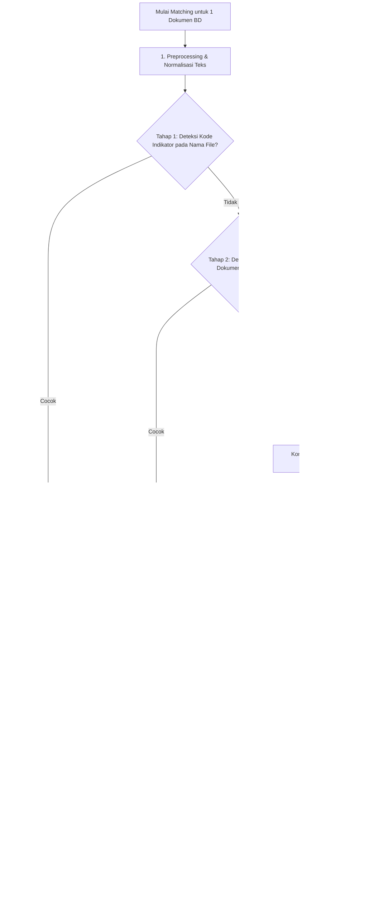
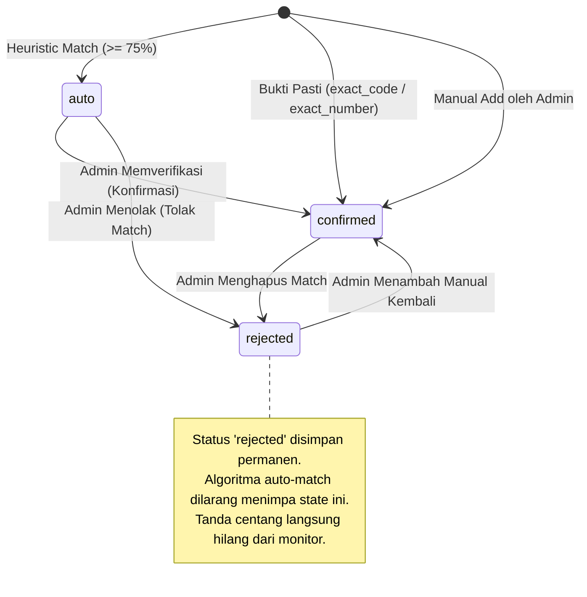

# Spesifikasi Algoritma Pencocokan (MATCHING_ALGORITHM.md)
## Sistem Matching Bukti Dukung ke Lembar Kerja (LK)

| Atribut | Nilai |
|---|---|
| Versi Dokumen | 1.0 |
| Tanggal | 29 Oktober 2026 |
| Basis PRD | `PRD.md` Versi 1.1 (Bagian 7.5, 8.2, 10, 11) |
| Basis Basis Data | `DATABASE.md` Versi 1.0 (Tabel `document_matches`, `lk_evidence_items`) |
| Ambang Batas Bawaan | 75.0% (`matching.similarity_threshold`) |

---

## 1. Pendahuluan & Gambaran Umum

Algoritma Matching adalah komponen inti yang bertugas memetakan Dokumen Bukti Dukung (BD) yang diunggah ke satu atau beberapa Indikator Lembar Kerja (LK). 

Sesuai temuan sampel nyata pada **PRD Bagian 1.1** dan keputusan **D1**, pencocokan dilakukan terhadap **Item Bukti LK** (`lk_evidence_items`) dan **Indikator LK** (`lk_indicators`), bukan terhadap nama LK secara umum.

### Prinsip Kerja Utama:
1. **Dua Golongan Bukti:**
   * **Bukti Pasti (Deterministic):** Kode indikator tertera eksplisit pada nama file atau nomor dokumen identik. Langsung berstatus `confirmed` (MATCH-03).
   * **Kemiripan Heuristik (Similarity):** Kemiripan teks nama dokumen dan/atau isi teks hasil ekstraksi/OCR. Berstatus `auto` jika mencapai ambang batas (MATCH-03).
2. **Langsung Tampil di Monitor (D2, MATCH-03, MON-02):**
   Baik status `auto` maupun `confirmed` **langsung menampilkan tanda centang (✔)** pada matriks monitor untuk semua role tanpa perlu menunggu persetujuan admin.
3. **Kekekalan Keputusan Admin (MATCH-06, AC-11):**
   Jika admin menolak atau menghapus match (`status = 'rejected'`), algoritma matching otomatis di masa mendatang **dilarang keras** membuat ulang relasi tersebut.
4. **Eksekusi Asinkron (MATCH-01, NFR-06):**
   Matching berjalan di background worker/queue agar proses upload dan impor Excel tidak memblokir antarmuka pengguna.

---

## 2. Struktur Objek yang Dicocokkan

```mermaid
graph LR
    subgraph Bukti Dukung (Source)
        BD[evidence_documents]
        BD --> NAMA[document_name]
        BD --> NO[document_number]
        BD --> TAHUN[year]
        BD --> FILE[original_filename]
        BD --> TEKS[extracted_text / OCR]
    end

    subgraph Target Matching
        ITEM[lk_evidence_items]
        IND[lk_indicators]
        LK[lembar_kerja]

        ITEM --> RES_NAME[resolved_name]
        IND --> KODE[code]
        IND --> URAIAN[title]
        LK --> PERIODE[period]
    end

    BD -.->|Pencocokan Multi-Tahap| ITEM
    ITEM --> IND
    IND --> LK
```

### 2.1 Resolusi Placeholder Tahun pada Item Bukti (LK-05, AC-26)
Pada file Excel LK (seperti sampel PEKPPP), nama dokumen harapan memuat placeholder tahun. Sebelum matching dijalankan, string template diselesaikan menurut periode LK:
* `[t]` ➔ Tahun periode LK berjalan (misal: LK Periode 2026 ➔ `2026`).
* `[t-1]` ➔ Satu tahun sebelum periode LK berjalan (misal: LK Periode 2026 ➔ `2025`).
* `[t-2]` ➔ Dua tahun sebelum periode LK berjalan.

Hasil resolusi disimpan pada kolom `lk_evidence_items.resolved_name` dan menjadi string target pencocokan.

---

## 3. Pipeline Pencocokan Multi-Tahap

Pipeline matching dijalankan berurutan dari aturan berbobot tertinggi (*Deterministic*) hingga analisis teks (*Heuristic*):



---

## 4. Rincian Logika Setiap Tahap

### 4.1 Tahap 0: Preprocessing & Normalisasi Teks
Sebelum teks dibandingkan, kedua belah pihak (input BD dan target Item Bukti) dinormalisasi:

1. **Case Folding:** Konversi seluruh karakter menjadi huruf kecil (*lowercase*).
2. **Pembersihan Simbol:** Menghapus tanda baca non-alfanumerik kecuali tanda pemisah kata/nomor surat (`/`, `-`, `.`).
3. **Ekspansi Singkatan Baku (Synonym Mapping):**
   Kamus sinonim internal diterapkan untuk menyelaraskan istilah umum perkantoran pemerintah:
   * `sk` ➔ `surat keputusan`
   * `sop` ➔ `standar operasional prosedur`
   * `sp` ➔ `standar pelayanan`
   * `lke` ➔ `lembar kerja evaluasi`
   * `notulen` ➔ `notula`
   * `monev` ➔ `monitoring evaluasi`
   * `renja` ➔ `rencana kerja`
   * `renstra` ➔ `rencana strategis`
4. **Stopwords Removal:** Menghapus kata hubung/tugas umum bahasa Indonesia (`dan`, `atau`, `yang`, `untuk`, `pada`, `ke`, `di`, `tentang`, `terkait`) khusus pada tahap pembandingan kemiripan heuristik.

---

### 4.2 Tahap 1: Pencocokan Kode Indikator Eksplisit (`exact_code`)
Berdasarkan sampel nyata (contoh KIP), pegawai sering menamai file dengan menyertakan kode butir indikator, seperti:
* `1.2.a SOP Pengelolaan Informasi.pdf`
* `[AI1i] SK Tim Kerja ZI.docx`

**Aturan Logika:**
1. Ekstrak pola kode potensial dari `original_filename` atau `document_name` menggunakan regex:
   ```regex
   (?:^|[\[\(\s_])([A-Za-z0-9]+(?:\.[A-Za-z0-9]+)*|[A-Z]{1,2}[0-9]+[a-z]?)(?:[\]\)\s_\.\-]|\b)
   ```
2. Cocokkan potongan kode hasil ekstraksi dengan `lk_indicators.code` pada LK periode aktif.
3. Jika terdapat kecocokan persis (*exact match*):
   * `confidence_score` = `100.0`
   * `status` = `'confirmed'`
   * `match_method` = `'exact_code'`
   * `match_reasons` = `{"rule": "exact_code", "matched_code": "1.2.a"}`
   * *Tahap selesai untuk indikator terkait.*

---

### 4.3 Tahap 2: Pencocokan Nomor Dokumen Eksplisit (`exact_number`)
Jika Bukti Dukung memiliki nomor dokumen resmi (`document_number`, misal: `W.12.PAS-01.OT.02.02 TAHUN 2026`):

**Aturan Logika:**
1. Bersihkan karakter spasi dan tanda baca berulang pada `document_number`.
2. Cari apakah nomor dokumen tersebut tercantum secara utuh di dalam:
   * Kolom uraian indikator (`lk_indicators.title`)
   * Kolom nama item bukti (`lk_evidence_items.resolved_name`)
3. Jika ditemukan kecocokan nomor dokumen:
   * `confidence_score` = `100.0`
   * `status` = `'confirmed'`
   * `match_method` = `'exact_number'`
   * `match_reasons` = `{"rule": "exact_number", "matched_number": "..."}`

---

### 4.4 Tahap 3: Kemiripan Teks Nama Item Bukti (`title_similarity`)
Jika Tahap 1 dan Tahap 2 tidak menghasilkan kecocokan bukti pasti, dilakukan komparasi kemiripan teks antara `evidence_documents.document_name` dengan `lk_evidence_items.resolved_name`.

#### Algoritma Komputasi Kemiripan:
Digunakan kombinasi **Trigram Similarity** (ekstensi PostgreSQL `pg_trgm`) dan **Token Jaccard / Levenshtein Distance**:

$$\text{Sim}_{\text{title}}(BD, Item) = \max\left( \text{TrigramSim}(N_{BD}, N_{Item}), \text{TokenSortRatio}(N_{BD}, N_{Item}) \right) \times 100$$

* **Penalti Perbedaan Tahun:**
  Jika dokumen memiliki atribut `year = 2024`, sedangkan item bukti yang dicocokkan adalah untuk tahun `2026` (setelah resolusi placeholder), skor dikenakan penalti sebesar $-20.0$ poin.

---

### 4.5 Tahap 4: Analisis Kontekstual Isi Teks (`content_similarity`)
Untuk dokumen yang memiliki `extracted_text` (hasil parser PDF atau Tesseract OCR):

**Aturan Logika:**
1. Dari `lk_evidence_items.resolved_name` dan `lk_indicators.title`, ekstraksi *kata kunci penting* (kata benda/frasa kunci di luar stopword).
2. Hitung frekuensi dan keberadaan kata kunci tersebut di dalam `extracted_text`.
3. Jika dokumen memuat frasa kunci inti (contoh: "Surat Keputusan", nama satker, dan konteks kegiatan indikator), skor dihitung dengan formula:

$$\text{Score}_{\text{content}} = \left( \frac{\text{Jumlah Kata Kunci Ditemukan}}{\text{Total Kata Kunci Indikator}} \right) \times 100$$

---

### 4.6 Pembobotan & Evaluasi Ambang Batas (Thresholding)
Untuk metode heuristik, skor akhir dihitung dengan pembobotan:

$$\text{FinalScore} = \left( 0.70 \times \text{Sim}_{\text{title}} \right) + \left( 0.30 \times \text{Score}_{\text{content}} \right)$$

*Jika dokumen tidak memiliki teks (misal file scan tanpa teks/OCR gagal), maka $\text{FinalScore} = \text{Sim}_{\text{title}}$.*

#### Penentuan Status Relasi:
* Jika $\text{FinalScore} \ge \text{Ambang Batas}$ (Bawaan: `75.0`):
  * Buat relasi di `document_matches`.
  * `status` = `'auto'`
  * `match_method` = `'title_similarity'` (atau `'content_similarity'`)
  * `confidence_score` = $\text{FinalScore}$
  * `match_reasons` = `{"matched_keywords": [...], "score_components": {"title": ..., "content": ...}}`
  * **Hasil langsung tampil tanda centang (✔) di monitor** (D2, MON-02).
* Jika $\text{FinalScore} < 75.0$:
  * Tidak ada relasi yang dibuat. Sel pada monitor tetap kosong (MON-02).

---

## 5. Mekanisme Penanganan Rejection (MATCH-06, AC-11)

Salah satu persyaratan paling krusial dalam PRD adalah:
> *"Match yang pernah rejected atau dihapus manual TIDAK boleh dibuat ulang oleh matching otomatis. Matching ulang harus menghormati keputusan admin." (MATCH-06)*

### 5.1 Siklus Hidup Match Decision



### 5.2 Logika Kueri Penyimpanan Match (Anti-Overwrite Query)
Ketika background matching worker menemukan calon kecocokan baru antara `document_id` dan `indicator_id`:

```sql
-- Worker memeriksa apakah relasi sudah pernah ditolak atau sudah ada
INSERT INTO document_matches (
    document_id,
    indicator_id,
    matched_item_id,
    status,
    match_method,
    confidence_score,
    match_reasons
) 
VALUES (
    :doc_id,
    :ind_id,
    :item_id,
    :status, -- 'auto' atau 'confirmed'
    :method,
    :score,
    :reasons
)
ON CONFLICT (document_id, indicator_id) DO UPDATE
SET 
    -- HANYA update jika status saat ini BUKAN 'rejected' dan BUKAN 'confirmed'
    matched_item_id = EXCLUDED.matched_item_id,
    status = CASE 
        WHEN document_matches.status IN ('rejected', 'confirmed') THEN document_matches.status
        ELSE EXCLUDED.status
    END,
    confidence_score = CASE 
        WHEN document_matches.status IN ('rejected', 'confirmed') THEN document_matches.confidence_score
        ELSE EXCLUDED.confidence_score
    END,
    match_reasons = CASE 
        WHEN document_matches.status IN ('rejected', 'confirmed') THEN document_matches.match_reasons
        ELSE EXCLUDED.match_reasons
    END,
    updated_at = CURRENT_TIMESTAMP
WHERE document_matches.status NOT IN ('rejected', 'confirmed');
```

Dengan klausul `WHERE document_matches.status NOT IN ('rejected', 'confirmed')`, basis data secara otomatis menolak pembaruan jika pasangan tersebut sudah pernah ditolak atau telah terverifikasi manual.

---

## 6. Skenario Pemicu Matching Ulang (Re-matching Scenarios)

Proses matching otomatis tidak hanya berjalan saat upload dokumen, melainkan juga pada peristiwa-peristiwa berikut:

| Pemicu | Lingkup Eksekusi | Kriteria Pembaruan |
|---|---|---|
| **Upload Dokumen Baru** (BD-01, MATCH-01) | Dokumen yang baru diunggah vs Seluruh LK periode aktif | Membentuk match baru (`auto` atau `confirmed`). |
| **Impor Ulang / Update Indikator LK** (LK-07, LKIMP-08, MATCH-07) | Seluruh Dokumen BD aktif vs Indikator LK yang berubah | Mencari match baru. Match `confirmed` dan `rejected` lama **tetap dipertahankan**. Match `auto` lama yang tidak lagi memenuhi ambang skor dihapus/diperbarui. |
| **Pemicu Manual oleh Admin** (MATCH-09) | 1 Dokumen spesifik vs Seluruh LK periode aktif | Dijalankan jika admin ingin mencocokkan ulang setelah dokumen diperbaiki metadatanya. |

---

## 7. Rangkuman Verifikasi Kriteria Penerimaan

| Kode AC | Kebutuhan Pengujian | Jaminan Desain Algoritma |
|---|---|---|
| **AC-08** | Dokumen cocok dengan LK 1, 2, dan 3 | Menghasilkan baris di `document_matches` untuk indikator pada ketiga LK tersebut. Monitor merender tanda ✔ pada kolom ketiga LK. |
| **AC-09** | Dokumen tanpa kecocokan | Skor < 75.0, tidak ada row dibuat. Seluruh kolom LK pada baris monitor kosong murni. |
| **AC-10** | Match `auto` baru dibuat belum diverifikasi | Langsung tampil ✔ di monitor (MON-02), detail sel menampilkan status Otomatis, dan masuk antrean verifikasi admin. |
| **AC-11** | Admin menolak match lalu LK di-rematch | Status menjadi `rejected`, tanda ✔ hilang dari monitor, dan saat re-match query ON CONFLICT mengabaikan pasangan tersebut (MATCH-06). |
| **AC-26** | Item bukti `[t-1]` pada LK periode 2026 | Preprocessor menyelesaikan menjadi tahun 2025 (`resolved_name`) sebelum kalkulasi kemiripan teks. |

