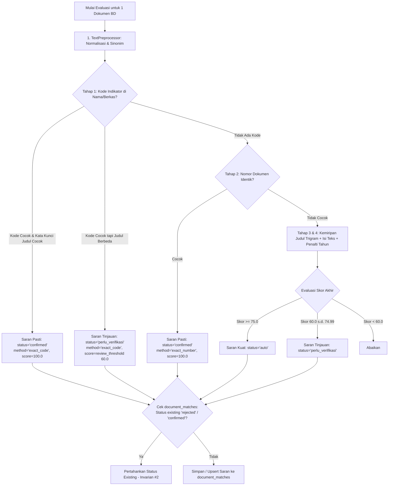

# Spesifikasi Algoritma Pencocokan (MATCHING_ALGORITHM.md)
## Sistem Matching Bukti Dukung ke Lembar Kerja (LK)

| Atribut | Nilai |
|---|---|
| Versi Dokumen | 2.0 |
| Tanggal | 16 November 2026 |
| Basis PRD | `PRD.md` Versi 2.0 |
| Basis Basis Data | `DATABASE.md` Versi 2.0 (Tabel `document_matches`, `document_lk_links`, `lk_evidence_items`) |
| Konfigurasi Ambang | `config('evidence.matching_suggest_threshold')` (75.0%) & `config('evidence.matching_review_threshold')` (60.0%) |

---

## 1. Peran Pencocokan Otomatis: Saran Verifikasi (Bukan Penentu Centang Matriks)

Algoritma Matching (`MatchingEngineService`) bertugas menganalisis kemiripan antara Dokumen Bukti Dukung (`evidence_documents`) terhadap **Item Bukti LK** (`lk_evidence_items`) dan **Indikator LK** (`lk_indicators`).

### Prinsip Kerja Utama:
1. **Hasil Pencocokan Hanya Berfungsi Sebagai Saran (*Advisory Suggestions*):**
   * Rekaman pada tabel `document_matches` **hanya merupakan saran indikator** untuk membantu Admin/Super Admin saat memeriksa pengajuan dokumen di **Antrean Verifikasi** (`VerificationQueuePage`).
   * Tabel `document_matches` **tidak menentukan tanda centang (✔) pada Matriks Monitor**. Tanda centang pada Matriks Monitor ditentukan murni oleh status persetujuan dokumen (`evidence_documents.approval_status = 'disetujui'`) dan tautan resmi pada tabel `document_lk_links` (`link_source` IN `'admin'`, `'drive_sync'`, `'backfill'`).
2. **Ambang Skor dari Konfigurasi (`config/evidence.php` & `.env`):**
   * Seluruh parameter ambang batas dibaca dari `config('evidence.*')` (bukan dari tabel `system_settings`):
     * **Ambang Saran Otomatis (`matching_suggest_threshold`):** Default `75.0` (env `MATCHING_SIMILARITY_THRESHOLD`). Skor $\ge 75.0$ menghasilkan saran berstatus `auto`.
     * **Ambang Tinjauan (`matching_review_threshold`):** Default `60.0` (env `MATCHING_REVIEW_THRESHOLD`). Skor $60.0\text{–}74.99$ menghasilkan saran berstatus `perlu_verifikasi`.
     * Skor $< 60.0$ diabaikan (tidak disimpan ke `document_matches`).
3. **Kekekalan Keputusan Penolakan Admin (MATCH-06, AC-11, Invarian #2):**
   * Jika suatu saran pada `document_matches` telah ditolak (`status = 'rejected'`), proses *re-matching* otomatis di masa mendatang **dilarang keras** menimpa atau membuat ulang pasangan `(document_id, indicator_id)` tersebut.
4. **Pendeteksi Kemiripan Antar-Dokumen (`DocumentSimilarityService`):**
   * Selain mencocokkan dokumen ke indikator LK, sistem menggunakan trigram & kemiripan judul/nomor untuk menampilkan maksimal 5 peringatan dokumen serupa saat pengguna mengisi formulir pengajuan baru, serta mencegah duplikasi berkas identik berbasis hash SHA-256 (`findIdenticalByHash`).

---

## 2. Struktur Objek yang Dicocokkan

```mermaid
graph LR
    subgraph Bukti Dukung (Source)
        BD[evidence_documents]
        BD --> NAMA[document_name]
        BD --> NO[document_number]
        BD --> TAHUN[year]
        BD --> FILE[original_filename]
        BD --> TEKS[extracted_text / OCR]
    end

    subgraph Target Saran Indikator
        ITEM[lk_evidence_items]
        IND[lk_indicators]
        LK[lembar_kerja]

        ITEM --> RES_NAME[resolved_name]
        IND --> KODE[code]
        IND --> URAIAN[title]
        LK --> PERIODE[period]
    end

    BD -.->|Evaluasi Deterministic & Heuristic| ITEM
    ITEM --> IND
    IND --> LK
    IND -.->|Disimpan sebagai Saran| DM[document_matches]
```

### 2.1 Resolusi Placeholder Tahun pada Item Bukti (`YearPlaceholderResolver`, AC-26)
Sebelum pencocokan dijalankan, placeholder tahun pada template item bukti diselesaikan menurut tahun periode LK (`lembar_kerja.period`):
* `[t]` ➔ Tahun periode LK berjalan (misal: `2026`).
* `[t-1]` ➔ Satu tahun sebelum periode LK berjalan (misal: `2025`).
* `[t-2]` ➔ Dua tahun sebelum periode LK berjalan (misal: `2024`).

Hasil resolusi disimpan pada kolom `lk_evidence_items.resolved_name`.

---

## 3. Pipeline Pencocokan Multi-Tahap



---

## 4. Rincian Logika Setiap Tahap

### 4.1 Tahap 0: Preprocessing & Normalisasi Teks (`TextPreprocessor`)
1. **Case Folding & Pembersihan Simbol:** Mengubah teks menjadi huruf kecil dan membersihkan karakter tanda baca non-alfanumerik kecuali pemisah kode/nomor surat (`/`, `-`, `.`).
2. **Ekspansi Sinonim Baku:** Menyelaraskan singkatan instansi (`sk` ➔ `surat keputusan`, `sop` ➔ `standar operasional prosedur`, `sp` ➔ `standar pelayanan`, `lke` ➔ `lembar kerja evaluasi`, `notulen` ➔ `notula`, `monev` ➔ `monitoring evaluasi`, `renja` ➔ `rencana kerja`, `renstra` ➔ `rencana strategis`).
3. **Stopwords Removal:** Menghapus kata hubung umum bahasa Indonesia pada pembandingan heuristik.

### 4.2 Tahap 1: Pencocokan Kode Indikator (`DeterministicMatchingRule::evaluateExactCode`)
1. Kode indikator minimal memiliki panjang yang valid ($\ge 3$ karakter) dan dicocokkan dengan batas kata (*word boundary*) terhadap `document_name` dan `original_filename`.
2. **Verifikasi Ganda Judul (*Dual Check*):**
   * Jika kode indikator cocok **dan** kata kunci judul indikator cocok minimal 2 kata (atau minimal 1 kata jika judul indikator hanya terdiri dari 1 kata kunci): menghasilkan `status = 'confirmed'`, `match_method = 'exact_code'`, `confidence_score = 100.0`.
   * Jika kode indikator cocok tetapi judul dokumen tidak memiliki irisan kata kunci yang cukup: menghasilkan `status = 'perlu_verifikasi'`, `match_method = 'exact_code'`, `confidence_score = config('evidence.matching_review_threshold', 60.0)`.

### 4.3 Tahap 2: Pencocokan Nomor Dokumen (`DeterministicMatchingRule::evaluateExactNumber`)
* Jika `document_number` terisi (minimal 5 karakter setelah normalisasi) dan tercantum utuh di dalam uraian indikator (`lk_indicators.title`) atau nama item bukti (`lk_evidence_items.resolved_name`), menghasilkan `status = 'confirmed'`, `match_method = 'exact_number'`, `confidence_score = 100.0`.

### 4.4 Tahap 3 & 4: Kemiripan Heuristik (`HeuristicMatchingRule`)
1. **Kemiripan Judul ($\text{Sim}_{\text{title}}$):** Dihitung menggunakan kombinasi Trigram Similarity (`TrigramSimilarity`) dan perbandingan token antara `document_name` terhadap `lk_indicators.title` serta `lk_evidence_items.resolved_name`.
2. **Kemiripan Isi Teks ($\text{Score}_{\text{content}}$):** Proporsi kata kunci indikator/item bukti yang ditemukan di dalam `extracted_text` (jika dokumen memiliki teks hasil ekstraksi/OCR).
3. **Pembobotan & Penalti Tahun:**
   $$\text{RawScore} = \left( 0.70 \times \text{Sim}_{\text{title}} \right) + \left( 0.30 \times \text{Score}_{\text{content}} \right)$$
   *(Jika `extracted_text` kosong, digunakan $\text{Sim}_{\text{title}}$ penuh).*
   Jika tahun dokumen (`evidence_documents.year`) berbeda dari tahun target item bukti/periode LK, skor dikurangi penalti **$-20.0$ poin**.
4. **Penentuan Status Saran Berdasarkan `config('evidence.*')`:**
   * $\text{FinalScore} \ge \text{config('evidence.matching\_suggest\_threshold', 75.0)}$ ➔ `status = 'auto'`
   * $\text{config('evidence.matching\_review\_threshold', 60.0)} \le \text{FinalScore} < 75.0$ ➔ `status = 'perlu_verifikasi'`
   * $\text{FinalScore} < 60.0$ ➔ Tidak disimpan.

---

## 5. Perlindungan Kekekalan Penolakan (`MatchingRepository`, Invarian #2)

Saat menyimpan kandidat saran ke `document_matches`, `MatchingRepository` memeriksa rekaman yang sudah ada untuk pasangan `(document_id, indicator_id)`:
* Apabila baris sudah berstatus `'rejected'` atau `'confirmed'`, worker otomatis **tidak akan pernah** menimpa baris tersebut (AC-11, AC-27).
* Ketika Admin menyetujui dokumen di `VerificationQueuePage`, Admin memilih satu atau lebih Lembar Kerja (LK) tujuan yang kemudian disimpan sebagai tautan resmi pada `document_lk_links` (`link_source = 'admin'`) dan mengubah `evidence_documents.approval_status` menjadi `'disetujui'`.
