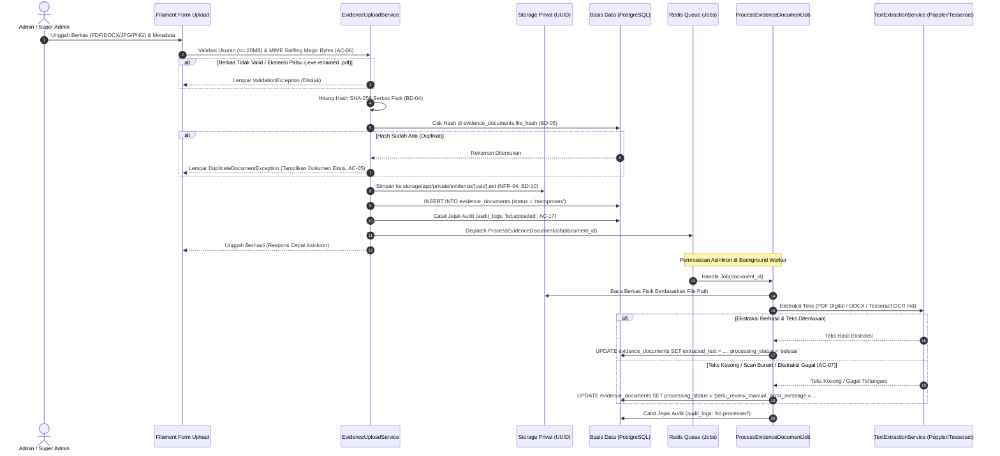

# Rencana Implementasi Teknis — Fase 4
## Bukti Dukung (BD) & Mesin Ekstraksi Teks (OCR/PDF)

| Parameter | Spesifikasi |
|---|---|
| **Fase Proyek** | Fase 4 dari 8 (Sesuai `Md/TASKS.md`, `Md/PRD.md`, `Md/DATABASE.md`, `Md/ARCHITECTURE.md`) |
| **Kriteria Penerimaan Terkait** | **AC-05** (Deduplikasi SHA-256), **AC-06** (Keamanan MIME Sniffing), **AC-07** (Ekstraksi scan/fallback `perlu_review_manual`), **AC-17** (Perekaman jejak audit mutasi) |
| **Kebutuhan Fungsional** | **BD-01** s.d. **BD-10**, **NFR-04** (Penyimpanan privat), **NFR-06** (Queue asinkron Redis) |
| **Pustaka & Perangkat Eksternal** | Poppler Utils (`pdftotext`, `pdftoppm`), Tesseract OCR v5 (`tessdata/ind`), `smalot/pdfparser`, Redis Queue |
| **Metodologi Pengujian** | Test-Driven Development (TDD) via PHPUnit 11 & Dummy Fixtures (Digital PDF, Image Scan, Fake EXE) |

---

## 1. Arsitektur & Alur Pemrosesan Berkas

---

## 2. Rincian Tugas Kerja (Work Breakdown Structure)

### TSK-401: Form Upload, Metadata & Validasi Keamanan Ketat (BD-01, BD-02, BD-03, BD-06, AC-06)
* **File Target:**
  - `app/Services/Evidence/EvidenceUploadService.php`
  - `app/Filament/Resources/EvidenceDocumentResource.php`
  - `app/Filament/Resources/EvidenceDocumentResource/Pages/CreateEvidenceDocument.php`
* **Spesifikasi Teknis & Logika:**
  - **Otorisasi Server-Side (BD-01, NFR-01):** Hanya role `super_admin` dan `admin` yang diizinkan mengunggah bukti dukung. Pengguna `pegawai` ditolak dengan `HTTP 403 Forbidden`.
  - **Metadata Input (BD-06):**
    * `document_name` (string, wajib, teks deskriptif dokumen).
    * `document_number` (string/null, opsional, nomor surat/SK/dokumen resmi).
    * `year` (integer, wajib, tahun penerbitan/kegiatan dokumen).
    * `document_type` (string/null, opsional, contoh: SK, SOP, Laporan, Form Evaluasi).
    * `external_link` (string/null, opsional, URL pendukung eksternal ber-skema `http://` atau `https://`).
  - **Batas Ukuran Berkas Dinamis (BD-02):** Mengambil batas dari `SystemSetting::get('upload.max_file_size_mb', 20)`. Jika berkas melebihi batas (default 20 MB = 20.971.520 bytes), tolak dengan pesan jelas.
  - **MIME Sniffing Berbasis Magic Bytes (BD-03, AC-06):**
    * Dilarang hanya membaca ekstensi string (`.pdf`, `.jpg`).
    * Gunakan fungsi PHP `finfo_file(FILEINFO_MIME_TYPE)` terhadap konten biner fisik berkas.
    * Format diizinkan murni:
      - PDF: `application/pdf`
      - DOCX: `application/vnd.openxmlformats-officedocument.wordprocessingml.document` (dan struktur ZIP dengan `[Content_Types].xml`)
      - JPEG: `image/jpeg`
      - PNG: `image/png`
    * Jika berkas `.exe`, skrip PHP, shell script, atau format lain di-rename menjadi `.pdf`, MIME sniffer mendeteksi sebagai `application/x-dosexec` atau `text/plain` dan langsung menolak dengan `ValidationException`.

---

### TSK-402: Deduplikasi SHA-256 & Proteksi Dokumen Ganda (BD-04, BD-05, AC-05)
* **File Target:**
  - `app/Services/Evidence/EvidenceUploadService.php`
  - `app/Exceptions/DuplicateDocumentException.php`
* **Spesifikasi Logika:**
  - Sebelum berkas disimpan secara permanen di basis data, sistem menghitung hash kriptografis SHA-256 (`hash_file('sha256', $filePath)`).
  - Melakukan pengecekan pada kolom `evidence_documents.file_hash` (memanfaatkan indeks unik `uq_documents_file_hash`).
  - **Jika Hash Sudah Ada (AC-05):**
    * Upload ditolak seketika tanpa membuat rekaman baru di tabel `evidence_documents`.
    * Sistem mengembalikan exception/respons berisi ID, nama, dan detail dokumen yang sudah ada di database.
    * Berkas sementara di direktori temporary langsung dihapus untuk mencegah penumpukan sampah disk.

---

### TSK-403: Penyimpanan Terisolasi (Private Storage) & Download Terproteksi (BD-10, NFR-04)
* **File Target:**
  - `config/filesystems.php` (menambahkan disk `private` atau path `storage/app/private/evidence`)
  - `app/Http/Controllers/EvidenceDownloadController.php`
  - `routes/web.php`
* **Spesifikasi Keamanan:**
  - Berkas fisik **dilarang keras** disimpan di direktori publik (`public/` atau symlink web publik).
  - Berkas disimpan di direktori privat: `storage/app/private/evidence/`.
  - Nama berkas fisik di disk di-generate secara acak menggunakan UUID v4 (`Str::uuid() . '.' . $extension`) untuk mencegah eksploitasi *Path Traversal* (`../`) dan *Direct Object Reference*.
  - Pemanggilan berkas untuk pengunduhan / pratinjau wajib melalui `EvidenceDownloadController` yang dilindungi middleware `auth`, `active`, dan otorisasi RBAC.

---

### TSK-404: Queue Worker & Pemrosesan Asinkron (MATCH-01, NFR-06)
* **File Target:**
  - `app/Jobs/ProcessEvidenceDocumentJob.php`
* **Spesifikasi Alur Job:**
  - Job mengimplementasikan `ShouldQueue` dan berjalan pada antrean Redis (`queue: default`).
  - Menerima parameter `document_id`.
  - Mengambil rekaman dokumen dari basis data. Jika dokumen sudah di-soft delete atau tidak ditemukan, hentikan dengan aman.
  - Memanggil `TextExtractionService`.
  - Memperbarui kolom `extracted_text` dan `processing_status`:
    * Jika teks berhasil diperoleh: status `selesai`.
    * Jika ekstraksi tidak menghasilkan teks / gagal tertangani: status `perlu_review_manual` (AC-07, BD-08).
  - Mencatat jejak audit `audit_logs` (`action = 'bd.processed'`).

---

### TSK-405: Ekstraksi Teks PDF Digital, DOCX & OCR Tesseract (BD-07, BD-08, A5, AC-07)
* **File Target:**
  - `app/Services/Evidence/TextExtractionService.php`
  - `app/Services/Evidence/Extractors/PdfTextExtractor.php`
  - `app/Services/Evidence/Extractors/DocxTextExtractor.php`
  - `app/Services/Evidence/Extractors/TesseractOcrExtractor.php`
* **Spesifikasi Mesin Ekstraksi:**
  1. **PDF Digital:**
     * Ekstraksi teks native menggunakan Poppler `pdftotext` (atau `smalot/pdfparser` sebagai fallback).
     * Jika teks yang dihasilkan memenuhi batas minimal (misal > 30 karakter bermakna), simpan hasil ekstraksi.
  2. **DOCX (Microsoft Word):**
     * Ekstraksi teks dari struktur ZIP XML internal (`word/document.xml`) tanpa memerlukan LibreOffice/MS Word.
  3. **Dokumen Gambar (JPG/PNG) & PDF Scan (Raster):**
     * Jika berkas berupa gambar murni (JPG, PNG), jalankan Tesseract OCR dengan bahasa Indonesia (`tesseract {image} stdout -l ind`).
     * Jika berkas PDF menghasilkan teks digital kosong / scan, konversikan halaman pertama PDF menjadi gambar PNG via Poppler `pdftoppm -png -r 150 -f 1 -l 2` lalu jalankan Tesseract OCR.
  4. **Fallback & Graceful Degradation (BD-08, AC-07):**
     * Jika berkas merupakan scan buram, kosong total, atau OCR tidak menghasilkan teks yang dapat dikenali, sistem **dilarang melempar error 500**.
     * Simpan status dokumen sebagai `perlu_review_manual` dengan `error_message = 'Teks tidak dapat diekstrak secara otomatis. Memerlukan peninjauan manual.'`.

---

### Manajemen UI Filament (EvidenceDocumentResource) (BD-01, BD-06, BD-09)
* **File Target:**
  - `app/Filament/Resources/EvidenceDocumentResource.php`
  - `app/Filament/Resources/EvidenceDocumentResource/Pages/ListEvidenceDocuments.php`
  - `app/Filament/Resources/EvidenceDocumentResource/Pages/CreateEvidenceDocument.php`
  - `app/Filament/Resources/EvidenceDocumentResource/Pages/ViewEvidenceDocument.php`
* **Spesifikasi Antarmuka:**
  - **Tabel Daftar Dokumen:** Menampilkan nama dokumen, nomor dokumen, tahun, jenis dokumen, ukuran berkas (terformat KB/MB), status pemrosesan (`Badge`: hijau untuk 'selesai', kuning untuk 'perlu_review_manual', abu-abu untuk 'memproses', merah untuk 'gagal'), dan waktu upload.
  - **Aksi Unduh Berkas:** Tombol aman untuk mengunduh berkas fisik lewat controller privat.
  - **Aksi Soft Delete Terproteksi (BD-09):** Tombol hapus hanya aktif untuk Super Admin. Hapus menggunakan Soft Deletes (`deleted_at`), menyembunyikan dokumen dan relasinya dari tampilan operasional.

---

## 3. Rencana Pengujian Otomatis (TDD Test Suite)

Pengujian akan disusun pada file `tests/Feature/Phase4EvidenceDocumentTest.php` mencakup skenario:

1. `test_admin_and_super_admin_can_upload_evidence_document()` (BD-01)
2. `test_pegawai_cannot_upload_evidence_document_returns_403()` (NFR-01, AC-01)
3. `test_upload_file_exceeding_max_size_is_rejected()` (BD-02)
4. `test_upload_renamed_exe_to_pdf_is_rejected_by_mime_sniffing()` (BD-03, AC-06)
5. `test_upload_identical_file_twice_is_rejected_as_duplicate()` (BD-04, BD-05, AC-05)
6. `test_uploaded_file_is_stored_with_uuid_in_private_storage()` (BD-10, NFR-04)
7. `test_process_job_extracts_digital_pdf_text_successfully()` (BD-07)
8. `test_process_job_extracts_docx_text_successfully()` (BD-07)
9. `test_process_job_runs_ocr_on_image_file()` (BD-07, A5)
10. `test_blank_or_unextractable_document_sets_status_to_perlu_review_manual_without_500()` (BD-08, AC-07)
11. `test_evidence_document_upload_and_mutations_are_logged_to_audit_logs()` (AC-17)
12. `test_super_admin_can_soft_delete_evidence_document_and_admin_cannot()` (BD-09)
13. `test_evidence_file_download_is_protected_by_authorization()` (BD-10)

---

## 4. Gerbang Verifikasi (Verification Gate 4)

Fase 4 dinyatakan **Selesai & Lulus** jika:
* [ ] Seluruh pengujian di `tests/Feature/Phase4EvidenceDocumentTest.php` berjalan **PASS 100%**.
* [ ] Berkas `.exe` yang diubah ekstensi menjadi `.pdf` terbukti ditolak oleh validasi MIME sniffing (AC-06).
* [ ] Mengunggah berkas yang sama dua kali terbukti ditolak sebagai duplikat dan tidak menggandakan rekaman (AC-05).
* [ ] Berkas scan/tanpa teks tersimpan dengan status `perlu_review_manual` tanpa kegagalan error 500 (AC-07).
* [ ] Seluruh mutasi upload dan pemrosesan tercatat pada tabel `audit_logs` (AC-17).
* [ ] Berkas fisik tersimpan aman di direktori privat server dengan penamaan UUID acak (BD-10).

