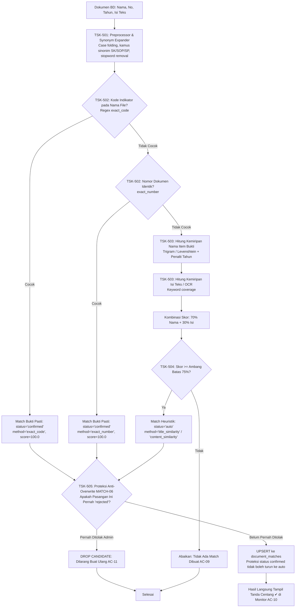

# Rencana Implementasi Teknis — Fase 5
## Mesin Algoritma Matching (Matching Engine)

| Parameter | Spesifikasi |
|---|---|
| **Fase Proyek** | Fase 5 dari 8 (Sesuai `Md/TASKS.md`, `Md/PRD.md`, `Md/MATCHING_ALGORITHM.md`, `Md/DATABASE.md`) |
| **Kriteria Penerimaan Terkait** | **AC-08** (Centang pada kolom LK yang cocok), **AC-09** (Dokumen tanpa kecocokan kosong murni), **AC-10** (Status `auto` >= 75% langsung tampil ✔), **AC-11** (Kekekalan penolakan admin / Anti-Overwrite `rejected`), **AC-26** (Resolusi placeholder tahun pada item bukti), **AC-27** (Re-matching otomatis) |
| **Kebutuhan Fungsional** | **MATCH-01** s.d. **MATCH-11**, **MON-02** (Centang langsung tampil), **D1** (Matching ke Item Bukti), **D2** (Status auto langsung aktif) |
| **Pustaka & Algoritma** | PostgreSQL `pg_trgm`, Kamus Sinonim Perkantoran, Token Trigram & Levenshtein Distance, Keyword Coverage |
| **Metodologi Pengujian** | Test-Driven Development (TDD) via PHPUnit 11 |

---

## 1. Arsitektur & Pipeline Matching Multi-Tahap



---

## 2. Rincian Tugas Kerja (Work Breakdown Structure)

### TSK-501: Preprocessor & Synonym Normalizer (MATCHING_ALGORITHM.md Bab 4.1)
* **File Target:**
  - `app/Services/Matching/TextPreprocessor.php`
* **Spesifikasi Teknis:**
  - **Normalisasi Dasar:** *Case folding* (huruf kecil), normalisasi spasi putih ganda, pembersihan tanda baca asing dengan tetap mempertahankan pemisah nomor/kode (`.`, `-`, `/`).
  - **Ekspansi Sinonim Istilah Baku:**
    * `sk` ➔ `surat keputusan`
    * `sop` ➔ `standar operasional prosedur`
    * `sp` ➔ `standar pelayanan`
    * `lke` ➔ `lembar kerja evaluasi`
    * `notulen` ➔ `notula`
    * `monev` ➔ `monitoring evaluasi`
    * `renja` ➔ `rencana kerja`
    * `renstra` ➔ `rencana strategis`
  - **Penyaringan Stopwords:** Menghapus kata hubung/tugas umum bahasa Indonesia (`dan`, `atau`, `yang`, `untuk`, `pada`, `ke`, `di`, `tentang`, `terkait`) khusus pada komparasi kemiripan heuristik.

---

### TSK-502: Rule Deterministic (Kode & Nomor Dokumen) (MATCH-03)
* **File Target:**
  - `app/Services/Matching/Rules/DeterministicMatchingRule.php`
  - `app/Services/Matching/DTOs/MatchCandidate.php`
* **Spesifikasi Teknis:**
  1. **Aturan `exact_code` (Tahap 1):**
     - Mengekstrak pola kode dari `original_filename` atau `document_name` menggunakan regex:
       `/(?:^|[\[\(\s_])([A-Za-z0-9]+(?:\.[A-Za-z0-9]+)+|[A-Z]{1,2}[0-9]+[a-z]?)(?:[\]\)\s_\.\-]|\b)/i`
     - Menyamakan dengan `lk_indicators.code` pada LK periode aktif.
     - Jika cocok: `confidence_score = 100.0`, `status = 'confirmed'`, `match_method = 'exact_code'`.
  2. **Aturan `exact_number` (Tahap 2):**
     - Jika bukti dukung memiliki `document_number`, bersihkan spasi berlebih dan cocokkan terhadap `lk_indicators.title` atau `lk_evidence_items.resolved_name`.
     - Jika cocok persis: `confidence_score = 100.0`, `status = 'confirmed'`, `match_method = 'exact_number'`.

---

### TSK-503: Rule Heuristic (Trigram & Keyword Similarity) (MATCH-03, MATCH-10)
* **File Target:**
  - `app/Services/Matching/Rules/HeuristicMatchingRule.php`
  - `app/Services/Matching/Similarity/TrigramSimilarity.php`
* **Spesifikasi Teknis:**
  1. **Kemiripan Nama Item Bukti (`title_similarity`):**
     - Mengomputasikan kemiripan teks antara `evidence_documents.document_name` dengan `lk_evidence_items.resolved_name` menggunakan Trigram Similarity dan Levenshtein distance.
     - **Penalti Perbedaan Tahun:** Jika tahun dokumen (`year`) berbeda dengan tahun item bukti / periode LK, skor dikurangi penalti sebesar `-20.0` poin.
  2. **Kemiripan Isi Teks / Ekstraksi OCR (`content_similarity`):**
     - Jika dokumen memiliki `extracted_text`, lakukan ekstraksi kata kunci dari `resolved_name` dan `lk_indicators.title`.
     - Hitung rasio kemunculan kata kunci pada isi teks: `Score_content = (kata_kunci_ditemukan / total_kata_kunci) * 100`.
  3. **Pembobotan Akhir:**
     - Jika ada teks ekstraksi: $\text{FinalScore} = (0.70 \times \text{Score}_{\text{title}}) + (0.30 \times \text{Score}_{\text{content}})$.
     - Jika tanpa teks ekstraksi: $\text{FinalScore} = \text{Score}_{\text{title}}$.

---

### TSK-504: Evaluasi Ambang Batas & Status Match Auto (D2, MATCH-03, MON-02, AC-10)
* **File Target:**
  - `app/Services/Matching/MatchingEngineService.php`
* **Spesifikasi Teknis:**
  - Ambang batas diambil dinamis dari `SystemSetting::get('matching.similarity_threshold', 75.0)`.
  - Jika $\text{FinalScore} \ge \text{Ambang Batas}$:
    - Membentuk kandidat match berstatus `'auto'`, `confidence_score = FinalScore`.
    - Menyimpan alasan kecocokan (`match_reasons`): daftar kata kunci cocok dan rincian skor.
    - Sesuai prinsip **D2 & MON-02**, status `auto` langsung menghasilkan centang (✔) di monitor tanpa menunggu konfirmasi admin.
  - Jika $\text{FinalScore} < \text{Ambang Batas}$:
    - Tidak ada relasi yang dibuat (sel di monitor tetap kosong murni - AC-09).

---

### TSK-505: Mekanisme Anti-Overwrite Rejection (MATCH-06, AC-11)
* **File Target:**
  - `app/Services/Matching/MatchingRepository.php`
* **Spesifikasi Teknis:**
  - Menerapkan query penyimpanan UPSERT PostgreSQL yang tunduk pada aturan invarian:
    ```sql
    INSERT INTO document_matches (document_id, indicator_id, matched_item_id, status, match_method, confidence_score, match_reasons)
    VALUES (...)
    ON CONFLICT (document_id, indicator_id) DO UPDATE
    SET 
        matched_item_id = EXCLUDED.matched_item_id,
        confidence_score = EXCLUDED.confidence_score,
        match_reasons = EXCLUDED.match_reasons,
        updated_at = CURRENT_TIMESTAMP
    WHERE document_matches.status NOT IN ('rejected', 'confirmed');
    ```
  - **Invarian 1 (AC-11):** Pasangan `(document_id, indicator_id)` yang berstatus `'rejected'` **dilarang keras** diubah kembali menjadi `'auto'` oleh matching engine.
  - **Invarian 2:** Pasangan yang berstatus `'confirmed'` **dilarang diturunkan derajatnya** menjadi `'auto'`.

---

### TSK-506: Job Re-matching Otomatis & Trigger Integrasi (MATCH-07, AC-27)
* **File Target:**
  - `app/Jobs/RematchActiveDocumentsJob.php`
  - `app/Jobs/ProcessEvidenceDocumentJob.php` (integrasi pemicu pasca-ekstraksi teks)
* **Spesifikasi Teknis:**
  - `RematchActiveDocumentsJob` menerima parameter opsional `lk_id` atau `document_id`.
  - Ketika indikator LK diperbarui/diimpor, job ini dipicu untuk mengevaluasi seluruh dokumen bukti aktif terhadap indikator yang berubah.
  - Saat job `ProcessEvidenceDocumentJob` selesai mengekstrak teks suatu dokumen, otomatis memicu matching pipeline untuk dokumen tersebut.

---

## 3. Rencana Pengujian Otomatis (TDD Test Suite)

Pengujian akan disusun pada file `tests/Feature/Phase5MatchingEngineTest.php` mencakup skenario:

1. `test_text_preprocessor_normalizes_text_and_expands_synonyms()` (TSK-501)
2. `test_deterministic_rule_matches_exact_code_in_filename_as_confirmed()` (TSK-502, MATCH-03)
3. `test_deterministic_rule_matches_exact_document_number_as_confirmed()` (TSK-502, MATCH-03)
4. `test_heuristic_rule_computes_title_and_content_similarity_with_year_penalty()` (TSK-503)
5. `test_matching_score_above_threshold_creates_auto_match_with_reasons()` (TSK-504, AC-10)
6. `test_matching_score_below_threshold_does_not_create_match()` (TSK-504, AC-09)
7. `test_rejected_match_is_never_overwritten_by_rematching_worker()` (TSK-505, MATCH-06, AC-11)
8. `test_confirmed_match_is_never_demoted_to_auto_by_rematching()` (TSK-505)
9. `test_rematch_active_documents_job_matches_all_eligible_documents()` (TSK-506, MATCH-07, AC-27)
10. `test_process_evidence_document_job_triggers_matching_pipeline_automatically()` (MATCH-01)
11. `test_document_matching_against_multiple_lks_creates_multiple_matches()` (AC-08)

---

## 4. Gerbang Verifikasi (Verification Gate 5)

Fase 5 dinyatakan **Selesai & Lulus** jika:
* [ ] Seluruh pengujian di `tests/Feature/Phase5MatchingEngineTest.php` berjalan **PASS 100%**.
* [ ] Dokumen dengan nama file `1.2.a SOP.pdf` terbukti otomatis berstatus `confirmed` pada indikator `1.2.a`.
* [ ] Dokumen dengan kemiripan heuristik >= 75% terbukti berstatus `auto` beserta rincian alasan kecocokan (`match_reasons`) (AC-10).
* [ ] Dokumen yang pernah ditolak admin (`status = 'rejected'`) terbukti kebal terhadap penimpaan saat matching ulang dijalankan (AC-11).
* [ ] Seluruh 52+ pengujian (Fase 1 s.d. Fase 5) berjalan hijau (*all green*).

