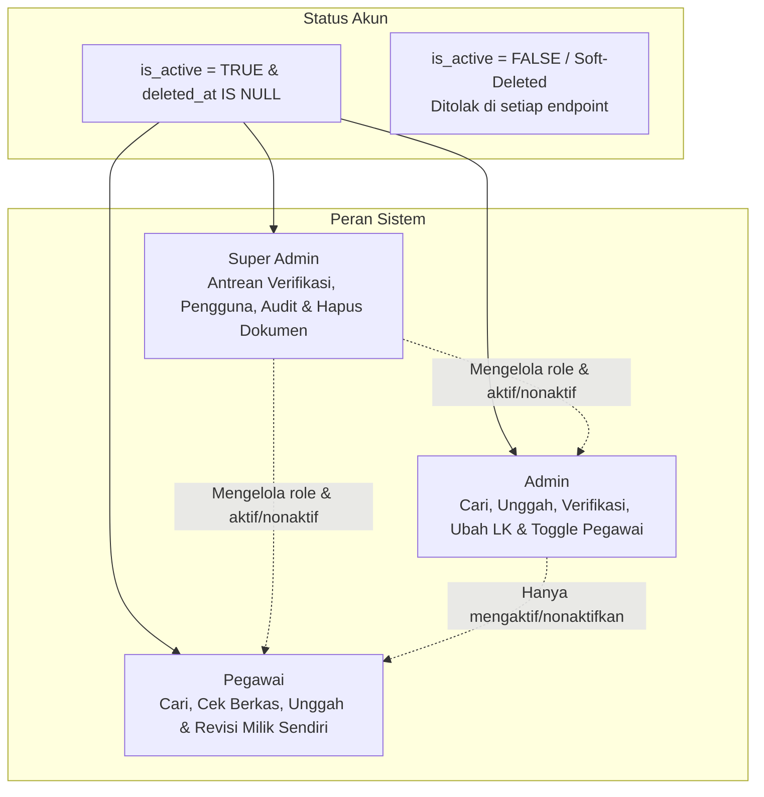

# Spesifikasi Kontrol Akses Berbasis Peran (RBAC.md)
## Perpustakaan Bukti Dukung BPS Kabupaten Tegal (ELKA)

| Atribut | Nilai |
|---|---|
| Versi Dokumen | 3.0 |
| Tanggal | 17 November 2026 |
| Basis PRD | `PRD.md` Versi 3.0 |
| Basis Basis Data | `DATABASE.md` Versi 3.0 (`users`, `evidence_documents`, `document_lk_links`, `audit_logs`) |
| Prinsip Utama | *Defense in Depth*, *Least Privilege*, *Server-Side Strict Enforcement* (`NFR-01`) |

---

## 1. Pendahuluan & Prinsip Keamanan

Pengamanan hak akses pada **ELKA** **wajib ditegakkan di sisi server** pada setiap *request*, controller, halaman Filament/Livewire, dan Policy. Menyembunyikan menu atau tombol di tampilan hanyalah kemudahan navigasi, bukan batas keamanan.

### 1.1 Menu & Kewenangan Tepat per Peran
1. **Pegawai (`pegawai`) — HANYA 2 Menu (*Cari Dokumen* & *Unggah Bukti*):**
   * Diarahkan pasca-login ke `/admin/cari-dokumen`.
   * Dapat mencari dokumen `'disetujui'`, melihat matriks 6 LK, mengklik centang untuk mengunduh/membuka tautan, memakai **Cek Berkas Sebelum Unggah**, mengajukan dokumen/tautan baru (wajib $\ge 1$ usul LK), serta melihat dan merevisi pengajuan miliknya sendiri saat status `'revisi'`.
2. **Admin (`admin`) — HANYA 3 Menu (*Cari Dokumen*, *Unggah Bukti*, & *Antrean Verifikasi*):**
   * Diarahkan pasca-login ke `/admin/cari-dokumen`.
   * Memiliki kewenangan Pegawai, ditambah kemampuan memverifikasi pengajuan di **Antrean Verifikasi** (`VerificationQueuePage`), mengubah LK dokumen `'disetujui'` langsung dari hasil **Cari Dokumen** (`evidence.manage_markup`), dan mengaktifkan/menonaktifkan akun ber-role `pegawai`.
   * Admin **tidak** melihat banner peringatan storage di Antrean Verifikasi.
3. **Super Admin (`super_admin`) — HANYA 3 Menu (*Antrean Verifikasi*, *Manajemen Pengguna*, & *Jejak Audit*):**
   * Diarahkan pasca-login ke `/admin/verification-queue`.
   * Memverifikasi pengajuan di **Antrean Verifikasi** (dan melihat banner peringatan kapasitas disk $\ge 80\%$ khusus Super Admin), mengelola akun pengguna & mengubah role (`Pegawai ↔ Admin`) di `UserResource`, memantau & mengekspor **Jejak Audit** di `AuditLogResource`, serta satu-satunya peran yang berwenang melakukan *soft-delete* dokumen (`evidence.delete`).
   * **Ditolak HTTP 403** apabila mengakses `/admin/cari-dokumen` maupun `/admin/evidence-documents` (menu Unggah Bukti disembunyikan dan diblokir di `EvidenceDocumentPolicy::viewAny`).

---

## 2. Definisi Peran & Hierarki

---

## 3. Matriks Izin Granular (`User::hasPermission`)

Sesuai implementasi aktual pada `App\Models\User::hasPermission(string $permission): bool`:

| Kode Permission | Deskripsi Aksi | Super Admin | Admin | Pegawai |
|---|---|:---:|:---:|:---:|
| `monitor.view` | Izin membaca data matriks dokumen resmi x 6 LK | ✔ | ✔ | ✔ |
| `evidence.view_link` | Mengakses endpoint unduhan `/evidence/download/{id}` (dengan validasi `EvidenceDocumentPolicy::view`) | ✔ | ✔ | ✔ |
| `evidence.search` | Mengakses halaman **Cari Dokumen** (`CariDokumenPage`) & **Cek Berkas** | ✘ | ✔ | ✔ |
| `evidence.upload` | Mengakses menu & halaman **Unggah Bukti** (`EvidenceDocumentResource`) serta mengunggah berkas/tautan | ✘ | ✔ | ✔ |
| `evidence.revise_own` | Merevisi pengajuan bukti dukung milik sendiri yang berstatus `'revisi'` | ✘ | ✘ | ✔ |
| `evidence.verify` | Mengakses **Antrean Verifikasi** (`VerificationQueuePage`) & memutus pengajuan | ✔ | ✔ | ✘ |
| `evidence.manage_markup` | Mengubah pemetaan LK resmi dokumen dari hasil Cari Dokumen | ✔ | ✔ | ✘ |
| `evidence.delete` | Melakukan *soft-delete* dokumen bukti dukung | ✔ | ✘ | ✘ |
| `audit.view` | Melihat & mengekspor riwayat jejak audit (`AuditLogResource`) | ✔ | ✘ | ✘ |
| `user.manage` | Mengelola akun pengguna dan mengubah role di `UserResource` | ✔ | ✘ | ✘ |

> **Catatan:** Seluruh izin lama terkait sinkronisasi Google Drive dan CRUD Master LK/Indikator telah dihapus dari `User::hasPermission`.

---

## 4. Kebijakan Dokumen (`EvidenceDocumentPolicy`) & Unduhan Aman

1. **`viewAny(User $user)`:**
   * `$this->isActiveUser($user) && $user->hasPermission('evidence.upload')`.
   * Pegawai dan Admin diizinkan (`true`); Super Admin ditolak (`false`, HTTP 403 di `/admin/evidence-documents`).
2. **`view(User $user, EvidenceDocument $doc)` & `GET /evidence/download/{id}`:**
   * Pengguna wajib aktif dan memiliki `evidence.view_link`. Dokumen *soft-deleted* selalu mengembalikan **HTTP 404**.
   * Super Admin, Admin, dan pemegang `evidence.verify` dapat melihat/mengunduh dokumen aktif pada status apa pun.
   * Pegawai hanya dapat melihat/mengunduh jika `approval_status === 'disetujui'` **atau** `uploaded_by === $user->id`. Dokumen milik orang lain yang belum disetujui ditolak **HTTP 403**.
3. **`create(User $user)`:** Wajib aktif dan memiliki `evidence.upload` (Pegawai & Admin).
4. **`update(User $user, EvidenceDocument $doc)`:**
   * Pemegang `evidence.verify` atau `evidence.manage_markup`, **atau** pemilik asli (`uploaded_by === $user->id`) saat `approval_status === 'revisi'`.
   * Di tabel `EvidenceDocumentResource`, tombol **Revisi** hanya ditampilkan untuk pengunggah asli saat `approval_status === 'revisi'`.
5. **`delete(User $user, EvidenceDocument $doc)`:** Hanya pemegang `evidence.delete` (**Super Admin**).

---

## 5. Autentikasi, Redirect Peran, & Perlindungan Sesi

1. **Abstraksi SSO (`SSOProviderInterface`):** `BpsKeycloakOidcProvider` untuk produksi/VPN BPS, dan `MockSSOProvider` + `/auth/sso/mock-login` khusus lingkungan `local`/`testing` (`404` di `production`).
2. **Redirect Pasca-Login (`User::homeUrl()`):**
   * `super_admin` ➔ `'/admin/verification-queue'`
   * `admin` & `pegawai` ➔ `'/admin/cari-dokumen'`
   * Diterapkan seragam di `LoginController`, `SSOController`, `ForceChangePasswordController`, rute `/` (`routes/web.php`), `AdminPanelProvider::homeUrl()`, dan `Dashboard::mount()` (`/admin`).
3. **Karantina Password Awal & Pencabutan Sesi Seketika:**
   * `EnsurePasswordChanged` menahan akun dengan `must_change_password = true` di `/auth/password/change`.
   * `EnsureAccountIsActive` memutus sesi akun yang dinonaktifkan (`is_active = false`) secara langsung (**HTTP 403**).
   * `UserPolicy`, `UserManagerService`, dan trigger PostgreSQL melindungi satu-satunya Super Admin aktif terakhir (Invarian #4).

---

## 6. Pemetaan Rute Web & Halaman Panel Aktual

| Rute / Halaman | Pengendali / Halaman | Penegakan Sisi Server | Peran Diizinkan |
|---|---|---|---|
| `GET /` | `routes/web.php` | Redirect `$user->homeUrl()` jika login; tampil `auth.login` jika tamu | Publik / Terautentikasi |
| `GET/POST /login`, `POST /logout` | `LoginController` | Rate limiter (5x/15m), tolak `pegawai` di form lokal (`AUTH-11`) | Semua (SSO), SA/Admin (lokal) |
| `GET /auth/sso/login`, `/callback` | `SSOController` | Tolak `mock_user` di luar `local`/`testing` atau driver non-`mock` | Pegawai, Admin |
| `GET /auth/sso/mock-login` | `SSOController::mockLogin` | HTTP 404 di luar `local`/`testing` | Uji lokal/otomatis |
| `GET/POST /auth/password/change` | `ForceChangePasswordController` | Middleware `auth` | Akun dengan `must_change_password = true` |
| `POST /evidence/upload` | `EvidenceController::upload` | `auth` + `evidence.upload` | Admin, Pegawai |
| `GET /evidence/download/{id}` | `EvidenceController::download` | `auth` + `evidence.view_link` + `EvidenceDocumentPolicy::view` | Sesuai policy dokumen |
| `DELETE /evidence/{id}` | `EvidenceController::destroy` | `auth` + `isSuperAdmin()` (`evidence.delete`) | Super Admin |
| `/admin` | `Dashboard::mount()` | Redirect ke `Auth::user()?->homeUrl() ?? '/login'` | Semua user aktif |
| `/admin/cari-dokumen` | `CariDokumenPage` | `canAccess()` (`role !== 'super_admin' && evidence.search`) | Admin, Pegawai (SA = 403) |
| `/admin/evidence-documents*` | `EvidenceDocumentResource` | `EvidenceDocumentPolicy` (`viewAny` cek `evidence.upload`) | Admin, Pegawai (SA = 403) |
| `/admin/verification-queue` | `VerificationQueuePage` | `canAccess()` (`evidence.verify`); banner storage khusus SA | Super Admin, Admin (Pegawai = 403) |
| `/admin/users` | `UserResource` | `UserPolicy::viewAny` (`user.manage`) | Super Admin |
| `/admin/audit-logs` | `AuditLogResource` | `AuditLogPolicy::viewAny` (`audit.view`) | Super Admin |
