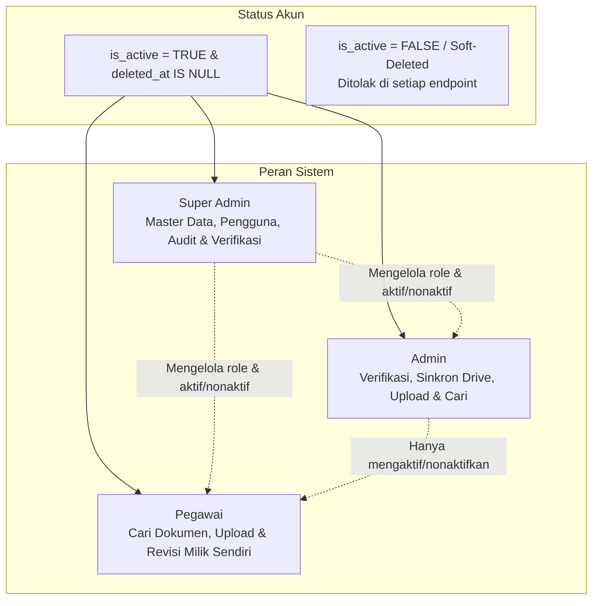

# Spesifikasi Kontrol Akses Berbasis Peran (RBAC.md)
## Sistem Matching Bukti Dukung ke Lembar Kerja (LK)

| Atribut | Nilai |
|---|---|
| Versi Dokumen | 2.0 |
| Tanggal | 16 November 2026 |
| Basis PRD | `PRD.md` Versi 2.0 |
| Basis Basis Data | `DATABASE.md` Versi 2.0 (Tabel `users`, `evidence_documents`, `document_lk_links`, `audit_logs`) |
| Prinsip Utama | *Defense in Depth*, *Least Privilege*, *Server-Side Strict Enforcement* (NFR-01) |

---

## 1. Pendahuluan & Prinsip Keamanan

Dokumen ini mengatur arsitektur Autentikasi dan Otorisasi (RBAC) untuk aplikasi Websinkronisasi (ELKA). Menjawab kebutuhan **NFR-01**, pengamanan hak akses **wajib ditegakkan di sisi server** pada setiap *request*, controller, halaman Filament/Livewire, dan Policy. Menyembunyikan tombol atau menu di sisi klien **bukan** merupakan mekanisme pengamanan, melainkan sekadar kenyamanan tampilan (*UX affordance*).

### 1.1 Prinsip-Prinsip Desain RBAC:
1. **Least Privilege (Hak Akses Terarah Sesuai Peran):** Pengguna hanya diberi wewenang yang sesuai dengan tanggung jawab operasionalnya:
   * **Pegawai:** Mencari dokumen yang sudah disetujui (`CariDokumenPage`), mengunggah/mengajukan bukti dukung baru (berkas maks 50 MB atau tautan), melihat dan merevisi pengajuan miliknya sendiri saat diminta revisi (`approval_status = 'revisi'`), melihat Matriks Monitor, serta mengunduh dokumen yang telah disetujui atau pengajuan miliknya sendiri.
   * **Admin:** Menjalankan seluruh fungsi operasional Pegawai ditambah memverifikasi pengajuan di Antrean Verifikasi (`VerificationQueuePage`), mengelola tautan Google Drive indikator LK, serta mengelola dan menyinkronkan folder Google Drive (`drive.sync`).
   * **Super Admin:** Mengelola master Lembar Kerja, profil & impor Excel, indikator LK, manajemen pengguna/role, jejak audit (`AuditLogResource`), menghapus dokumen bukti dukung (`evidence.delete`), serta ikut memverifikasi di Antrean Verifikasi (`evidence.verify`). Super Admin **tidak** mengunggah bukti dukung, **tidak** membuka halaman Cari Dokumen (`evidence.search`), dan **tidak** menjalankan sinkronisasi Google Drive (`drive.sync`).
2. **Server-Side Active Session Check (AUTH-07, AC-15, AC-18):** Status keaktifan akun (`is_active`) dan `deleted_at IS NULL` wajib diperiksa di sisi server pada setiap permintaan melalui `EnsureAccountIsActive`. Akun yang dinonaktifkan segera diputus sesinya seketika.
3. **Portal Tunggal Terpadu (*Unified Single Portal* — AUTH-01, AUTH-03, AUTH-11, D6, D7):**
   * Aplikasi menggunakan satu portal login di rute `/login`.
   * **Opsi 1 (SSO BPS):** Pegawai dan Admin BPS masuk via SSO Keycloak BPS (`BpsKeycloakOidcProvider`, atau `MockSSOProvider` pada lingkungan `local`/`testing`).
   * **Opsi 2 (Formulir Lokal):** Khusus Super Admin (dan akun pengelola lokal) masuk via kredensial lokal. Akun Super Admin awal hasil seeder wajib mengganti password saat login pertama (`must_change_password = true`, Invarian #8).
   * **Penegakan AUTH-11:** Akun ber-role `pegawai` dilarang login melalui formulir password lokal.
4. **Pencegahan Kunci Diri / Self-Lockout (AUTH-06, AC-04, Invarian #4):** Sistem secara absolut menolak penonaktifan, penghapusan, atau penurunan role dari satu-satunya Super Admin aktif yang tersisa, serta menolak pengguna menonaktifkan akunnya sendiri.
5. **Auditability (AUDIT-01, AUDIT-02, Invarian #5):** Setiap peristiwa keamanan dan mutasi data (login, logout, pergantian role, aktivasi/penonaktifan akun, unggah/revisi/verifikasi/hapus dokumen, impor LK) wajib dicatat secara *append-only* dalam tabel `audit_logs`.

---

## 2. Definisi Peran (Roles) & Hierarki

Sistem membagi pengguna ke dalam 3 peran (*role*) diskret dan 1 status pembekuan akun:

### 2.1 Rincian Karakteristik Peran

| Peran (`role`) | Deskripsi & Batas Kewenangan | Metode Autentikasi | Sumber Pembuatan Akun |
|---|---|---|---|
| **Super Admin** (`super_admin`) | Pengelola sistem, master LK, profil impor Excel, pengguna, dan audit log. Ikut memiliki akses ke Antrean Verifikasi (`evidence.verify`) dan berhak melakukan soft-delete dokumen (`evidence.delete`). **Tidak mengunggah bukti dukung, tidak membuka halaman Cari Dokumen, dan tidak menjalankan sinkronisasi Google Drive.** | Kredensial lokal (`SuperAdminSeeder`) / SSO | Seeder awal (lokal) atau promosi oleh Super Admin lain |
| **Admin** (`admin`) | Verifikator dan operator harian. Berwenang memverifikasi pengajuan di Antrean Verifikasi (setujui + pilih LK resmi, minta revisi, atau tolak), menjalankan sinkronisasi baca-saja Google Drive, mengatur tautan Drive indikator LK, mencari dokumen, mengunggah bukti dukung, dan mengaktifkan/menonaktifkan akun Pegawai. | SSO Kantor / Lokal | Dipromosikan oleh Super Admin |
| **Pegawai** (`pegawai`) | Pengguna operasional kantor. Berwenang mencari dokumen yang sudah disetujui (`CariDokumenPage`), mengunggah berkas bukti dukung (maks 50 MB) atau mengirim tautan eksternal beserta usulan LK (`proposed`), merevisi pengajuan miliknya sendiri yang berstatus `revisi`, melihat Matriks Monitor, dan mengunduh dokumen resmi. | SSO Kantor | *Auto-provisioning* otomatis saat login pertama via SSO (AUTH-10, AC-21) |
| **Akun Nonaktif** (`is_active = false`) | Status pembekuan akun. Tidak dapat login, sesi aktif diputus seketika, dan seluruh pemanggilan endpoint ditolak dengan HTTP 403 (AUTH-07, AC-15, AC-18). | - | Dibekukan oleh Admin (khusus Pegawai) atau Super Admin (semua role kecuali Super Admin aktif terakhir) |

---

## 3. Matriks Izin Granular (`User::hasPermission`)

Seluruh pengecekan izin granular diimplementasikan di `App\Models\User::hasPermission(string $permission): bool`. Berikut matriks izin resmi sesuai kode aktual:

| Kode Permission | Deskripsi Aksi | Super Admin | Admin | Pegawai |
|---|---|:---:|:---:|:---:|
| `monitor.view` | Melihat halaman Matriks Monitor Dokumen x LK & ekspor CSV | ✔ | ✔ | ✔ |
| `evidence.view_link` | Mengakses tautan bukti / endpoint unduhan dokumen (dengan validasi `EvidenceDocumentPolicy::view`) | ✔ | ✔ | ✔ |
| `evidence.search` | Membuka halaman Cari Dokumen (`CariDokumenPage`) & mencari bukti dukung | ✘ | ✔ | ✔ |
| `evidence.upload` | Mengunggah berkas bukti dukung atau mengirim tautan eksternal | ✘ | ✔ | ✔ |
| `evidence.revise_own` | Merevisi pengajuan bukti dukung milik sendiri yang berstatus `revisi` | ✘ | ✘ | ✔ |
| `evidence.verify` | Membuka Antrean Verifikasi (`VerificationQueuePage`) & memverifikasi pengajuan (setujui/revisi/tolak) | ✔ | ✔ | ✘ |
| `evidence.manage_markup` | Mengelola metadata dan pemetaan LK pada dokumen bukti dukung | ✔ | ✔ | ✘ |
| `evidence.delete` | Melakukan soft-delete master dokumen bukti dukung | ✔ | ✘ | ✘ |
| `lk.manage_drive_links` | Mengelola tautan Google Drive (`evidence_link`) pada indikator LK | ✔ | ✔ | ✘ |
| `drive.sync` | Mengelola daftar folder Google Drive & memicu sinkronisasi Drive (`SyncGoogleDriveJob`) | ✘ | ✔ | ✘ |
| `lk.manage` | Menambah, mengubah, menghapus master Lembar Kerja & mengimpor Excel LK | ✔ | ✘ | ✘ |
| `lk.indicator_manage` | Menambah, mengubah, dan menghapus master Indikator LK | ✔ | ✘ | ✘ |
| `audit.view` | Melihat dan mengekspor riwayat jejak audit (`AuditLogResource`) | ✔ | ✘ | ✘ |
| `user.manage` | Mengelola akun pengguna dan mengubah role di `UserResource` | ✔ | ✘ | ✘ |

> **Catatan Pembersihan Izin Lama:** Izin warisan `settings.manage`, `match.manual_create`, `match.manual_delete`, dan `match.rematch` telah dihapus dari sistem karena pengaturan kini berbasis `config('evidence.*')` dan verifikasi dilakukan pada level dokumen-ke-LK di `VerificationQueuePage`.

---

## 4. Kebijakan Otorisasi Dokumen (`EvidenceDocumentPolicy`) & Unduhan Aman

Selain pemeriksaan permission dasar, akses terhadap rekaman `EvidenceDocument` ditegakkan oleh `App\Policies\EvidenceDocumentPolicy` dan `EvidenceController::download`:

1. **`view(User $user, EvidenceDocument $doc)` & `GET /evidence/download/{id}`:**
   * Pengguna wajib aktif (`is_active = true`, `deleted_at = null`) dan memiliki izin `evidence.view_link`.
   * Dokumen yang sudah di-*soft-delete* selalu mengembalikan **HTTP 404**.
   * **Super Admin** dan **Admin** (serta pemegang `evidence.verify`) diizinkan melihat/mengunduh seluruh dokumen aktif pada status apa pun.
   * **Pegawai** hanya diizinkan melihat/mengunduh dokumen apabila:
     * `approval_status === 'disetujui'`, **ATAU**
     * `uploaded_by === $user->id` (pemilik pengajuan sendiri, misalnya saat status masih `'menunggu'`, `'revisi'`, atau `'ditolak'`).
   * Pegawai yang mencoba melihat atau mengunduh dokumen milik pengguna lain yang belum berstatus `'disetujui'` ditolak dengan **HTTP 403 Forbidden**.
2. **`update(User $user, EvidenceDocument $doc)`:**
   * Diizinkan bagi pemegang `evidence.verify` / `evidence.manage_markup` (Admin & Super Admin).
   * Bagi Pegawai (`evidence.revise_own`), hanya diizinkan jika `uploaded_by === $user->id` **DAN** `approval_status === 'revisi'`.
3. **`delete(User $user, EvidenceDocument $doc)`:**
   * Hanya diizinkan bagi pengguna aktif yang memiliki `evidence.delete` (**Super Admin**).

---

## 5. Arsitektur Autentikasi & Siklus Hidup Sesi

### 5.1 Abstraksi SSO Kantor (`SSOProviderInterface` — NFR-16, AUTH-01)
Sistem mengabstraksi protokol SSO melalui `App\Services\Auth\Contracts\SSOProviderInterface` yang diikat di `AppServiceProvider`:
* **`BpsKeycloakOidcProvider`:** Integrasi OpenID Connect (OIDC) Keycloak BPS (`services.sso.driver = keycloak`).
* **`MockSSOProvider`:** Simulasi login SSO untuk lingkungan `local` dan `testing` (diblokir keras di `production`).

### 5.2 Karantina Password Pertama Super Admin Seeder (AUTH-03, AC-03, Invarian #8)
* `SuperAdminSeeder` membaca kredensial dari `.env` (`SEEDER_SUPERADMIN_EMAIL`, `SEEDER_SUPERADMIN_PASSWORD`) dan membuat akun `super_admin` dengan `auth_provider = 'local'` serta `must_change_password = true`.
* Middleware `EnsurePasswordChanged` mengalihkan seluruh request pengguna yang memiliki `must_change_password = true` ke rute `/auth/password/change` hingga password baru disimpan.

### 5.3 Pencabutan Sesi Seketika & Proteksi Super Admin Terakhir (AUTH-06, AUTH-07, AC-04, AC-15)
* Middleware `EnsureAccountIsActive` memeriksa `is_active` pada setiap request; jika akun dinonaktifkan saat sedang login, sesi langsung diputus dan mengembalikan **HTTP 403**.
* `UserPolicy`, `UserManagerService`, dan trigger PostgreSQL mencegah penghapusan, penonaktifan, atau penurunan role dari satu-satunya Super Admin aktif yang tersisa.

---

## 6. Pemetaan Rute Web & Halaman Panel Filament

| Rute / Halaman | Kelas Pengendali / Halaman | Guard & Izin Server-Side | Role yang Diizinkan |
|---|---|---|---|
| `GET /login`, `POST /login` | `LoginController` | Guest / Rate Limited (tolak `pegawai` di form lokal) | Semua (SSO), Super Admin/Admin Lokal |
| `GET /auth/sso/login`, `/callback` | `SSOController` | Web | Pegawai, Admin (SSO) |
| `GET /auth/sso/mock-login` | `SSOController::mockLogin` | Hanya environment `local`/`testing` (404 di `production`) | Uji lokal/otomatis |
| `GET/POST /auth/password/change` | `ForceChangePasswordController` | `auth` | Akun dengan `must_change_password = true` |
| `POST /evidence/upload` | `EvidenceController::upload` | `auth` + `evidence.upload` | Admin, Pegawai |
| `GET /evidence/download/{id}` | `EvidenceController::download` | `auth` + `evidence.view_link` + `EvidenceDocumentPolicy::view` | Semua (dokumen `disetujui`), Pemilik/Admin/SA (non-`disetujui`) |
| `DELETE /evidence/{id}` | `EvidenceController::destroy` | `auth` + `isSuperAdmin()` (`evidence.delete`) | Super Admin |
| `/admin/monitor-matrix` | `MonitorMatrixPage` | `monitor.view` | Super Admin, Admin, Pegawai |
| `/admin/cari-dokumen` | `CariDokumenPage` | `evidence.search` | Admin, Pegawai (Super Admin = 403) |
| `/admin/evidence-documents` | `EvidenceDocumentResource` | `EvidenceDocumentPolicy` (Pegawai di-scope `uploaded_by` sendiri) | Super Admin (lihat/hapus), Admin, Pegawai (milik sendiri & unggah) |
| `/admin/verification-queue` | `VerificationQueuePage` | `evidence.verify` (aksi Drive butuh `drive.sync`) | Super Admin, Admin (Drive sync khusus Admin) |
| `/admin/lembar-kerjas` | `LembarKerjaResource` | `LembarKerjaPolicy` (`lk.manage`) | Super Admin |
| `/admin/lk-import-profiles` | `LkImportProfileResource` | `LkImportProfilePolicy` (`lk.manage`) | Super Admin |
| `/admin/lk-indicators` | `LkIndicatorResource` | `LkIndicatorPolicy` (`lk.indicator_manage` / `lk.manage_drive_links`) | Super Admin (CRUD penuh), Admin (kelola tautan Drive) |
| `/admin/users` | `UserResource` | `UserPolicy` (`user.manage` / kelola status Pegawai) | Super Admin |
| `/admin/audit-logs` | `AuditLogResource` | `AuditLogPolicy` (`audit.view`) | Super Admin |
