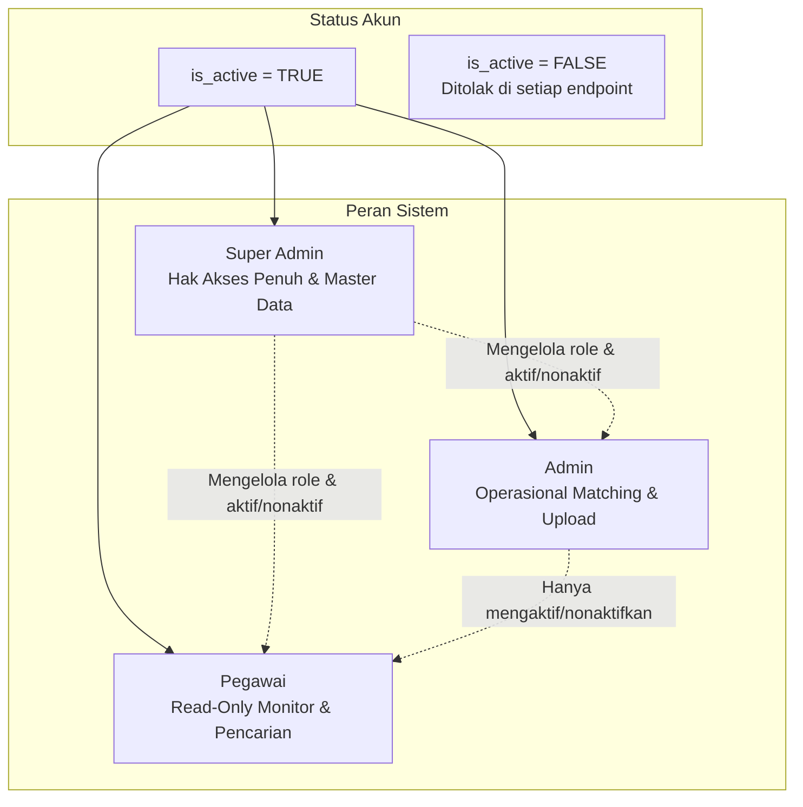
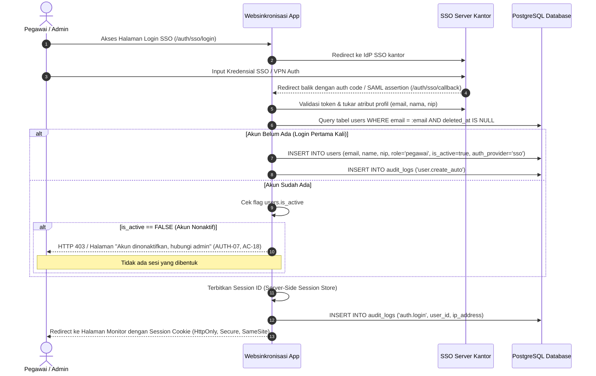
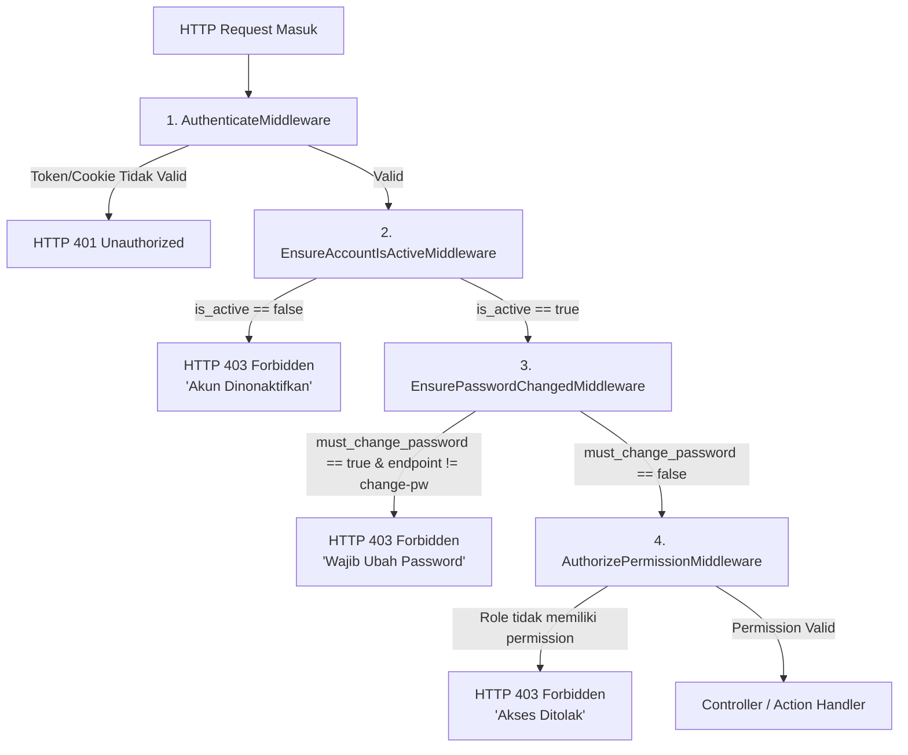

# Spesifikasi Kontrol Akses Berbasis Peran (RBAC.md)
## Sistem Matching Bukti Dukung ke Lembar Kerja (LK)

| Atribut | Nilai |
|---|---|
| Versi Dokumen | 1.0 |
| Tanggal | 29 Oktober 2026 |
| Basis PRD | `PRD.md` Versi 1.1 (Bagian 5, 6, 7.1, 9, 10, 11) |
| Basis Basis Data | `DATABASE.md` Versi 1.0 (Tabel `users`, `audit_logs`) |
| Prinsip Utama | *Defense in Depth*, *Least Privilege*, *Server-Side Strict Enforcement* (NFR-01) |

---

## 1. Pendahuluan & Prinsip Keamanan

Dokumen ini mengatur arsitektur Autentikasi dan Otorisasi (RBAC) untuk aplikasi Websinkronisasi. Menjawab kebutuhan **NFR-01**, pengamanan hak akses **wajib ditegakkan di sisi server** pada setiap *request/endpoint*. Menyembunyikan komponen tombol, menu, atau elemen UI di sisi klien **bukan** merupakan mekanisme pengamanan, melainkan sekadar kenyamanan tampilan (*UX affordance*).

### 1.1 Prinsip-Prinsip Desain RBAC:
1. **Least Privilege (Hak Akses Terkecil):** Pengguna hanya diberi wewenang terkecil yang dibutuhkan untuk menjalankan tugasnya. Peran `pegawai` bersifat *read-only* mutlak.
2. **Server-Side Active Session Check (AUTH-07, AC-15, AC-18):** Status keaktifan akun (`is_active`) wajib diperiksa di sisi server pada setiap permintaan, bukan hanya saat proses *handshake* login awal. Akun yang dinonaktifkan akan segera diputus sesinya seketika.
3. **Pemisahan Jalur Login (AUTH-01, AUTH-03, AUTH-11, D6, D7):**
   * Pegawai dan Admin **hanya** dapat login melalui SSO kantor. Tidak ada form/kredensial lokal untuk pegawai/admin.
   * Super Admin awal (dummy) menggunakan autentikasi lokal terisolasi di luar SSO dengan kewajiban ganti password pada saat login pertama (`must_change_password = true`).
4. **Pencegahan Kunci Diri / Self-Lockout (AUTH-06, AC-04):** Sistem secara absolut menolak penonaktifan atau penurunan role dari Super Admin terakhir yang aktif, serta menolak pengguna menonaktifkan akunnya sendiri.
5. **Auditability (AUDIT-01):** Setiap peristiwa yang berkaitan dengan keamanan (login, logout, pergantian role, aktivasi/penonaktifan akun, kegagalan otorisasi) wajib dicatat dalam tabel `audit_logs`.

---

## 2. Definisi Peran (Roles) & Hierarki

Sistem membagi pengguna ke dalam 3 peran (*role*) diskret dan 1 status akun (*state*):



### 2.1 Rincian Karakteristik Peran

| Peran (`role`) | Deskripsi & Batas Kewenangan | Metode Autentikasi | Sumber Pembuatan Akun |
|---|---|---|---|
| **Super Admin** | Tingkat akses tertinggi. Berwenang mengelola master LK, indikator, profil impor, eksekusi impor Excel, menghapus master Bukti Dukung (BD), mengubah role pengguna (Pegawai ↔ Admin), mengelola status aktif seluruh akun, dan melihat audit log. | Kredensial lokal (dummy seeder) / Ditugaskan oleh Super Admin lain via SSO | Seeder awal (lokal) atau promosi akun SSO oleh Super Admin |
| **Admin** | Pengelola operasional harian. Berwenang mengunggah Bukti Dukung baru (A4), memverifikasi hasil matching otomatis (konfirmasi/tolak), menambah/menghapus relasi matching secara manual, serta menonaktifkan/mengaktifkan kembali akun **Pegawai** saja. Tidak dapat mengubah role, master LK, maupun akun Admin/Super Admin. | SSO Kantor | Dipromosikan dari role Pegawai oleh Super Admin |
| **Pegawai** | Pengguna umum / pembaca. Berwenang melakukan pencarian Bukti Dukung, melihat matriks centang pada monitor, dan membuka tautan bukti pendukung. Bersifat *read-only* mutlak. | SSO Kantor | *Auto-provisioning* otomatis saat login pertama via SSO (AUTH-10, A11) |
| **Akun Nonaktif** (`is_active = false`) | Bukan sebuah peran, melainkan status pembekuan akun. Tidak dapat login, sesi yang sedang berjalan diputus seketika, dan seluruh pemanggilan API ditolak dengan respons HTTP 403 (AUTH-07, D4). | - | Dibekukan oleh Admin (untuk Pegawai) atau Super Admin (untuk semua) |

---

## 3. Katalog Izin Granular (Permissions Matrix)

Untuk menjaga modularitas kode dan mempermudah pengujian otorisasi, hak akses didefinisikan ke dalam bentuk *granular permissions*:

```
<resource>.<action>
```

### 3.1 Daftar Permission

| Kode Permission | Deskripsi Aksi | Super Admin | Admin | Pegawai |
|---|---|:---:|:---:|:---:|
| `monitor.view` | Melihat tabel matriks centang bukti dukung ke LK | ✔ | ✔ | ✔ |
| `evidence.search` | Melakukan pencarian (FTS/fuzzy) bukti dukung | ✔ | ✔ | ✔ |
| `evidence.view_link` | Membuka tautan eksternal bukti dukung / indikator | ✔ | ✔ | ✔ |
| `evidence.upload` | Mengunggah file bukti dukung baru (PDF/DOCX/Scan) | ✔ | ✔ | ✘ |
| `evidence.delete` | Melakukan soft-delete master dokumen bukti dukung | ✔ | ✘ | ✘ |
| `match.verify` | Mengonfirmasi atau menolak match hasil otomatis (`auto`) | ✔ | ✔ | ✘ |
| `match.manual_create` | Menambahkan relasi BD ↔ LK secara manual | ✔ | ✔ | ✘ |
| `match.manual_delete` | Menghapus relasi BD ↔ LK secara manual | ✔ | ✔ | ✘ |
| `match.rematch` | Memicu matching ulang otomatis pada satu BD atau LK | ✔ | ✔ | ✘ |
| `lk.manage` | Tambah, ubah, dan soft-delete master Lembar Kerja | ✔ | ✘ | ✘ |
| `lk.indicator_manage` | Tambah, ubah, dan soft-delete indikator & item bukti | ✔ | ✘ | ✘ |
| `lk.import_excel` | Mengunggah & mengimpor file Excel LK dengan Profil Impor | ✔ | ✘ | ✘ |
| `user.change_role` | Mengubah role pengguna (Pegawai ↔ Admin) | ✔ | ✘ | ✘ |
| `user.toggle_pegawai` | Mengaktifkan / menonaktifkan akun role Pegawai | ✔ | ✔ | ✘ |
| `user.toggle_admin` | Mengaktifkan / menonaktifkan akun role Admin | ✔ | ✘ | ✘ |
| `audit.view` | Melihat riwayat jejak audit sistem (`audit_logs`) | ✔ | ✘ | ✘ |
| `settings.manage` | Mengubah ambang batas matching & setting sistem | ✔ | ✘ | ✘ |

---

## 4. Arsitektur Autentikasi

### 4.1 Lapisan Abstraksi SSO Kantor (NFR-16, AUTH-01)
Mengingat protokol SSO instansi (OIDC, SAML 2.0, atau CAS) dikonfigurasi melalui variabel lingkungan (*environment*), sistem menggunakan antarmuka kontrak `SSOProviderInterface`.

```
                  ┌─────────────────────────────────────────┐
                  │          SSOProviderInterface           │
                  ├─────────────────────────────────────────┤
                  │ + getRedirectUrl(): string              │
                  │ + handleCallback(request): SSOUserData  │
                  │ + logout(sessionId): void               │
                  └─────────────────────────────────────────┘
                                       ▲
                                       │ implements
         ┌─────────────────────────────┼─────────────────────────────┐
         │                             │                             │
┌──────────────────┐         ┌───────────────────┐         ┌──────────────────┐
│  OIDCProvider    │         │   SAML2Provider   │         │   MockProvider   │
│  (OAuth2 / OIDC) │         │ (Enterprise IdP)  │         │ (Local Dev Test) │
└──────────────────┘         └───────────────────┘         └──────────────────┘
```

#### Struktur Data Pengguna SSO (`SSOUserData`):
* `identifier`: string unik stabil (email atau NIP)
* `email`: string
* `name`: string
* `nip`: string (opsional/nullable)

### 4.2 Alur Login & *Auto-Provisioning* Pegawai (AUTH-10, AC-21)



### 4.3 Alur Autentikasi Dummy Super Admin (AUTH-03, AUTH-04, D6, AC-03)

1. **Inisialisasi via Seeder:**
   * Kredensial dibaca dari file environment:
     * `SEEDER_SUPERADMIN_EMAIL=superadmin@kantor.local`
     * `SEEDER_SUPERADMIN_PASSWORD=RahasiaAwal123!`
   * Disimpan ke database dengan password ter-hash menggunakan `Argon2id` atau `Bcrypt` (work factor minimal 12).
   * Flag akun: `auth_provider = 'local'`, `must_change_password = TRUE`.
2. **Karantina Login Pertama (AC-03):**
   * Super Admin login melalui form khusus: `POST /auth/local/login`.
   * Sistem mendeteksi `must_change_password == TRUE`.
   * Sesi diberikan status sementara (`PENDING_PASSWORD_CHANGE`).
   * Akses ke seluruh endpoint selain `POST /auth/change-password` diblokir (HTTP 403 Forbidden).
   * Setelah password baru dikonfirmasi, hash diperbarui, `must_change_password` diubah menjadi `FALSE`, dan sesi penuh diterbitkan.
3. **Proteksi Brute-Force (AUTH-09):**
   * Endpoint login lokal dibatasi maksimal 5 percobaan gagal per 15 menit per IP address (*rate limiting*).

---

## 5. Siklus Hidup Akun & Sesi (Session Lifecycle & Invalidation)

### 5.1 Validasi Sesi di Sisi Server pada Setiap Permintaan (AUTH-07, AC-15)
Untuk memenuhi syarat bahwa penonaktifan akun bekerja secara seketika (*instant*):

1. **Penyimpanan Sesi:** Sesi disimpan di sisi server (Database `sessions` table atau Redis store) yang memetakan `session_id` ke `user_id`.
2. **Pemeriksaan Status di Middleware:**
   Pada setiap HTTP Request yang masuk:
   ```text
   Ambil session_id -> Ambil user_id -> Ambil data user dari cache/DB
   IF user.deleted_at IS NOT NULL OR user.is_active == FALSE THEN
       Hancurkan sesi di session store (Revoke session)
       Hapus cookie di response
       Kembalikan respons HTTP 403: "Akun Anda telah dinonaktifkan. Silakan hubungi Administrator."
   END IF
   ```
3. **Session Idle Timeout (AUTH-09):** Sesi kedaluwarsa secara otomatis jika tidak ada aktivitas pengguna selama **120 menit** berturut-turut.

### 5.2 Aturan Bisnis Perubahan Status & Role (Guard Rails)

#### Aturan 1: Mutasi Role Pengguna (AUTH-05, D5, AC-19)
* **Hanya Super Admin** yang dapat mengubah role pengguna (`POST /api/v1/users/{id}/role`).
* Admin atau Pegawai yang mencoba mengakses endpoint ini **HARUS DITOLAK** dengan respons `HTTP 403 Forbidden`.
* Perubahan role yang sah:
  * `pegawai` ➔ `admin`
  * `admin` ➔ `pegawai`
  * Role `super_admin` tidak dapat diturunkan jika tersisa hanya 1 orang.

#### Aturan 2: Penonaktifan Akun Bertingkat (AUTH-08, D4, D5, AC-19, AC-20)
* **Admin** hanya memiliki izin menonaktifkan/mengaktifkan akun ber-role `pegawai`.
* Jika Admin mencoba menonaktifkan akun ber-role `admin` atau `super_admin`, sistem **HARUS MENOLAK** dengan respons `HTTP 403 Forbidden` (AC-19).
* **Super Admin** dapat menonaktifkan/mengaktifkan akun ber-role `pegawai` dan `admin`.

#### Aturan 3: Proteksi Super Admin Terakhir & Self-Action (AUTH-06, AC-04)
* Pengguna dilarang menonaktifkan akunnya sendiri (`user_id == current_auth_user.id`).
* Sistem melakukan pengecekan `COUNT(id) FROM users WHERE role = 'super_admin' AND is_active = TRUE AND deleted_at IS NULL`. Jika hasilnya `1`, penonaktifan atau penurunan role terhadap Super Admin tersebut ditolak keras:
  ```json
  {
    "status": "error",
    "message": "Operasi ditolak: Sistem harus memiliki setidaknya satu Super Admin aktif."
  }
  ```

---

## 6. Pipeline Middleware Penegakan Otorisasi Server-Side

Setiap panggilan API dan halaman web melewati pipeline middleware berurutan berikut:



### 6.1 Spesifikasi Tugas Middleware

1. **`AuthenticateMiddleware`:**
   * Memvalidasi keabsahan session cookie atau bearer token.
   * Mengaitkan objek `current_user` ke konteks request.
   * Gagal ➔ Mengembalikan HTTP 401.
2. **`EnsureAccountIsActiveMiddleware` (AUTH-07, AC-15):**
   * Mengambil status `is_active` pengguna terkini dari database/cache cepat.
   * Jika bernilai `FALSE`, sesi segera dihapus (*session destroyed*), dan mengembalikan HTTP 403 dengan kode error `ACCOUNT_DEACTIVATED`.
3. **`EnsurePasswordChangedMiddleware` (AUTH-03, AC-03):**
   * Jika `current_user.must_change_password == TRUE`, hanya rute `POST /auth/change-password` dan `POST /auth/logout` yang diizinkan lewat. Rute lain dialihkan atau ditolak dengan HTTP 403 `PASSWORD_CHANGE_REQUIRED`.
4. **`AuthorizePermissionMiddleware(permission)` (NFR-01, AC-01, AC-02):**
   * Memeriksa apakah `current_user.role` memiliki permission yang disyaratkan untuk endpoint tersebut (berdasarkan Matriks Bab 3).
   * Jika tidak cocok ➔ Mengembalikan HTTP 403 `ACCESS_DENIED`.

---

## 7. Pemetaan Endpoint API & Guard Otorisasi

Tabel ini menjadi panduan mutlak bagi implementasi rute backend:

| Method | Endpoint URI | Required Permission | Role yang Diizinkan | Audit Log Action |
|---|---|---|---|---|
| **GET** | `/auth/sso/login` | *Public* | Semua | - |
| **GET** | `/auth/sso/callback` | *Public* | Semua | `auth.login` |
| **POST** | `/auth/local/login` | *Public (Rate Limited)* | Dummy Super Admin | `auth.local_login` |
| **POST** | `/auth/logout` | `authenticated` | Super Admin, Admin, Pegawai | `auth.logout` |
| **POST** | `/auth/change-password` | `authenticated` | Super Admin (dummy) | `auth.change_password` |
| **GET** | `/api/v1/monitor` | `monitor.view` | Super Admin, Admin, Pegawai | - |
| **GET** | `/api/v1/evidence` | `evidence.search` | Super Admin, Admin, Pegawai | - |
| **GET** | `/api/v1/evidence/{id}` | `evidence.search` | Super Admin, Admin, Pegawai | - |
| **POST** | `/api/v1/evidence/upload` | `evidence.upload` | Super Admin, Admin | `bd.upload` |
| **DELETE**| `/api/v1/evidence/{id}` | `evidence.delete` | **Super Admin** | `bd.delete` |
| **GET** | `/api/v1/matches/queue` | `match.verify` | Super Admin, Admin | - |
| **POST** | `/api/v1/matches/{id}/confirm`| `match.verify` | Super Admin, Admin | `match.confirmed` |
| **POST** | `/api/v1/matches/{id}/reject` | `match.verify` | Super Admin, Admin | `match.rejected` |
| **POST** | `/api/v1/matches` | `match.manual_create` | Super Admin, Admin | `match.manual_created` |
| **DELETE**| `/api/v1/matches/{id}` | `match.manual_delete` | Super Admin, Admin | `match.manual_deleted` |
| **POST** | `/api/v1/matches/rematch` | `match.rematch` | Super Admin, Admin | `match.rematch_triggered` |
| **GET** | `/api/v1/lk` | `monitor.view` | Super Admin, Admin, Pegawai | - |
| **POST** | `/api/v1/lk` | `lk.manage` | **Super Admin** | `lk.created` |
| **PUT** | `/api/v1/lk/{id}` | `lk.manage` | **Super Admin** | `lk.updated` |
| **DELETE**| `/api/v1/lk/{id}` | `lk.manage` | **Super Admin** | `lk.deleted` |
| **POST** | `/api/v1/lk/import/preview` | `lk.import_excel` | **Super Admin** | - |
| **POST** | `/api/v1/lk/import/commit` | `lk.import_excel` | **Super Admin** | `lk.import_committed` |
| **GET** | `/api/v1/users` | `user.toggle_pegawai` | Super Admin, Admin | - |
| **PUT** | `/api/v1/users/{id}/role` | `user.change_role` | **Super Admin** | `user.role_changed` |
| **POST** | `/api/v1/users/{id}/toggle-status`| Dinamis (Cek Bab 5.2) | Super Admin (Semua), Admin (Hanya Pegawai) | `user.status_toggled` |
| **GET** | `/api/v1/audit-logs` | `audit.view` | **Super Admin** | - |
| **GET** | `/api/v1/settings` | `settings.manage` | **Super Admin** | - |
| **PUT** | `/api/v1/settings` | `settings.manage` | **Super Admin** | `settings.updated` |

---

## 8. Verifikasi Terhadap Acceptance Criteria (AC Checklist)

| Kode AC | Persyaratan Pengujian | Cara RBAC Menjamin Keberhasilan | Status |
|---|---|---|:---:|
| **AC-01** | Pegawai memanggil endpoint tambah/hapus match secara langsung | `AuthorizePermissionMiddleware` menolak karena Pegawai tidak memiliki `match.manual_create` / `match.manual_delete` ➔ Mengembalikan HTTP 403 Forbidden. | ✔ Terpenuhi |
| **AC-02** | Admin membuka kelola LK, impor LK, atau ubah role | Route dilindungi oleh `lk.manage`, `lk.import_excel`, dan `user.change_role` yang hanya dimiliki Super Admin ➔ Mengembalikan HTTP 403 Forbidden. | ✔ Terpenuhi |
| **AC-03** | Login super admin dummy pertama kali | `EnsurePasswordChangedMiddleware` mengkarantina sesi sampai password lokal diganti via `/auth/change-password`. | ✔ Terpenuhi |
| **AC-04** | Super admin terakhir menonaktifkan dirinya | Logika validasi di endpoint `toggle-status` memeriksa `COUNT(super_admin)` dan menolak jika tersisa 1 orang ➔ HTTP 422 Unprocessable Entity. | ✔ Terpenuhi |
| **AC-15** | Akun dinonaktifkan saat sedang login | `EnsureAccountIsActiveMiddleware` memeriksa status database pada setiap panggilan request. Sesi seketika dihancurkan ➔ HTTP 403 Forbidden. | ✔ Terpenuhi |
| **AC-18** | Pengguna nonaktif login via SSO | Callback SSO mendeteksi `is_active == false` pada record pengguna ➔ Tidak membuat sesi dan langsung menampilkan pesan error akun nonaktif. | ✔ Terpenuhi |
| **AC-19** | Admin mengubah role pegawai atau menonaktifkan Admin lain | `user.change_role` dicegah di middleware (khusus Super Admin). Penonaktifan akun Admin oleh Admin dicegah di level validasi service ➔ HTTP 403 Forbidden. | ✔ Terpenuhi |
| **AC-20** | Admin menonaktifkan & mengaktifkan kembali akun Pegawai | Admin memiliki izin `user.toggle_pegawai`. Logika memverifikasi target adalah Pegawai ➔ Berhasil dan tercatat di `audit_logs`. | ✔ Terpenuhi |
| **AC-21** | Pegawai SSO pertama kali masuk | Callback SSO otomatis menjalankan auto-provisioning `role = 'pegawai'` dan `is_active = true`. | ✔ Terpenuhi |

