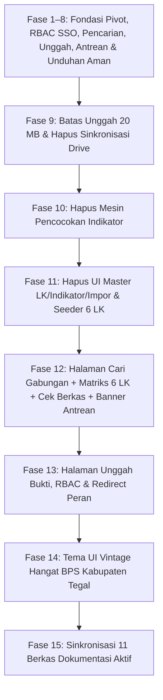

# Rencana Kerja & Rincian Tugas (TASKS.md)
## Perpustakaan Bukti Dukung BPS Kabupaten Tegal (ELKA)

| Atribut | Nilai |
|---|---|
| Versi Dokumen | 3.0 |
| Tanggal | 17 November 2026 |
| Basis PRD | `PRD.md` Versi 3.0 |
| Dokumen Teknis | `DATABASE.md`, `RBAC.md`, `MATCHING_ALGORITHM.md`, `ARCHITECTURE.md`, `AGENTS.md` |
| Pendekatan Eksekusi | *Phase-based, Test-Driven Development (TDD), Verification Gates* |

---

## 1. Ikhtisar Tahapan Implementasi & Penyederhanaan (Fase 1 s.d. Fase 15)

Proyek dibangun dan disederhanakan secara bertahap dengan pendekatan TDD (*Red-Green-Refactor*) serta gerbang verifikasi ketat di setiap fase:

---

## 2. Ringkasan Tugas per Fase

### Fase 1–8 (Fondasi & Baseline Sistem)
* **Skema & Seed:** Penyiapan tabel `users`, `lembar_kerja`, `evidence_documents`, `document_lk_links`, dan `audit_logs` (*append-only* dengan trigger `prevent_audit_logs_mutation`), migrasi pivot & backfill `2026_11_11_000001`–`000002`, serta `SuperAdminSeeder`.
* **Autentikasi & RBAC:** Abstraksi SSO Keycloak BPS (`SSOProviderInterface`), karantina password awal (`EnsurePasswordChanged`), pencabutan sesi seketika (`EnsureAccountIsActive`), serta kebijakan `EvidenceDocumentPolicy` dan `UserPolicy`.
* **Pencarian, Ekstraksi, & Unduhan:** `DocumentSearchService` (FTS + `ILIKE` + `pg_trgm`), `DocumentSimilarityService`, `TextExtractionService` (PDF/DOCX/Tesseract OCR `ind`), `EvidenceUploadService`, serta `EvidenceController::download` berawalan kode LK resmi (`admin`, `drive_sync`, `backfill`; atau `DRAFT`).

### Fase 9: Batas Unggah 20 MB Seragam & Hapus Sinkronisasi Google Drive
* Menyeragamkan batas ukuran unggah menjadi **20 MB (`20.971.520` byte)** di `config/evidence.php`, `EvidenceUploadService`, `config/livewire.php`, `EvidenceDocumentResource`, `docker/app/uploads.ini` (`25M`/`30M`), `deploy/nginx/websinkronisasi.conf`, dan `.env.example`.
* Menghapus integrasi API Google Drive dan OCR Drive dari server; mempertahankan `DocumentLkLink::OFFICIAL_SOURCES` dan kolom historis pasif di database.

### Fase 10: Hapus Mesin Pencocokan Dokumen $\rightarrow$ Indikator
* Menghapus layanan pencocokan indikator dan job *rematch*, serta membersihkan pemanggilan di `ProcessEvidenceDocumentJob` (kini murni ekstraksi teks lewat `TextExtractionService`) dan `VerificationQueuePage`.
* Mempertahankan penuh `DocumentSimilarityService` untuk pengecekan SHA-256 identik dan kandidat dokumen mirip (maks 5).

### Fase 11: Hapus UI Master LK / Indikator / Impor Excel & Seeder 6 LK
* Menghapus resource Filament dan layanan impor Excel untuk Master LK, Profil Impor, dan Indikator LK beserta observer-nya.
* Menyederhanakan `InitialLkSeeder` agar langsung menyediakan 6 rak LK aktif (`KIP`, `PEKPPP`, `ZI`, `SAKIP`, `DATA_SEKTORAL`, `DATA_SEKUNDER`) dengan `default_profile_id = null`.

### Fase 12: Halaman Cari Gabungan (`CariDokumenPage`), Banner Storage, & Hapus `MonitorMatrixPage`
* Memindahkan `getStorageUsage(): array` ke `MonitorMatrixService` dan menampilkan banner peringatan kapasitas penyimpanan $\ge 80\%$ **khusus Super Admin** di `VerificationQueuePage`.
* Menggabungkan matriks 6 LK (`DISTINCT lk_id`), klik centang membuka bagian unduh (`toggleDownloadSection`), fitur **Cek Berkas Sebelum Unggah** (`checkUploadedFile()` dengan pembersihan file sementara di `finally` tanpa baris DB baru), dan aksi **Ubah LK** Admin (`reviseMarkup`) ke `CariDokumenPage`.
* Mengarahkan `User::homeUrl()`, `AdminPanelProvider::homeUrl()`, dan `Dashboard::mount()` sesuai peran, lalu menghapus `MonitorMatrixPage`, `monitor-matrix.blade.php`, dan ekspor CSV matriks.

### Fase 13: Halaman Unggah Bukti, Navigasi Tepat per Peran, & Redirect Pasca-Login
* Mengubah `EvidenceDocumentPolicy::viewAny()` menjadi cek izin `evidence.upload` sehingga Super Admin ditolak 403 di `/admin/evidence-documents`.
* Menyelaraskan `EvidenceDocumentResource` menjadi **Unggah Bukti** (`shouldRegisterNavigation` cek `evidence.upload`), panduan berkas $> 20\text{ MB}$ ke Google Drive, wajib memilih $\ge 1$ LK (`minItems(1)` + validasi server), dan tombol **Revisi** hanya bagi pengunggah asli saat status `'revisi'`.
* Menyeragamkan redirect di `LoginController`, `SSOController`, `ForceChangePasswordController`, dan `routes/web.php` (`/`) ke `User::homeUrl()`.

### Fase 14: Tema UI "Vintage Hangat" & Identitas BPS Kabupaten Tegal
* Mengganti tema panel, halaman login, halaman ganti password, komponen logo (`logo-bps-tegal.png` / `logo.png` / fallback SVG), dan halaman utama dengan palet krem hangat (`#FAF9F5`, `#F0EEE6`, terakota `#B5532F`, biru BPS `#0B5FA5`), tipografi serif Georgia + sans sistem $\ge 17\text{ px}$, tombol `min-height: 56px`, tanpa font eksternal CDN dan tanpa `transition: all`.

### Fase 15: Sinkronisasi 11 Berkas Dokumentasi Aktif
* Memperbarui seluruh 11 berkas dokumentasi aktif (`AGENTS.md`, `Md/AGENTS.md`, `Md/PRD.md`, `Md/RBAC.md`, `Md/DATABASE.md`, `Md/MATCHING_ALGORITHM.md`, `Md/ARCHITECTURE.md`, `Md/TASKS.md`, `README.md`, `carapenggunaan.md`, `skenario_testing.md`) agar selaras 100% dengan implementasi final dan suite pengujian penuh (**211 tes lulus**).
