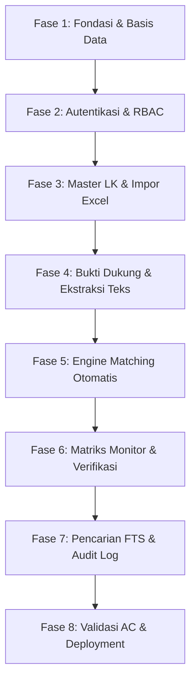

# Rencana Kerja & Rincian Tugas (TASKS.md)
## Sistem Matching Bukti Dukung ke Lembar Kerja (LK)

| Atribut | Nilai |
|---|---|
| Versi Dokumen | 1.0 |
| Tanggal | 29 Oktober 2026 |
| Basis PRD | `PRD.md` Versi 1.1 (Bagian 7, 8, 9, 10) |
| Dokumen Teknis | `DATABASE.md`, `RBAC.md`, `MATCHING_ALGORITHM.md`, `ARCHITECTURE.md` |
| Pendekatan Eksekusi | *Phase-based, Test-Driven Development (TDD), Verification Gates* |

---

## 1. Ikhtisar Tahapan Eksekusi (Roadmap)

Pelaksanaan proyek dibagi menjadi **8 Fase Berurutan**. Setiap fase memiliki kriteria penyelesaian (*Definition of Done*) yang jelas dan pengujian verifikasi yang wajib lolos sebelum melangkah ke fase berikutnya.

---

## 2. Rincian Tugas per Fase

### Fase 1: Fondasi Proyek, Database & Seeder Awal
**Tujuan:** Menyiapkan struktur proyek Laravel 11, koneksi PostgreSQL 15, migrasi tabel lengkap, dan seeder data awal.

| ID Task | Judul Tugas | Deskripsi Teknis | Referensi Kebutuhan |
|---|---|---|---|
| **TSK-101** | Inisialisasi Proyek & Dependensi | Install Laravel 11, Filament v3, paket `smalot/pdfparser`, `phpoffice/phpspreadsheet`, `pgcrypto`, `pg_trgm`. | NFR-09, ARCHITECTURE.md |
| **TSK-102** | Migrasi PostgreSQL DDL | Buat migration file lengkap sesuai `DATABASE.md`: ENUMs, tabel `users`, `lembar_kerja`, `lk_import_profiles`, `lk_indicators`, `lk_evidence_items`, `evidence_documents`, `document_matches`, `lk_import_logs`, `audit_logs`, `system_settings`. | DATABASE.md Bab 4 |
| **TSK-103** | Constraints & Database Triggers | Implementasikan check constraint URL (`http/https`), unique constraint anti-duplikasi, dan trigger anti-tampering pada tabel `audit_logs`. | LK-09, AUDIT-02, NFR-10 |
| **TSK-104** | Seeder Super Admin Dummy Awal | Buat `SuperAdminSeeder` membaca email & password dari `.env`, hash dengan Argon2id, set `must_change_password = true`, `auth_provider = 'local'`. | AUTH-03, AUTH-04, D6, AC-03 |
| **TSK-105** | Seeder 6 Master LK & Profil Bawaan | Buat `InitialLkSeeder` untuk 6 LK (ZI, PEKPPP, KIP, SAKIP, Data Sekunder, Data Sektoral) beserta profil impor awal untuk ZI, PEKPPP, dan KIP. | LK-01, LKIMP-03 |

**Gate Verifikasi Fase 1:**
* `php artisan migrate:fresh --seed` berjalan sukses tanpa error.
* Trigram index dan FTS index terkonfirmasi aktif di PostgreSQL.
* Mencoba eksekusi `DELETE FROM audit_logs` menghasilkan exception trigger.

---

### Fase 2: Autentikasi, SSO Abstraction & RBAC Middleware
**Tujuan:** Mengamankan seluruh akses sistem dengan pengamanan sisi server yang ketat.

| ID Task | Judul Tugas | Deskripsi Teknis | Referensi Kebutuhan |
|---|---|---|---|
| **TSK-201** | Abstraksi SSO Driver | Buat antarmuka `SSOProviderInterface` dan implementasi OIDC/Mock provider untuk testing SSO lokal. | NFR-16, AUTH-01 |
| **TSK-202** | SSO Controller & Auto-Provisioning | Buat alur redirect SSO dan callback. Implementasikan auto-provisioning akun baru ber-role `pegawai` dan `is_active = true`. | AUTH-02, AUTH-10, AC-21 |
| **TSK-203** | Form Login Dummy Super Admin & Karantina | Buat login form lokal untuk super admin seeder. Jika `must_change_password = true`, batasi rute hanya ke form ganti password. | AUTH-03, AC-03 |
| **TSK-204** | Pipeline Middleware Keamanan | Bangun 4 middleware: `Authenticate`, `EnsureAccountIsActive`, `EnsurePasswordChanged`, dan `AuthorizePermission`. | RBAC.md Bab 6, NFR-01 |
| **TSK-205** | Pengelolaan Akun & Guard Rails | Bangun controller pengelolaan pengguna: Super Admin ubah role (Pegawai ↔ Admin), Super Admin aktif/nonaktifkan semua akun, Admin HANYA aktif/nonaktifkan Pegawai, cegah mutasi Super Admin terakhir. | AUTH-05, AUTH-06, AUTH-08, D5, AC-04, AC-19, AC-20 |
| **TSK-206** | Instant Session Revocation | Saat akun diubah menjadi `is_active = false`, hancurkan sesi pengguna seketika dari session store. | AUTH-07, AC-15, AC-18 |

**Gate Verifikasi Fase 2:**
* Unit test: Pegawai memanggil endpoint admin langsung menghasilkan `HTTP 403 Forbidden` (AC-01).
* Unit test: Akun nonaktif yang login via SSO ditolak dan tidak dapat sesi (AC-18).
* Unit test: Super Admin terakhir tidak dapat dinonaktifkan (AC-04).

---

### Fase 3: Master LK, Profil Impor & Parser Excel
**Tujuan:** Memungkinkan Super Admin mengimpor dan mengelola ribuan indikator LK dari file Excel secara idempoten.

| ID Task | Judul Tugas | Deskripsi Teknis | Referensi Kebutuhan |
|---|---|---|---|
| **TSK-301** | Manajemen Master LK (CRUD) | Buat halaman Filament untuk kelola LK, kategori internal/eksternal, periode tahun, dan soft delete dengan konfirmasi relasi terdampak. | LK-02, LK-03, LK-06, AC-14 |
| **TSK-302** | Mesin Profil Impor Excel | Bangun konfigurasi profil dinamis (nama sheet, header row, pemetaan kolom, dan parsing strategy: single cell numbered list, checklist sheet, single item). | LKIMP-02, LKIMP-03 |
| **TSK-303** | Parser Excel & Filter Sanitasi | Gunakan `PhpSpreadsheet` mode *read data only* (tolak `.xlsm`). Filter baris narasi, judul, rekap, rumus, dan sheet pivot. Validasi skema tautan hanya `http/https`. | LKIMP-05, LKIMP-09, LKIMP-10, LK-09, AC-24, AC-25 |
| **TSK-304** | Year Placeholder Resolver | Implementasikan resolusi `[t]`, `[t-1]`, `[t-2]` menjadi tahun terhitung berdasarkan periode LK ke kolom `resolved_name`. | LK-05, AC-26 |
| **TSK-305** | Layar Pratinjau Impor (Preview Gate) | Tampilkan pratinjau data indikator, item bukti, dan daftar baris yang dilewati sebelum committed. | LKIMP-04 |
| **TSK-306** | Eksekusi Impor Idempoten | Simpan data ke `lk_indicators` dan `lk_evidence_items` menggunakan pola upsert idempoten berdasarkan `(lk_id, code)` agar file yang sama tidak membuat data ganda. | LKIMP-07, AC-23 |

**Gate Verifikasi Fase 3:**
* Impor sampel file ZI, PEKPPP, dan KIP menghasilkan jumlah baris yang sesuai sampel nyata (AC-22).
* Mengimpor file yang sama dua kali tidak menggandakan data (AC-23).
* Mengunggah file `.xlsm` atau file palsu ditolak dengan pesan jelas (AC-24).

---

### Fase 4: Bukti Dukung (BD) & Mesin Ekstraksi Teks
**Tujuan:** Menangani upload dokumen, validasi keamanan ketat, deduplikasi file, dan ekstraksi teks asinkron.

| ID Task | Judul Tugas | Deskripsi Teknis | Referensi Kebutuhan |
|---|---|---|---|
| **TSK-401** | Form Upload & Validasi Keamanan | Buat form upload dokumen (PDF, DOCX, JPG, PNG). Validasi ukuran maks 20MB dan validasi MIME Sniffing berdasarkan magic bytes. | BD-01, BD-02, BD-03, AC-06 |
| **TSK-402** | Deduplikasi SHA-256 | Hitung hash SHA-256 saat upload. Jika hash sudah ada di database, tolak upload dan tampilkan record BD yang sudah ada. | BD-04, BD-05, AC-05 |
| **TSK-403** | Penyimpanan Terisolasi (Private Storage) | Simpan berkas fisik di direktori privat server dengan nama file acak UUID untuk mencegah *path traversal*. | BD-10, NFR-04 |
| **TSK-404** | Queue Worker & Job Pemrosesan | Buat job `ProcessEvidenceDocumentJob` yang berjalan di Redis queue. | MATCH-01, NFR-06 |
| **TSK-405** | Ekstraksi Teks PDF Digital & OCR Tesseract | Integrasikan parser PDF digital native. Jika dokumen berupa scan/gambar atau teks kosong, jalankan Tesseract OCR bahasa Indonesia. Jika OCR gagal, tandai status `perlu_review_manual`. | BD-07, BD-08, A5, AC-07 |

**Gate Verifikasi Fase 4:**
* Upload file `.exe` yang di-rename menjadi `.pdf` ditolak oleh MIME sniffer (AC-06).
* Upload file identik dua kali ditolak sebagai duplikat (AC-05).
* Upload PDF scan tanpa teks tersimpan dengan status `perlu_review_manual` tanpa error 500 (AC-07).

---

### Fase 5: Mesin Algoritma Matching (Matching Engine)
**Tujuan:** Mengimplementasikan pencocokan multi-tahap (Bukti Pasti & Heuristik) serta perlindungan terhadap penolakan admin.

| ID Task | Judul Tugas | Deskripsi Teknis | Referensi Kebutuhan |
|---|---|---|---|
| **TSK-501** | Preprocessor & Synonym Normalizer | Normalisasi teks (lowercase, simbol, kamus sinonim SK/SOP/SP, stopword removal). | MATCHING_ALGORITHM.md Bab 4.1 |
| **TSK-502** | Rule Deterministic (Kode & No Dokumen) | Pencocokan kode indikator pada nama file (`exact_code`) dan nomor SK identik (`exact_number`) ➔ Skor 100%, status `confirmed`. | MATCH-03 |
| **TSK-503** | Rule Heuristic (Trigram & Keyword Similarity) | Komputasi skor kemiripan nama item bukti (Trigram + Levenshtein) dan kata kunci isi teks. Terapkan penalti tahun. | MATCH-03, MATCH-10 |
| **TSK-504** | Thresholding & Status Match Auto | Jika skor >= ambang batas (75.0%), bentuk relasi `document_matches` status `auto` yang langsung tampil ✔ di monitor. | D2, MATCH-03, MON-02, AC-10 |
| **TSK-505** | Mekanisme Anti-Overwrite (MATCH-06) | Terapkan query upsert dengan klausul `WHERE status NOT IN ('rejected', 'confirmed')` agar relasi yang pernah ditolak admin tidak pernah dibuat ulang. | MATCH-06, AC-11 |
| **TSK-506** | Job Re-matching Otomatis | Buat `RematchActiveDocumentsJob` yang dipicu saat ada perubahan indikator/item bukti LK. | MATCH-07, AC-27 |

**Gate Verifikasi Fase 5:**
* Dokumen dengan nama file `1.2.a SOP.pdf` langsung menghasilkan match `confirmed` pada indikator `1.2.a`.
* Dokumen dengan skor kemiripan 80% langsung berstatus `auto` dan centang ✔ tampil di monitor (AC-10).
* Admin menolak match, kemudian re-match dijalankan: match yang ditolak tidak muncul kembali (AC-11).

---

### Fase 6: Matriks Monitor, Antrean Verifikasi & Koreksi Manual
**Tujuan:** Membangun antarmuka utama tabel centang (Monitor) dan modul koreksi/verifikasi admin.

| ID Task | Judul Tugas | Deskripsi Teknis | Referensi Kebutuhan |
|---|---|---|---|
| **TSK-601** | Halaman Monitor Matriks (MON) | Bangun tabel matriks Filament: Baris = Bukti Dukung, Kolom = LK (grup Internal & Eksternal). Render ✔ jika match `auto` atau `confirmed`. Kosongkan murni jika tidak cocok. | MON-01, MON-02, MON-03, AC-08, AC-09 |
| **TSK-602** | Kueri Pivot Server-Side & Paginasi | Terapkan kueri agregasi JSON PostgreSQL di sisi server dengan paginasi agar merespons ≤ 2 detik untuk 10.000 dokumen. | MON-08, NFR-05 |
| **TSK-603** | Modal Detail Centang (Drill-Down) | Saat tanda ✔ diklik, buka modal menampilkan daftar indikator cocok, skor, status (Otomatis / Terverifikasi), dan tautan bukti http/https yang dapat diklik (`rel="noopener noreferrer"`). | MON-04, MON-05, MON-06, MON-10, AC-12 |
| **TSK-604** | Antrean Verifikasi Admin | Buat halaman khusus admin untuk melihat daftar match berstatus `auto` beserta skor dan alasan kecocokan (`match_reasons`). Sediakan aksi satu klik: Konfirmasi (menjadi `confirmed`) atau Tolak (menjadi `rejected`). | MATCH-04, MATCH-10 |
| **TSK-605** | Koreksi Manual Relasi (Tambah/Hapus) | Sediakan tombol bagi Admin untuk menambah match manual (menjadi `confirmed`) atau menghapus match (menjadi `rejected`) langsung dari UI. | MATCH-05, AC-16 |

**Gate Verifikasi Fase 6:**
* Halaman monitor menampilkan centang pada LK yang cocok dan sel lain kosong murni tanpa karakter apa pun (AC-08, AC-09).
* Klik tanda centang menampilkan rincian indikator dan tautan valid (AC-12).
* Dua admin menambahkan match yang sama secara bersamaan tidak menghasilkan data ganda / error 500 (AC-16).

---

### Fase 7: Full-Text Search, Jejak Audit & Hardening Sistem
**Tujuan:** Menuntaskan fitur pencarian dokumen, pencatatan jejak audit menyeluruh, dan penguatan keamanan aplikasi.

| ID Task | Judul Tugas | Deskripsi Teknis | Referensi Kebutuhan |
|---|---|---|---|
| **TSK-701** | Pencarian Multi-Kolom FTS & Fuzzy | Bangun pencarian terpadu pada nama, nomor, dan isi dokumen menggunakan PostgreSQL FTS (`to_tsvector`) dan trigram fuzzy search. Sanitasi query input untuk mencegah SQL injection. | SEARCH-01, SEARCH-02, SEARCH-05, SEARCH-06, AC-13 |
| **TSK-702** | Tampilan Hasil Pencarian Matriks | Tampilkan baris monitor (centang LK) untuk setiap dokumen yang ditemukan dari hasil pencarian. | SEARCH-03, SEARCH-04 |
| **TSK-703** | Perekaman Audit Log Otomatis | Hubungkan event listener pada setiap mutasi data: login, logout, create user, change role, toggle active, impor LK, upload BD, konfirmasi/penolakan match. | AUDIT-01, AC-17 |
| **TSK-704** | Layar Penampil Audit Log Super Admin | Buat halaman Filament untuk Super Admin melihat catatan audit log dengan filter pengguna, aksi, dan rentang tanggal. | AUDIT-03 |
| **TSK-705** | Pengaturan Sistem Dinamis | Buat halaman pengaturan untuk Super Admin mengonfigurasi ambang batas matching (`matching.similarity_threshold`) dan batas ukuran upload. | MATCH-11, BD-02 |

**Gate Verifikasi Fase 7:**
* Input pencarian berisi `'; DROP TABLE--` atau 10.000 karakter tidak menghasilkan error 500 atau SQL injection (AC-13).
* Setiap aksi mutasi data (AC-05 s.d. AC-16) terverifikasi tercatat di tabel `audit_logs` (AC-17).

---

### Fase 8: Pengujian Akseptansi Menyeluruh (E2E) & Kesiapan Rilis
**Tujuan:** Memvalidasi seluruh 27 Kriteria Penerimaan (Acceptance Criteria) dan menyiapkan konfigurasi server produksi.

| ID Task | Judul Tugas | Deskripsi Teknis | Referensi Kebutuhan |
|---|---|---|---|
| **TSK-801** | Suite Pengujian Otomatis AC-01 s.d. AC-27 | Jalankan seluruh unit & feature test suite di Laravel (`php artisan test`) untuk memastikan kepatuhan 100% terhadap tabel Kriteria Penerimaan. | PRD.md Bagian 10 |
| **TSK-802** | Konfigurasi Web Server Nginx & HTTPS | Konfigurasikan virtual host Nginx reverse proxy dengan HTTP/2, sertifikat SSL internal kantor, dan pembatasan akses hanya melalui intranet/VPN. | NFR-03, NFR-15, D8 |
| **TSK-803** | Konfigurasi Systemd Supervisor Daemon | Konfigurasikan systemd service untuk menjalankan queue worker Laravel secara persisten dengan auto-restart saat terjadi kegagalan. | NFR-06, NFR-07 |
| **TSK-804** | Prosedur Backup Terjadwal | Buat skrip cronjob untuk backup database PostgreSQL harian (`pg_dump`) dan sinkronisasi direktori berkas bukti dukung privat. | NFR-08 |

**Gate Verifikasi Fase 8:**
* Seluruh 27 skenario Acceptance Criteria berstatus **PASSED**.
* Kueri matriks monitor pada 10.000 data dokumen uji merespons dalam waktu < 2 detik.

