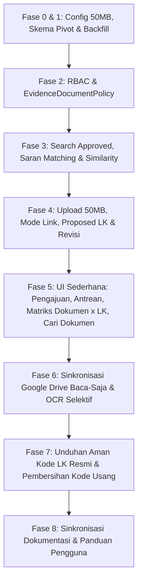

# Rencana Kerja & Rincian Tugas (TASKS.md)
## Sistem Matching Bukti Dukung ke Lembar Kerja (LK)

| Atribut | Nilai |
|---|---|
| Versi Dokumen | 2.0 |
| Tanggal | 16 November 2026 |
| Basis PRD | `PRD.md` Versi 2.0 |
| Dokumen Teknis | `DATABASE.md`, `RBAC.md`, `MATCHING_ALGORITHM.md`, `ARCHITECTURE.md`, `AGENTS.md` |
| Pendekatan Eksekusi | *Phase-based, Test-Driven Development (TDD), Verification Gates* |

---

## 1. Ikhtisar Tahapan Implementasi & Pivot Arsitektur (8 Fase)

Proyek dieksekusi secara bertahap dengan pendekatan TDD (*Red-Green-Refactor*) dan gerbang verifikasi ketat di setiap fase:

---

## 2. Rincian Tugas per Fase

### Fase 1 (termasuk Pra-Fase 0): Konfigurasi `config/evidence.php`, Skema Pivot, & Backfill
* **Konfigurasi Terpusat:** Pembuatan `config/evidence.php` dan publikasi `config/livewire.php` untuk batas unggah **50 MB** (`max:51200`), ambang saran matching (`75.0` / `60.0`), batas peringatan disk (`80%`), dan parameter Google Drive (`DRIVE_API_KEY`).
* **Skema Database (`2026_11_11_000001`):** Penambahan kolom `approval_status`, `approval_notes`, `approved_by`, `approved_at`, `source_type`, dan `drive_*` pada `evidence_documents`; pembuatan tabel `document_lk_links` (`proposed`, `admin`, `drive_sync`, `backfill`) dan `drive_sync_folders`.
* **Migrasi Backfill (`2026_11_11_000002`):** Dokumen lama diset `approval_status = 'disetujui'` dan relasi `document_matches` (`auto`/`confirmed`) di-backfill secara idempoten ke `document_lk_links` (`link_source = 'backfill'`).

### Fase 2: Autentikasi SSO BPS, Seeder Super Admin, & Penyelarasan RBAC
* **Matriks `User::hasPermission`:** Penyelarasan izin untuk `super_admin`, `admin`, dan `pegawai` (Pegawai memiliki `evidence.upload`, `evidence.search`, `evidence.revise_own`, `evidence.view_link`, `monitor.view`; Admin memiliki `evidence.verify` dan `drive.sync`; Super Admin mengelola master LK, pengguna, audit, hapus dokumen, dan ikut memverifikasi antrean tanpa mengunggah/mencari/sinkron Drive).
* **Policy Dokumen (`EvidenceDocumentPolicy`):** Pembatasan `view` (dokumen `disetujui`, pemilik pengajuan sendiri, atau Admin/Super Admin) dan `update` (revisi hanya oleh pengunggah asli saat status `revisi`).

### Fase 3: Pencarian Dokumen Disetujui, Saran Pencocokan, & Kemiripan Dokumen
* **Filter Persetujuan pada Pencarian (`DocumentSearchService`):** Hanya mengembalikan dokumen aktif berstatus `approval_status = 'disetujui'` dengan eager loading `lembarKerja` resmi (`DISTINCT` tanpa duplikasi LK).
* **Saran Pencocokan (`MatchingEngineService`):** Menyimpan kandidat kecocokan di `document_matches` sebagai saran verifikasi (`confirmed`, `auto` $\ge 75$, `perlu_verifikasi` $60\text{–}74$) tanpa menentukan centang matriks.
* **Kemiripan Dokumen (`DocumentSimilarityService`):** Menyediakan `findIdenticalByHash()` dan `findSimilarCandidates()` (maksimal 5 kandidat serupa).

### Fase 4: Unggah Aman 50 MB, Mode Tautan, Usulan LK (`proposed`), & Revisi
* **Unggah Berkas (`EvidenceUploadService::upload`):** Validasi ukuran $\le 50\text{ MB}$ dan MIME *magic bytes* sniffing (`finfo` + validasi kontainer DOCX/XLSX), penyimpanan UUID di disk `private`, serta pembungkusan pembuatan `EvidenceDocument` (`menunggu`) + `DocumentLkLink` (`proposed`) + `AuditLog` dalam satu `DB::transaction` dengan pembersihan berkas yatim bila gagal.
* **Mode Tautan (`createLinkSubmission`):** Pengajuan berkas $> 50\text{ MB}$ atau video cukup menggunakan tautan `http://` atau `https://` (`source_type = 'link'`).
* **Revisi Aman (`reviseSubmission`):** Hanya pemilik asli saat status `revisi`; menangani `UniqueConstraintViolationException`, menghapus berkas lama hanya setelah transaksi DB *commit*, dan mereset status ke `menunggu`.

### Fase 5: Antarmuka Sederhana (Pengajuan, Antrean Verifikasi, Matriks Dokumen x LK, Cari Dokumen)
* **Unggah & Pengajuan Saya (`EvidenceDocumentResource`):** Pilihan radio Unggah Berkas vs Tempel Tautan, multi-select LK usulan, peringatan maks 5 dokumen mirip, riwayat unggahan terbaru (di-scope ke milik sendiri untuk Pegawai), dan alur revisi.
* **Antrean Verifikasi (`VerificationQueuePage`):** Kartu pengajuan (`menunggu`, `revisi`, `ditolak`, `semua`), saran indikator dari `document_matches`, pilihan LK resmi, tombol Setujui (`link_source = 'admin'`), Minta Revisi (wajib catatan), dan Tolak (wajib catatan).
* **Matriks Monitor (`MonitorMatrixPage` & `MonitorMatrixService`):** Matriks **Dokumen (`disetujui`) x Lembar Kerja** dengan tanda centang (**✔**) dari `document_lk_links` resmi, tombol **Unduh CSV**, dan peringatan kapasitas penyimpanan bagi Super Admin.
* **Cari Dokumen (`CariDokumenPage`):** Pencarian dokumen `disetujui` dengan filter LK & tahun, badge LK resmi, serta tombol Unduh / Buka Tautan.

### Fase 6: Sinkronisasi Google Drive Baca-Saja & OCR Selektif
* **Sinkronisasi Baca-Saja (`GoogleDriveSyncService` & `SyncGoogleDriveJob`):** Mengambil metadata berkas dari folder Drive aktif menggunakan `config('evidence.drive_api_key')`. Folder yang terhubung ke LK (`lk_id`) otomatis menyetujui dokumen **baru** (`approval_status = 'disetujui'`, `link_source = 'drive_sync'`) tanpa menghidupkan kembali link LK pada dokumen lama yang telah dihapus admin.
* **OCR Selektif (`ProcessDriveFileOcrJob`):** Mengunduh sementara berkas PDF/gambar $\le 50\text{ MB}$ yang namanya kurang deskriptif, mengekstrak teks/OCR, menjalankan pencocokan saran, dan membersihkan berkas sementara di blok `finally`.

### Fase 7: Unduhan Aman Berawalan Kode LK Resmi & Pembersihan Kode Usang
* **Endpoint Unduhan (`EvidenceController::download` & `buildDownloadFilename`):**
  * Menegakkan `evidence.view_link` + `EvidenceDocumentPolicy::view` (dokumen *soft-deleted* = 404).
  * Redirect aman ke `external_link` untuk `source_type` `'drive'`/`'link'` (tolak skema selain `http`/`https` dengan 422).
  * Stream berkas `upload` dengan nama berawalan kode LK resmi (`admin`/`drive_sync`/`backfill`, `DISTINCT`, urut abjad, maks 4 kode, atau `DRAFT` bila belum resmi), sanitasi karakter ilegal/kontrol, panjang total $\le 150$ karakter dengan ekstensi utuh.
* **Pembersihan Komponen Warisan:** Penghapusan `DryRunMatchingService`, `ManualMatchService`, `SystemSettingResource` (+Pages/Observer/Policy), `QuickWorkflowWidget`, izin yatim (`settings.manage`, `match.manual_create`, `match.manual_delete`, `match.rematch`), serta pembaruan seeder demo agar menggunakan `approval_status = 'disetujui'` dan `document_lk_links` resmi.

### Fase 8: Sinkronisasi Dokumentasi & Panduan Pengguna
* Penyelarasan `AGENTS.md`, `Md/AGENTS.md`, `Md/PRD.md`, `Md/RBAC.md`, `Md/DATABASE.md`, `Md/MATCHING_ALGORITHM.md`, `Md/ARCHITECTURE.md`, `Md/TASKS.md`, `README.md`, `carapenggunaan.md`, dan `skenario_testing.md` dengan kondisi aktual kode produksi dan suite pengujian penuh (**305 tes lulus**).
