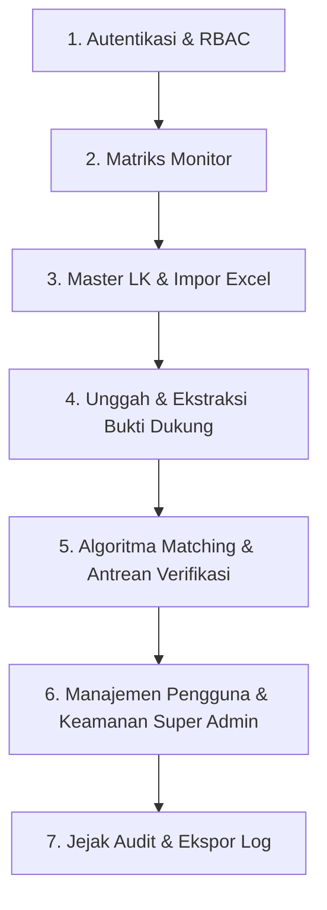

# Panduan Skenario Pengujian Manual (Manual Testing Guide)
## Sistem Websinkronisasi Bukti Dukung ke Lembar Kerja Penilaian - BPS RI

Dokumen ini disusun sebagai panduan pengujian manual menyeluruh (*end-to-end*) bagi penguji internal BPS untuk memvalidasi seluruh fungsi, alur bisnis, aturan hak akses (RBAC), integritas audit, serta ketahanan invarian sistem sebelum rilis produksi.

---

## 1. Daftar Akun & Kredensial Uji Resmi

Sistem telah dilengkapi dengan akun bawaan (*seeders*) untuk masing-masing hak akses:

| No | Peran (Role) | Nama Pengguna / Satker | Identitas Masuk (Email / NIP) | Kata Sandi | Metode Masuk |
|:---:|---|---|---|---|---|
| **1** | **Super Admin** | Akhmad Rizki, S.Tr.Stat. | `akhmad.rizki@bps.go.id` | *(Gunakan Simulasi SSO)* | SSO BPS / Mock SSO |
| **2** | **Super Admin (Lokal)** | Dodi Anwar, S.Kom. | `dodi.anwar@bps.go.id` | `Password123!` | Form Lokal Login |
| **3** | **Admin (Verifikator Lokal)** | Dimas Pratama, S.Kom. | `dimas.pratama@bps.go.id` *(NIP: `199602182019011002`)* | `Password123!` | Form Lokal Login |
| **4** | **Admin (Verifikator SSO)** | Siti Rahmawati, S.Stat. | `siti.rahmawati@bps.go.id` | *(Gunakan Simulasi SSO)* | Mock SSO ("Admin") |
| **5** | **Pegawai (Pengunggah SSO)** | Nurul Hidayah, S.Tr.Stat. | `nurul.hidayah@bps.go.id` | *(Gunakan Simulasi SSO)* | Mock SSO ("Pegawai") |
| **6** | **Akun Nonaktif (Uji Tolak)** | Bayu Wicaksono, A.Md. | `bayu.wicaksono@bps.go.id` | *(Gunakan Simulasi SSO)* | Mock SSO ("Nonaktif") |

> **URL Aplikasi:** `http://localhost:8000`  
> **URL Login:** `http://localhost:8000/login`  
> **URL Simulasi SSO:** `http://localhost:8000/auth/sso/mock-login`

---

## 2. Matriks Rincian Skenario Pengujian

---

### Skenario 1: Autentikasi, SSO BPS & Kontrol Tema Tampilan

#### Test Case 1.1: Login Form Lokal Akun Admin & Super Admin
* **Tujuan:** Memastikan pengelola lokal dapat masuk menggunakan email atau NIP.
* **Langkah Pengujian:**
  1. Akses `http://localhost:8000/login`.
  2. Masukkan Email: `dimas.pratama@bps.go.id` dan Kata Sandi: `Password123!`.
  3. Klik tombol **Masuk ke Dashboard →**.
* **Hasil yang Diharapkan:**
  - [ ] Berhasil diarahkan ke `/admin/monitor-matrix`.
  - [ ] Profil pojok kanan atas menampilkan inisial `DP` (*Dimas Pratama*).
  - [ ] Menu di sidebar hanya menampilkan fitur Admin (*Matriks Monitor, Unggah Bukti, Antrean Verifikasi, Master Lembar Kerja*). Menu *Manajemen Pengguna* dan *Jejak Audit* disembunyikan.

#### Test Case 1.2: Larangan Pegawai Masuk via Form Lokal (Invarian AUTH-11)
* **Tujuan:** Memastikan akun ber-role pegawai dicegah menggunakan kata sandi lokal dan diarahkan ke SSO.
* **Langkah Pengujian:**
  1. Pada form lokal `http://localhost:8000/login`, masukkan email pegawai: `pegawai.active@bps.go.id`.
  2. Masukkan sembarang kata sandi, klik **Masuk ke Dashboard →**.
* **Hasil yang Diharapkan:**
  - [ ] Login ditolak.
  - [ ] Muncul pesan peringatan merah: *"Akun Pegawai wajib masuk menggunakan tombol Login SSO BPS (Opsi 1)."*
  - [ ] Percobaan tercatat pada tabel `audit_logs` dengan aksi `auth.login_blocked_pegawai_local`.

#### Test Case 1.3: Login Sekali Klik Menggunakan Simulasi SSO
* **Tujuan:** Memverifikasi autentikasi SSO satu-klik untuk alur pengujian cepat.
* **Langkah Pengujian:**
  1. Buka `http://localhost:8000/auth/sso/mock-login`.
  2. Klik tombol biru: **"Masuk sebagai Pegawai (Read-Only)"**.
* **Hasil yang Diharapkan:**
  - [ ] Langsung masuk tanpa input password ke halaman `/admin/monitor-matrix`.
  - [ ] Tampil sebagai *Nurul Hidayah, S.Tr.Stat.* (Pegawai).
  - [ ] Pegawai dapat melihat monitor, mengunggah bukti, namun menu *Antrean Verifikasi*, *Manajemen Pengguna*, dan *Jejak Audit* tidak ada di sidebar.

#### Test Case 1.4: Pencegahan Akses Akun Berstatus Nonaktif (AUTH-05, AC-18)
* **Tujuan:** Memastikan akun yang telah dinonaktifkan tidak dapat login ke sistem.
* **Langkah Pengujian:**
  1. Buka `http://localhost:8000/auth/sso/mock-login`.
  2. Klik tombol merah: **"Masuk sebagai Akun Nonaktif (Uji Tolak)"**.
* **Hasil yang Diharapkan:**
  - [ ] Login ditolak dan dikembalikan ke halaman login.
  - [ ] Muncul notifikasi error bahwa akun telah dinonaktifkan oleh administrator.
  - [ ] Tidak ada sesi aktif yang terbentuk.

#### Test Case 1.5: Pengujian 3 Mode Tampilan (Terang, Gelap, Bawaan Windows)
* **Tujuan:** Memverifikasi pengubah tema di dropdown profil berjalan lancar tanpa tabrakan warna.
* **Langkah Pengujian:**
  1. Klik ikon inisial profil di pojok kanan atas.
  2. Klik ikon **Matahari (Mode Terang)**. Periksa kontras latar belakang, teks sidebar, dan kartu.
  3. Klik ikon **Bulan (Mode Gelap)**. Periksa apakah teks tetap jelas terbaca (putih/slate-100 di atas slate-900).
  4. Klik ikon **Komputer (Bawaan Windows)**. Periksa apakah tema menyesuaikan preferensi OS.
* **Hasil yang Diharapkan:**
  - [ ] Seluruh halaman beralih warna secara mulus.
  - [ ] Tidak ada teks putih di atas putih atau teks gelap di atas gelap.
  - [ ] Pilihan mode tersimpan di `localStorage` peramban.

---

### Skenario 2: Matriks Pemetaan Bukti Dukung (Monitor Matrix)

#### Test Case 2.1: Tampilan Tanda Centang (✔) dan Sel Kosong Murni (MON-02, AC-08, AC-09)
* **Tujuan:** Memverifikasi keterpenuhan eviden tampil tegas tanpa nilai ambigu.
* **Langkah Pengujian:**
  1. Masuk ke menu **Matriks Monitor** (`/admin/monitor-matrix`).
  2. Periksa tabel baris indikator terhadap kolom lembar kerja (ZI, PEKPPP, SAKIP, KIP, EPSS).
* **Hasil yang Diharapkan:**
  - [ ] Indikator yang memiliki pasangan bukti berstatus `auto` atau `confirmed` langsung menampilkan tanda centang tebal (**✔**).
  - [ ] Sel yang belum memiliki bukti dukung terpetakan **wajib kosong murni** (tidak ada teks `null`, strip `-`, atau angka nol `0`).

#### Test Case 2.2: Modal Rincian Bukti (*Drilldown*) & Tautan Aman (MON-10, AC-12, AC-25)
* **Tujuan:** Memeriksa detail bukti dukung saat sel centang diklik.
* **Langkah Pengujian:**
  1. Klik pada salah satu tanda centang (**✔**) di tabel matriks.
  2. Periksa modal rincian yang terbuka.
  3. Periksa tautan berkas dan tautan Google Drive resmi (jika ada).
* **Hasil yang Diharapkan:**
  - [ ] Modal menampilkan nama dokumen, nomor SK, tanggal, dan tingkat kemiripan.
  - [ ] Tautan eksternal menggunakan skema aman `https://` dengan atribut `rel="noopener noreferrer"` serta membuka tab baru.
  - [ ] Skema berbahaya (`javascript:`, `file:`) otomatis ditolak atau dinonaktifkan.

#### Test Case 2.3: Filter & Paginasi Matriks Tanpa Tabrakan Panah Dropdown
* **Tujuan:** Memastikan filter lembar kerja dan selektor baris per halaman berfungsi rapi.
* **Langkah Pengujian:**
  1. Ganti filter **Periode Tahun** (contoh: 2026).
  2. Ketik kata kunci pada kotak pencarian dokumen.
  3. Ubah dropdown **Baris per halaman** dari 15 ke 25 atau 50.
* **Hasil yang Diharapkan:**
  - [ ] Tabel terfilter secara instan (reaktif via Livewire).
  - [ ] Angka pada dropdown baris per halaman tidak tertimpa ikon panah dropdown.
  - [ ] Navigasi halaman sebelumnya/berikutnya berfungsi normal.

---

### Skenario 3: Master Lembar Kerja (LK) & Wizard Impor Excel

#### Test Case 3.1: Penjelajahan Master Lembar Kerja
* **Tujuan:** Memastikan seluruh 7 instrumen evaluasi kinerja BPS terdaftar lengkap.
* **Langkah Pengujian:**
  1. Masuk sebagai **Admin** atau **Super Admin**, buka menu **Master Lembar Kerja** (`/admin/lembar-kerjas`).
  2. Periksa instrumen yang terdaftar: *LKE Zona Integritas*, *PEKPPP*, *SAKIP*, *KIP*, *EPSS*, dll.
* **Hasil yang Diharapkan:**
  - [ ] Setiap lembar kerja menampilkan periode tahun anggaran aktif dan jumlah total indikator.
  - [ ] Tautan folder Google Drive resmi instansi dapat dibuka atau diperbarui.

#### Test Case 3.2: Wizard Impor Excel 4 Tahap & Profil Bawaan BPS (LKIMP-01 s.d. LKIMP-07)
* **Tujuan:** Menguji alur pemetaan kolom berkas evaluasi `.xlsx`.
* **Langkah Pengujian:**
  1. Buka menu **Impor Excel (Wizard)** (`/admin/lk-import-profiles`).
  2. Langkah 1: Pilih target LK (contoh: *LKE Zona Integritas 2026*).
  3. Langkah 2: Pilih profil bawaan *"Profil Standar LKE ZI (Rekomendasi)"*.
  4. Periksa pemetaan otomatis kolom kode indikator, uraian pertanyaan, dan kata kunci eviden.
* **Hasil yang Diharapkan:**
  - [ ] Sistem menampilkan ringkasan jumlah baris file, indikator valid, dan baris dilewati (subtotal/judul bab).
  - [ ] Tidak ada crash atau format formula yang merusak basis data.

#### Test Case 3.3: Uji Idempotensi Impor Ulang (LKIMP-07, AC-23)
* **Tujuan:** Menjamin impor berkas Excel yang sama berkali-kali tidak melipatgandakan data.
* **Langkah Pengujian:**
  1. Jalankan proses impor berkas evaluasi hingga selesai.
  2. Catat jumlah indikator LK (misal: 109 indikator).
  3. Lakukan proses impor ulang dengan berkas Excel yang sama persis.
* **Hasil yang Diharapkan:**
  - [ ] Jumlah indikator tetap 109 (tidak menjadi 218).
  - [ ] Sistem melakukan *upsert* berdasarkan kode indikator unik tanpa duplikasi.
  - [ ] Relasi bukti dukung yang sudah disetujui sebelumnya tidak terhapus.

---

### Skenario 4: Unggah Bukti Dukung & Ekstraksi Teks/OCR

#### Test Case 4.1: Unggah Berkas Baru Berbagai Format (BD-01, BD-03)
* **Tujuan:** Menguji pengunggahan dokumen SK, Laporan, atau Data resmi.
* **Langkah Pengujian:**
  1. Buka menu **Unggah Bukti Dukung** (`/admin/evidence-documents/create`).
  2. Unggah berkas contoh (PDF, DOCX, JPEG, atau PNG) dengan ukuran $\le 20\text{MB}$.
  3. Isi Nama Dokumen: `SK Tim Reformasi Birokrasi BPS Kabupaten Tegal 2026`.
  4. Isi Nomor Dokumen: `B-104/3328/KP.010/2026`.
  5. Pilih Jenis Dokumen: `Surat Keputusan (SK)`.
  6. Klik tombol **Simpan & Jalankan Matching**.
* **Hasil yang Diharapkan:**
  - [ ] Berkas tersimpan di penyimpanan privat (`storage/app/evidence_documents`) dengan nama acak UUID.
  - [ ] Status pemrosesan berubah menjadi `selesai` atau memicu antrean OCR.
  - [ ] Sistem mencatat waktu unggah dan pengunggah di riwayat.

#### Test Case 4.2: Proteksi Duplikasi Berkas Berbasis SHA-256 (BD-05, AC-05)
* **Tujuan:** Memastikan sistem menolak berkas identik yang diunggah ulang.
* **Langkah Pengujian:**
  1. Coba unggah kembali berkas fisik yang persis sama dengan berkas pada Test Case 4.1.
  2. Klik tombol **Simpan & Jalankan Matching**.
* **Hasil yang Diharapkan:**
  - [ ] Sistem menolak unggahan dan menampilkan notifikasi kesalahan: *"Dokumen dengan isi file identik sudah pernah diunggah."*
  - [ ] Basis data tidak menyimpan berkas ganda.

#### Test Case 4.3: Validasi Magic Bytes MIME-Sniffing (BD-03, AC-06)
* **Tujuan:** Menguji penolakan file berbahaya yang sengaja diganti ekstensinya.
* **Langkah Pengujian:**
  1. Buat file script atau eksekusi palsu (misal berkas teks biasa atau shell script).
  2. Ubah ekstensinya menjadi `.pdf` (misal: `test_palsu.pdf`).
  3. Coba unggah berkas tersebut ke formulir.
* **Hasil yang Diharapkan:**
  - [ ] Sistem mendeteksi header asli file (*magic bytes*) dan menolak berkas karena MIME-type bukan `application/pdf`.

#### Test Case 4.4: Penanganan Dokumen Pindaian Tanpa Teks (AC-07)
* **Tujuan:** Memastikan dokumen hasil pindaian kosong diarahkan ke review manual.
* **Langkah Pengujian:**
  1. Unggah dokumen PDF hasil scan yang tidak memiliki lapisan teks digital.
  2. Periksa status berkas pada tabel daftar bukti dukung.
* **Hasil yang Diharapkan:**
  - [ ] Sistem tidak crash. Status berkas ditandai sebagai `perlu_review_manual` agar admin dapat memeriksa secara visual.

---

### Skenario 5: Mesin Algoritma Matching & Antrean Verifikasi (Layer Admin)

#### Test Case 5.1: Verifikasi Antrean Berpasangan Otomatis (MATCH-01 s.d. MATCH-04)
* **Tujuan:** Menguji rekomendasi kecocokan eviden ke indikator evaluasi.
* **Langkah Pengujian:**
  1. Masuk sebagai **Admin** (`dimas.pratama@bps.go.id`), buka **Antrean Verifikasi** (`/admin/verification-queue`).
  2. Periksa daftar antrean dengan status `Menunggu Verifikasi`.
  3. Amati skor kemiripan (misal $\ge 90\%$ hijau atau $75-89\%$ amber).
* **Hasil yang Diharapkan:**
  - [ ] Tabel menyajikan perbandingan dokumen sumber (kiri) vs butir indikator LK target (kanan).
  - [ ] Baris tabel lapang dengan tombol aksi setujui/tolak berukuran ramah sentuh ($\ge 44\text{px}$).

#### Test Case 5.2: Modal Inspeksi Berdampingan (*Side-by-Side Comparison*)
* **Tujuan:** Membandingkan isi dokumen fisik dengan indikator sebelum mengambil keputusan.
* **Langkah Pengujian:**
  1. Pada salah satu baris antrean, klik tombol **Periksa Detail**.
  2. Periksa panel kiri (Nomor SK, tanggal terbit, ringkasan teks).
  3. Periksa panel kanan (Uraian pertanyaan LK dan token bukti yang diharapkan).
* **Hasil yang Diharapkan:**
  - [ ] Modal terbuka dalam format 2 kolom lebar (*side-by-side*).
  - [ ] Kata kunci yang relevan ditandai warna sorotan.
  - [ ] Terdapat opsi input catatan verifikator.

#### Test Case 5.3: Penolakan Permanen & Uji Kekekalan Invarian MATCH-06 (AC-11)
* **Tujuan:** Membuktikan bahwa bukti yang ditolak admin tidak akan pernah dibangkitkan kembali oleh worker matching di masa depan.
* **Langkah Pengujian:**
  1. Pada modal inspeksi atau tabel antrean, klik tombol **Tolak** pada pasangan bukti.
  2. Masukkan alasan penolakan: *"Bukti tidak relevan dengan indikator ZI"*.
  3. Konfirmasi penolakan. Periksa status pasangan bukti tersebut (kini masuk tab *Ditolak Permanen*).
  4. Jalankan ulang pencocokan otomatis (rematch) melalui tombol evaluasi atau upload berkas baru.
* **Hasil yang Diharapkan:**
  - [ ] Tanda centang pada sel matriks monitor langsung hilang.
  - [ ] **Kekal:** Algoritma worker matching masa depan **dilarang keras** memulihkan atau merender ulang relasi yang telah berstatus `rejected`.

#### Test Case 5.4: Seleksi Massal (*Bulk Actions*) Antrean
* **Tujuan:** Mempercepat kerja verifikator senior melalui aksi massal.
* **Langkah Pengujian:**
  1. Centang beberapa kotak (*checkbox*) berukuran $20\times 20\text{px}$ pada tabel antrean.
  2. Amati bilah aksi massal yang muncul di bagian atas tabel.
  3. Klik tombol hijau: **"Setujui Terpilih (X Berkas)"**.
* **Hasil yang Diharapkan:**
  - [ ] Seluruh berkas yang dipilih langsung berubah status menjadi `confirmed` tanpa perlu reload halaman.
  - [ ] Matriks monitor seketika menampilkan tanda centang untuk seluruh butir yang disetujui.

---

### Skenario 6: Manajemen Pengguna & Keamanan Super Admin

#### Test Case 6.1: Tambah Pengguna Baru & Penugasan Role
* **Tujuan:** Menguji pembuatan akun admin/pegawai baru oleh Super Admin.
* **Langkah Pengujian:**
  1. Masuk sebagai **Super Admin** (`dodi.anwar@bps.go.id`), buka **Manajemen Pengguna** (`/admin/users`).
  2. Klik tombol **Tambah Pengguna**.
  3. Masukkan Nama, Email BPS, NIP, dan pilih Peran (*Admin* atau *Pegawai*).
  4. Simpan data.
* **Hasil yang Diharapkan:**
  - [ ] Akun baru tampil pada tabel pengguna.
  - [ ] Akun dapat digunakan untuk login sesuai role yang diberikan.

#### Test Case 6.2: Pembatasan Wewenang Role Admin (AUTH-07, AC-02, AC-19)
* **Tujuan:** Memastikan Admin tidak dapat mengubah role akun lain atau mengedit Super Admin.
* **Langkah Pengujian:**
  1. Masuk sebagai **Admin** (`dimas.pratama@bps.go.id`).
  2. Coba akses langsung URL `/admin/users` melalui bilah alamat browser.
* **Hasil yang Diharapkan:**
  - [ ] Server menolak request dengan status **403 Forbidden** (penegakan hak akses sisi server).
  - [ ] Admin tidak memiliki akses mengubah struktur otorisasi kantor.

#### Test Case 6.3: Proteksi Super Admin Terakhir (AUTH-06, AC-04)
* **Tujuan:** Memastikan sistem menolak penonaktifan atau penurunan role dari satu-satunya Super Admin aktif.
* **Langkah Pengujian:**
  1. Masuk sebagai Super Admin.
  2. Pada tabel Manajemen Pengguna, coba nonaktifkan atau turunkan role akun Super Admin Anda sendiri jika tidak ada Super Admin aktif lain.
* **Hasil yang Diharapkan:**
  - [ ] Aksi dibatalkan dengan notifikasi galat tegas: *"Tidak dapat menonaktifkan atau mengubah peran Super Admin aktif terakhir."*
  - [ ] Sistem terlindung dari kondisi kehilangan akses pengelola (*lockout*).

#### Test Case 6.4: Paginasi Berjendela (*Windowed Pagination*)
* **Tujuan:** Memastikan daftar pengguna tidak menumpuk nomor tombol halaman.
* **Langkah Pengujian:**
  1. Buka halaman **Manajemen Pengguna** (memiliki lebih dari 200 data akun uji).
  2. Amati bilah navigasi paginasi di bawah tabel.
* **Hasil yang Diharapkan:**
  - [ ] Nomor halaman ditampilkan dalam format berjendela maksimal 7 tombol (misal: `1 2 3 ... 24`).
  - [ ] Ringkasan teks *"Menampilkan 1 - 6 dari 278 pengguna terdaftar"* tidak patah/menumpuk secara vertikal.

---

### Skenario 7: Jejak Audit (Audit Trail Immutability)

#### Test Case 7.1: Pencatatan Otomatis Setiap Aktivitas Mutasi (AUDIT-01, AC-17)
* **Tujuan:** Memverifikasi jejak rekam digital instansi.
* **Langkah Pengujian:**
  1. Masuk sebagai **Super Admin**, buka menu **Jejak Audit** (`/admin/audit-logs`).
  2. Periksa log rekaman dari aktivitas login, unggah dokumen, persetujuan verifikasi, dan modifikasi data.
* **Hasil yang Diharapkan:**
  - [ ] Setiap entri memuat waktu presisi, pelaku (*user_id*), aksi, alamat IP, nilai lama (*old values*), dan nilai baru (*new values*).

#### Test Case 7.2: Kekekalan Audit Log (*Immutability Trigger*, AUDIT-02)
* **Tujuan:** Membuktikan bahwa rekaman audit tidak dapat diubah atau dihapus oleh siapapun.
* **Langkah Pengujian:**
  1. Periksa antarmuka Jejak Audit: tidak ada tombol *Edit* atau *Hapus*.
  2. Jika dieksekusi perintah SQL `DELETE FROM audit_logs` langsung ke basis data PostgreSQL:
* **Hasil yang Diharapkan:**
  - [ ] Trigger PostgreSQL `prevent_audit_logs_mutation` memicu pengecualian (*exception*) dan menolak operasi penghapusan atau modifikasi data audit.

#### Test Case 7.3: Ekspor Jejak Audit ke File CSV
* **Tujuan:** Menguji kebutuhan pelaporan kepatuhan internal inspektorat BPS.
* **Langkah Pengujian:**
  1. Pada halaman Jejak Audit, gunakan filter kategori atau rentang tanggal.
  2. Klik tombol **Ekspor CSV**.
* **Hasil yang Diharapkan:**
  - [ ] Berkas CSV terunduh secara stream tanpa membebani memori server.
  - [ ] Format data rapi dan dapat dibuka langsung pada Microsoft Excel.

---

## 3. Lembar Hasil Pengujian Manual (Checklist Ringkasan)

Penguji dapat mencatat hasil validasi pada tabel berikut:

| Modul Pengujian | Target Uji | Status (PASS / FAIL) | Catatan / Temuan |
|---|---|:---:|---|
| **1. Autentikasi** | Form Lokal, SSO Mock, Proteksi Nonaktif, 3-Theme Switcher | `[  ]` | |
| **2. Matriks Monitor** | Centang ✔ Otomatis, Sel Blank Murni, Drilldown Modal | `[  ]` | |
| **3. Master LK** | Daftar 7 LK BPS, Wizard Impor Excel, Idempotensi | `[  ]` | |
| **4. Bukti Dukung** | Upload Berkas, Cek SHA-256 Duplikat, Magic Bytes MIME | `[  ]` | |
| **5. Antrean Verifikasi** | Side-by-Side Modal, MATCH-06 Rejection, Bulk Action | `[  ]` | |
| **6. User Management** | Tambah User, RBAC Server-Side, Windowed Pagination | `[  ]` | |
| **7. Jejak Audit** | Audit Auto-Log, Immutability Trigger, Ekspor CSV | `[  ]` | |

---
**BPS RI &copy; 2026 - Sistem Websinkronisasi Bukti Dukung ke Lembar Kerja Penilaian**

