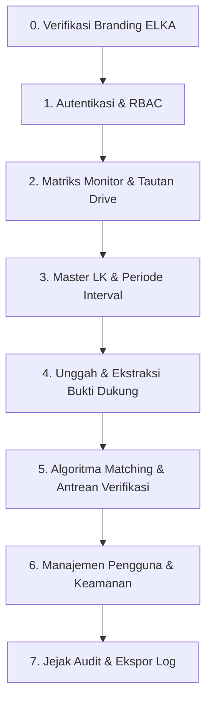

# Panduan Skenario Pengujian Manual (Manual Testing Guide)
## Sistem ELKA Bukti Dukung ke Lembar Kerja Penilaian - BPS RI

Dokumen ini disusun sebagai panduan pengujian manual menyeluruh (*end-to-end*) bagi penguji internal BPS untuk memvalidasi seluruh fungsi, alur bisnis, aturan hak akses (RBAC), integritas audit, tautan Google Drive, periode evaluasi interval, serta ketahanan invarian sistem **ELKA**.

---

## 1. Daftar Akun & Kredensial Uji Resmi

Sistem telah dilengkapi dengan akun bawaan (*seeders*) untuk masing-masing hak akses:

| No | Peran (Role) | Nama Pengguna / Satker | Identitas Masuk (Email / NIP) | Kata Sandi | Metode Masuk |
|:---:|---|---|---|---|---|
| **1** | **Super Admin (Lokal)** | Super Admin Inisial | `admin@kantor.go.id` | `123456789` | Form Lokal Login |
| **2** | **Admin (Verifikator Lokal)** | Dimas Pratama, S.Kom. | `dimas.pratama@bps.go.id` *(NIP: `199602182019011002`)* | `Password123!` | Form Lokal Login |
| **3** | **Pegawai (Pengunggah SSO)** | Pegawai Contoh SSO | `pegawai.sample@bps.go.id` | *(Gunakan Tombol Biru)* | Mock SSO ("Pegawai") |
| **4** | **Admin (Verifikator SSO)** | Admin BPS Contoh | `admin.sample@bps.go.id` | *(Gunakan Tombol Hijau)* | Mock SSO ("Admin") |
| **5** | **Akun Nonaktif (Uji Tolak)** | Akun Nonaktif SSO | `inactive.sample@bps.go.id` | *(Gunakan Tombol Merah)* | Mock SSO ("Nonaktif") |

> **URL Aplikasi:** `http://localhost:8000`  
> **URL Login:** `http://localhost:8000/login`  
> **URL Simulasi SSO:** `http://localhost:8000/auth/sso/mock-login`

---

## 2. Peta Alur Pengujian Sistem

---

### Skenario 0: Verifikasi Branding & Nama Aplikasi "ELKA"

* **Tujuan:** Memastikan penamaan aplikasi di seluruh antarmuka web konsisten menggunakan nama **ELKA**, bukan nama lama.
* **Langkah Pengujian:**
  1. Akses halaman awal `http://localhost:8000/login`.
  2. Periksa judul tab browser (*title tag*).
  3. Periksa header teks panel kiri login.
  4. Masuk ke halaman admin (`/admin/monitor-matrix`).
  5. Periksa logo dan nama aplikasi di sidebar navigasi panel admin (kiri atas).
* **Hasil yang Diharapkan:**
  - [ ] Judul halaman login menampilkan: **ELKA - BPS Kabupaten Tegal**.
  - [ ] Panel hero login menampilkan nama aplikasi: **ELKA** dengan pill **Portal Resmi**.
  - [ ] Di dalam panel admin, sidebar menampilkan logo BPS dengan teks nama sistem: **ELKA** (*BPS Kabupaten Tegal*).
  - [ ] Tidak ada lagi teks atau penamaan "Websinkronisasi" pada antarmuka publik.

---

### Skenario 1: Autentikasi, SSO BPS & Kontrol Hak Akses (RBAC)

#### Test Case 1.1: Login Form Lokal Super Admin & Admin
* **Tujuan:** Memastikan pengelola lokal dapat masuk menggunakan email dan kata sandi lokal.
* **Langkah Pengujian:**
  1. Akses `http://localhost:8000/login`.
  2. Masukkan Email: `admin@kantor.go.id` dan Kata Sandi: `123456789`.
  3. Klik tombol **Masuk ke Dashboard →**.
* **Hasil yang Diharapkan:**
  - [ ] Berhasil masuk dan diarahkan ke `/admin/monitor-matrix`.
  - [ ] Profil pojok kanan atas menampilkan pengguna Super Admin.
  - [ ] Seluruh menu sidebar tampil lengkap (*Matriks Monitor, Unggah Bukti Dukung, Antrean Verifikasi, Master Lembar Kerja, Impor Excel, Manajemen Pengguna, Jejak Audit*).

#### Test Case 1.2: Larangan Pegawai Masuk via Form Lokal (Invarian AUTH-11)
* **Tujuan:** Memastikan akun ber-role pegawai dicegah menggunakan kata sandi lokal dan diarahkan ke SSO.
* **Langkah Pengujian:**
  1. Pada form lokal `http://localhost:8000/login`, masukkan email pegawai: `pegawai.sample@bps.go.id`.
  2. Masukkan sembarang kata sandi, klik **Masuk ke Dashboard →**.
* **Hasil yang Diharapkan:**
  - [ ] Login ditolak.
  - [ ] Muncul pesan peringatan merah: *"Akun Pegawai wajib masuk menggunakan tombol Login SSO BPS (Opsi 1)."*
  - [ ] Percobaan tercatat pada tabel `audit_logs` dengan aksi `auth.login_blocked_pegawai_local`.

#### Test Case 1.3: Login Sekali Klik Menggunakan Simulasi SSO (Pegawai)
* **Tujuan:** Memverifikasi autentikasi SSO satu-klik untuk alur kerja pegawai pengunggah.
* **Langkah Pengujian:**
  1. Buka `http://localhost:8000/auth/sso/mock-login`.
  2. Klik tombol biru: **"Masuk sebagai Pegawai (Read-Only)"**.
* **Hasil yang Diharapkan:**
  - [ ] Langsung masuk tanpa input password ke halaman `/admin/monitor-matrix`.
  - [ ] Tampil sebagai *Pegawai Contoh SSO* (Pegawai).
  - [ ] Pegawai dapat melihat **Matriks Monitor** dan membuka menu **Unggah Bukti Dukung**.
  - [ ] Menu administratif (*Antrean Verifikasi, Impor Excel, Manajemen Pengguna, Jejak Audit*) disembunyikan dari sidebar.

#### Test Case 1.4: Pencegahan Akses Akun Berstatus Nonaktif (AUTH-05, AC-18)
* **Tujuan:** Memastikan akun yang telah dinonaktifkan ditolak secara tegas dari sisi server.
* **Langkah Pengujian:**
  1. Buka `http://localhost:8000/auth/sso/mock-login`.
  2. Klik tombol merah: **"Masuk sebagai Akun Nonaktif (Uji Tolak)"**.
* **Hasil yang Diharapkan:**
  - [ ] Server menolak request dengan status **403 Forbidden** (*"Akun Anda dinonaktifkan, silakan hubungi administrator."*).
  - [ ] Tidak ada sesi aktif yang terbentuk.
  - [ ] Aktivitas tercatat di `audit_logs` dengan aksi `auth.sso_login_blocked_inactive`.

---

### Skenario 2: Matriks Pemetaan Bukti Dukung & Integrasi Link Google Drive

#### Test Case 2.1: Tampilan Tanda Centang (✔) dan Sel Kosong Murni (MON-02, AC-08, AC-09)
* **Tujuan:** Memverifikasi keterpenuhan eviden tampil tegas tanpa nilai ambigu.
* **Langkah Pengujian:**
  1. Masuk ke menu **Matriks Monitor** (`/admin/monitor-matrix`).
  2. Periksa tabel baris indikator terhadap kolom lembar kerja (ZI, PEKPPP, SAKIP, KIP, EPSS).
* **Hasil yang Diharapkan:**
  - [ ] Indikator yang memiliki pasangan bukti berstatus `auto` atau `confirmed` langsung menampilkan tanda centang tebal (**✔**).
  - [ ] Sel yang belum memiliki bukti dukung terpetakan **wajib kosong murni** (tidak ada teks `null`, strip `-`, atau angka nol `0`).

#### Test Case 2.2: Klik Tanda Centang (✔) Langsung Menuju Link Google Drive
* **Tujuan:** Memastikan penguji/auditor dapat mengklik tanda centang untuk langsung membuka folder/dokumen Google Drive bukti terkait.
* **Langkah Pengujian:**
  1. Pada tabel Matriks Monitor, cari sel yang memiliki tanda centang (**✔**).
  2. Arahkan kursor (*hover*) pada tanda centang: amati tampilan kursor dan tooltip yang menunjukkan link Google Drive.
  3. Klik tanda centang tersebut.
* **Hasil yang Diharapkan:**
  - [ ] Jika indikator memiliki `drive_url`, browser membuka tab baru langsung menuju URL Google Drive tersebut.
  - [ ] Tautan menggunakan protokol aman (`https://drive.google.com/...`) dengan atribut keamanan `rel="noopener noreferrer"`.
  - [ ] Jika indikator belum memiliki link Google Drive, klik centang membuka modal rincian bukti dukung (*drilldown*).

#### Test Case 2.3: Modal Rincian Bukti (*Drilldown*) & Tombol Akses Google Drive
* **Tujuan:** Memeriksa detail bukti dukung saat sel centang dibuka melalui modal inspeksi.
* **Langkah Pengujian:**
  1. Klik tombol detail pada baris indikator atau sel centang.
  2. Periksa modal rincian yang terbuka.
* **Hasil yang Diharapkan:**
  - [ ] Modal menampilkan judul indikator, kode LK, nama berkas eviden, nomor dokumen/SK, dan skor kecocokan algoritma.
  - [ ] Terdapat tombol jelas: **"Buka Folder / Dokumen di Google Drive"** yang dapat diklik langsung.
  - [ ] Terdapat tombol unduh fisik dokumen asli jika disimpan secara lokal.

#### Test Case 2.4: Filter Periode Interval Waktu (1 Bulan, 3 Bulan, 6 Bulan, 12 Bulan)
* **Tujuan:** Memastikan filter lembar kerja menggunakan interval waktu, bukan lagi tahunan.
* **Langkah Pengujian:**
  1. Di bagian atas tabel Matriks Monitor, periksa dropdown **Periode Evaluasi**.
  2. Pilih opsi: **1 Bulan**, **3 Bulan**, **6 Bulan**, atau **12 Bulan**.
  3. Lakukan filter.
* **Hasil yang Diharapkan:**
  - [ ] Pilihan dropdown berisi opsi interval: `1 Bulan`, `3 Bulan`, `6 Bulan`, dan `12 Bulan`.
  - [ ] Tabel Matriks Monitor reaktif menyaring indikator sesuai periode interval yang dipilih tanpa error query database.

---

### Skenario 3: Master Lembar Kerja (LK) & Wizard Impor Excel

#### Test Case 3.1: Penjelajahan Master LK & Pengaturan Link Google Drive
* **Tujuan:** Memastikan Master LK mencantumkan periode interval dan memungkinkan penyematan link Google Drive.
* **Langkah Pengujian:**
  1. Masuk sebagai **Admin** atau **Super Admin**, buka menu **Master Lembar Kerja** (`/admin/lembar-kerjas`).
  2. Periksa kolom **Periode** pada setiap lembar kerja (contoh: *LKE Zona Integritas - 12 Bulan*).
  3. Klik aksi edit pada salah satu indikator LK.
  4. Isi atau perbarui field **Link Google Drive Dokumen** dengan tautan `https://drive.google.com/drive/folders/contoh-folder`.
  5. Simpan perubahan.
* **Hasil yang Diharapkan:**
  - [ ] Kolom periode menampilkan nilai interval (misal: *12 Bulan*, *6 Bulan*).
  - [ ] Link Google Drive tersimpan dengan sukses dan divalidasi protokol `https://`.
  - [ ] Link tersebut langsung terhubung ke sel centang di Matriks Monitor.

#### Test Case 3.2: Wizard Impor Excel 4 Tahap dengan Periode Interval
* **Tujuan:** Menguji impor lembar kerja evaluasi `.xlsx` baru dengan pemilihan periode waktu.
* **Langkah Pengujian:**
  1. Buka menu **Impor Excel (Wizard)** (`/admin/lk-import-profiles`).
  2. Tahap 1: Pilih target LK dan tentukan **Periode Evaluasi** (*1 Bulan*, *3 Bulan*, *6 Bulan*, atau *12 Bulan*).
  3. Tahap 2: Pilih profil pemetaan bawaan BPS (contoh: *Profil Standar LKE ZI*).
  4. Tahap 3: Unggah berkas Excel template instrumen evaluasi.
  5. Tahap 4: Konfirmasi dan jalankan impor.
* **Hasil yang Diharapkan:**
  - [ ] Sistem menampilkan ringkasan jumlah indikator yang berhasil diekstrak.
  - [ ] Indikator baru tersimpan dengan periode interval yang dipilih.

#### Test Case 3.3: Uji Idempotensi Impor Ulang (LKIMP-07, AC-23)
* **Tujuan:** Menjamin impor berkas Excel yang sama berkali-kali tidak melipatgandakan data.
* **Langkah Pengujian:**
  1. Jalankan proses impor berkas evaluasi hingga selesai.
  2. Catat jumlah indikator LK (misal: 109 indikator).
  3. Lakukan proses impor ulang dengan berkas Excel yang sama persis.
* **Hasil yang Diharapkan:**
  - [ ] Jumlah indikator tetap 109 (tidak menjadi 218).
  - [ ] Sistem melakukan *upsert* berdasarkan kode indikator unik tanpa duplikasi.
  - [ ] Tautan bukti dukung yang sudah terhubung tidak terhapus.

---

### Skenario 4: Unggah Bukti Dukung & Ekstraksi Teks/OCR

#### Test Case 4.1: Akses Menu & Unduh Berkas Contoh Siap Uji
* **Tujuan:** Memastikan penguji dapat mengunduh dokumen sampel resmi dan mengakses formulir unggah bukti dukung.
* **Langkah Pengujian:**
  1. Masuk sebagai **Pegawai** (via Mock SSO) atau **Admin**.
  2. Klik menu **Unggah Bukti Dukung** (`/admin/evidence-documents`).
  3. Klik tombol **Unggah Bukti Baru** (tersedia di header atas maupun di tombol state kosong).
  4. Pada bagian atas formulir unggah, amati banner **"Berkas Sampel Siap Uji"**.
  5. Klik salah satu tombol unduh berkas sampel:
     - `SK_Tim_Pembangunan_Zona_Integritas_2026.pdf` (Target: LK ZI)
     - `Standar_Pelayanan_Publik_BPS_2026.pdf` (Target: LK PEKPPP)
     - `Laporan_Kinerja_Instansi_Pemerintah_LKjIP_2026.pdf` (Target: LK SAKIP)
     - `Daftar_Informasi_Publik_DIP_PPID_2026.docx` (Target: LK KIP)
* **Hasil yang Diharapkan:**
  - [ ] Halaman dapat diakses tanpa hambatan 403.
  - [ ] Berkas contoh berhasil diunduh ke folder Downloads di komputer penguji.

#### Test Case 4.2: Unggah Berkas Sampel & Uji Ekstraksi/Pencocokan Otomatis
* **Tujuan:** Menguji pengunggahan berkas contoh dan membuktikan pencocokan otomatis instan ke indikator LK.
* **Langkah Pengujian:**
  1. Pada formulir yang sama (`/admin/evidence-documents/create`), pilih berkas contoh yang baru saja diunduh (misal: `SK_Tim_Pembangunan_Zona_Integritas_2026.pdf`).
  2. Isi Nama Dokumen: `SK Tim Kerja Pembangunan ZI 2026 [ZI-1.1]`.
  3. Isi Nomor Dokumen: `B-105/3328/KP.010/2026`.
  4. Isi Tahun: `2026` dan Jenis Dokumen: `Surat Keputusan (SK)`.
  5. Klik tombol **Simpan & Jalankan Matching**.
  6. Setelah kembali ke tabel bukti dukung, buka menu **Matriks Monitor** (`/admin/monitor-matrix`) dengan periode `12 Bulan`.
* **Hasil yang Diharapkan:**
  - [ ] Berkas tersimpan di folder privat (`storage/app/evidence_documents`) dengan nama acak UUID (NFR-04, BD-10).
  - [ ] Status pemrosesan langsung bernilai `selesai`.
  - [ ] Pada **Matriks Monitor**, baris dokumen tersebut langsung menampilkan tanda centang (**✔**) di bawah kolom **ZI**.
  - [ ] Tanda centang (**✔**) dapat diklik dan langsung membuka folder Google Drive resmi Tim Kerja ZI.

#### Test Case 4.3: Proteksi Duplikasi Berkas Berbasis SHA-256 (BD-05, AC-05)
* **Tujuan:** Memastikan sistem menolak berkas fisik yang sama agar tidak terjadi pemborosan penyimpanan.
* **Langkah Pengujian:**
  1. Coba unggah kembali berkas fisik yang persis sama dengan berkas pada Test Case 4.2.
  2. Klik tombol **Simpan & Jalankan Matching**.
* **Hasil yang Diharapkan:**
  - [ ] Sistem menolak unggahan dan menampilkan notifikasi kesalahan: *"Dokumen dengan isi file identik sudah pernah diunggah."*
  - [ ] Basis data tidak menyimpan rekaman ganda.

#### Test Case 4.4: Validasi Magic Bytes MIME-Sniffing (BD-03, AC-06)
* **Tujuan:** Menguji penolakan file berbahaya yang sengaja diganti ekstensinya.
* **Langkah Pengujian:**
  1. Buat berkas executable/script palsu (misal berkas `.sh` atau `.bat`).
  2. Ubah ekstensinya secara manual menjadi `.pdf` (misal: `surat_sk.pdf`).
  3. Coba unggah berkas tersebut ke formulir.
* **Hasil yang Diharapkan:**
  - [ ] Sistem memeriksa *magic bytes* asli file dan menolak berkas karena tipe konten sebenarnya tidak diizinkan.

---

### Skenario 5: Mesin Algoritma Matching & Antrean Verifikasi (Layer Admin)

#### Test Case 5.1: Rekomendasi Pencocokan Otomatis (Threshold $\ge 75\%$)
* **Tujuan:** Menguji pencocokan eviden ke indikator evaluasi berdasarkan kode pasti, nomor dokumen, dan kemiripan teks heuristik.
* **Langkah Pengujian:**
  1. Masuk sebagai **Admin** (`admin.sample@bps.go.id` atau `dimas.pratama@bps.go.id`).
  2. Buka menu **Antrean Verifikasi** (`/admin/verification-queue`).
  3. Periksa daftar rekomendasi pasangan bukti dukung dan indikator LK.
* **Hasil yang Diharapkan:**
  - [ ] Pasangan bukti dengan skor $\ge 75\%$ otomatis berstatus `auto` dan langsung menampilkan tanda centang pada Matriks Monitor.
  - [ ] Rekomendasi menampilkan skor persentase kemiripan dan rincian alasan (*matching reasons*).

#### Test Case 5.2: Modal Inspeksi Berdampingan (*Side-by-Side Comparison*)
* **Tujuan:** Membandingkan isi dokumen fisik dengan indikator sebelum admin memberikan konfirmasi.
* **Langkah Pengujian:**
  1. Pada baris antrean verifikasi, klik tombol **Periksa Detail**.
  2. Amati panel kiri (data dokumen bukti dukung) dan panel kanan (rincian butir indikator LK).
* **Hasil yang Diharapkan:**
  - [ ] Modal terbuka lebar dalam tata letak berdampingan (*side-by-side*).
  - [ ] Kata kunci dan nomor dokumen yang cocok diberi penanda visual sorotan.
  - [ ] Tersedia tombol **Setujui (Confirm)** dan **Tolak (Reject)**.

#### Test Case 5.3: Penolakan Permanen & Uji Kekekalan Invarian MATCH-06 (AC-11)
* **Tujuan:** Membuktikan bahwa bukti yang ditolak admin tidak akan pernah dibuat ulang oleh worker matching di masa depan.
* **Langkah Pengujian:**
  1. Pada modal inspeksi atau tabel antrean, klik tombol **Tolak**.
  2. Masukkan alasan penolakan: *"Bukti tidak relevan dengan indikator"*.
  3. Konfirmasi penolakan. Periksa status relasi tersebut (berubah menjadi `rejected`).
  4. Buka Matriks Monitor: periksa apakah tanda centang pada sel terkait telah hilang.
  5. Picu ulang pencocokan otomatis (*rematch worker*).
* **Hasil yang Diharapkan:**
  - [ ] Tanda centang pada sel matriks monitor langsung hilang (sel menjadi kosong murni).
  - [ ] **Kekal (Immutable Rejection):** Algoritma worker matching masa depan **dilarang keras** memulihkan atau merender ulang relasi yang telah berstatus `rejected`.

#### Test Case 5.4: Seleksi Massal (*Bulk Actions*) Antrean
* **Tujuan:** Mempercepat kerja verifikator melalui persetujuan massal.
* **Langkah Pengujian:**
  1. Centang beberapa kotak centang (*checkbox*) pada tabel antrean.
  2. Klik tombol aksi massal: **Setujui Terpilih**.
* **Hasil yang Diharapkan:**
  - [ ] Seluruh berkas yang dipilih berubah status menjadi `confirmed`.
  - [ ] Matriks monitor seketika menampilkan tanda centang untuk seluruh butir yang disetujui.

---

### Skenario 6: Manajemen Pengguna & Keamanan Super Admin

#### Test Case 6.1: Tambah Pengguna Baru & Penugasan Role
* **Tujuan:** Menguji penambahan akun admin/pegawai baru oleh Super Admin.
* **Langkah Pengujian:**
  1. Masuk sebagai **Super Admin** (`admin@kantor.go.id`), buka **Manajemen Pengguna** (`/admin/users`).
  2. Klik tombol **Tambah Pengguna**.
  3. Masukkan Nama, Email BPS, NIP, dan pilih Peran (*Admin* atau *Pegawai*).
  4. Simpan data.
* **Hasil yang Diharapkan:**
  - [ ] Akun baru tampil pada tabel pengguna.
  - [ ] Akun baru dapat digunakan untuk login sesuai role yang ditetapkan.

#### Test Case 6.2: Pembatasan Wewenang Role Admin (AUTH-07, AC-02, AC-19)
* **Tujuan:** Memastikan Admin tidak dapat mengubah role akun lain atau mengedit Super Admin.
* **Langkah Pengujian:**
  1. Masuk sebagai **Admin** (`dimas.pratama@bps.go.id` atau `admin.sample@bps.go.id`).
  2. Coba akses langsung URL `/admin/users` melalui bilah alamat browser.
* **Hasil yang Diharapkan:**
  - [ ] Server menolak request dengan status **403 Forbidden** (penegakan hak akses sisi server).
  - [ ] Admin tidak memiliki akses ke menu manajemen otorisasi pengguna.

#### Test Case 6.3: Proteksi Super Admin Terakhir (AUTH-06, AC-04)
* **Tujuan:** Memastikan sistem menolak penonaktifan atau penurunan role dari satu-satunya Super Admin aktif.
* **Langkah Pengujian:**
  1. Masuk sebagai Super Admin.
  2. Pada tabel Manajemen Pengguna, coba nonaktifkan atau turunkan role akun Super Admin jika tidak ada Super Admin aktif lain.
* **Hasil yang Diharapkan:**
  - [ ] Aksi dibatalkan dengan notifikasi galat tegas: *"Tidak dapat menonaktifkan atau mengubah peran Super Admin aktif terakhir."*
  - [ ] Sistem terlindung dari risiko kehilangan kendali akses (*lockout*).

---

### Skenario 7: Jejak Audit (Audit Trail Immutability)

#### Test Case 7.1: Pencatatan Otomatis Setiap Aktivitas Mutasi (AUDIT-01, AC-17)
* **Tujuan:** Memverifikasi jejak rekam digital instansi.
* **Langkah Pengujian:**
  1. Masuk sebagai **Super Admin**, buka menu **Jejak Audit** (`/admin/audit-logs`).
  2. Periksa log rekaman dari aktivitas login, unggah berkas, persetujuan verifikasi, dan penolakan bukti.
* **Hasil yang Diharapkan:**
  - [ ] Setiap entri memuat waktu presisi, pelaku (*user_id*), aksi, alamat IP, nilai lama (*old values*), dan nilai baru (*new values*).

#### Test Case 7.2: Kekekalan Audit Log (*Immutability Trigger*, AUDIT-02)
* **Tujuan:** Membuktikan bahwa rekaman audit bersifat *append-only* dan tidak dapat diubah atau dihapus oleh siapapun.
* **Langkah Pengujian:**
  1. Periksa antarmuka Jejak Audit: tidak ada tombol *Edit* atau *Hapus*.
  2. Jika dieksekusi perintah SQL `DELETE FROM audit_logs` langsung ke basis data PostgreSQL:
* **Hasil yang Diharapkan:**
  - [ ] Trigger PostgreSQL `prevent_audit_logs_mutation` memicu pengecualian (*exception*) dan menolak operasi penghapusan atau modifikasi data audit.

#### Test Case 7.3: Ekspor Jejak Audit ke File CSV
* **Tujuan:** Menguji kebutuhan pelaporan kepatuhan internal inspektorat BPS.
* **Langkah Pengujian:**
  1. Pada halaman Jejak Audit, gunakan filter kategori atau rentang tanggal.
  2. Klik tombol **Ekspor CSV**.
* **Hasil yang Diharapkan:**
  - [ ] Berkas CSV terunduh secara stream tanpa membebani memori server.
  - [ ] Format data rapi dan dapat dibuka langsung pada Microsoft Excel.

---

## 3. Lembar Hasil Pengujian Manual (Checklist Ringkasan)

Penguji dapat mencatat hasil validasi pada tabel berikut:

| Modul Pengujian | Target Uji Utama | Status (PASS / FAIL) | Catatan / Temuan |
|---|---|:---:|---|
| **0. Branding ELKA** | Nama sistem ELKA di login, browser tab, dan panel sidebar | `[  ]` | |
| **1. Autentikasi** | Form Lokal, Mock SSO (Pegawai & Admin), Blokir Nonaktif | `[  ]` | |
| **2. Matriks Monitor** | Centang ✔ Otomatis, Sel Blank Murni, Klik Menuju Link Drive | `[  ]` | |
| **3. Master LK** | Periode Interval (1, 3, 6, 12 Bulan), Pengaturan Link Drive | `[  ]` | |
| **4. Bukti Dukung** | Akses Menu Upload, Cek SHA-256 Duplikat, Magic Bytes MIME | `[  ]` | |
| **5. Antrean Verifikasi** | Side-by-Side Modal, Kekekalan MATCH-06 Rejection, Bulk Action | `[  ]` | |
| **6. User Management** | Tambah User, RBAC Server-Side 403, Proteksi Super Admin | `[  ]` | |
| **7. Jejak Audit** | Audit Auto-Log, Immutability Trigger, Ekspor CSV | `[  ]` | |

---
**BPS RI &copy; 2026 - Sistem ELKA Bukti Dukung ke Lembar Kerja Penilaian**
